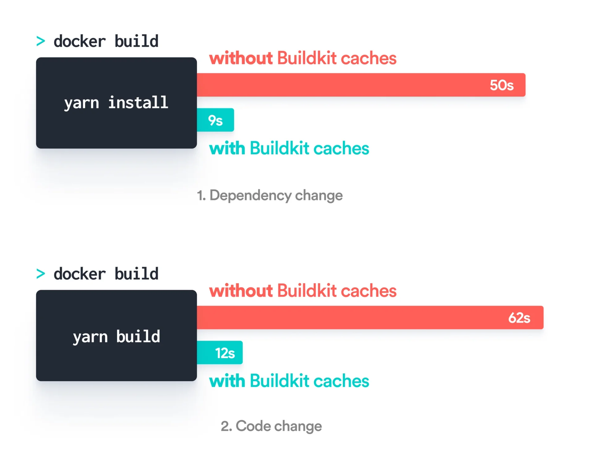

At Okteto we are very passionate about increasing developer productivity. We were looking for ways to improve our container build times when we came across an amazing project, [BuildKit](https://github.com/moby/buildkit). BuildKit helps us build Docker images faster than ever.

{/* truncate */}

But when getting started we found that there were very few practical examples on how someone could optimize their Dockerfiles with Buildkit - so we thought why not change that? This article is going to be about how you too can optimize your Docker builds using [Buildkit caches](https://github.com/moby/buildkit/blob/master/frontend/dockerfile/docs/syntax.md#run---mounttypecache)!

## The Why

The first question which arises is, why even bother with optimizing your Dockerfiles? Well, the thing is that containers have revolutionized how we build, ship, and run our applications these days. So much so that containers are now heavily integrated into the development cycle and are built over and over - manually or in CI pipelines for testing and live previews.

The biggest quality of life improvement that comes with better image build times is faster testing and review cycles. The quicker everyone can see and test the changes they make, the more the productivity of the team would increase! We have first-hand witnessed this for our website, but more on that [later](https://www.okteto.com/blog/building-docker-images-faster-for-webpack/#performance-evaluation).

## The Standard Dockerfile for Webpack

Before we look at how we can speed up build times using BuildKit, let's first see how a standard Dockerfile for Webpack should look like.

```yaml
# Dockerfile

FROM node:16 as build

WORKDIR /usr/src/app

COPY package.json yarn.lock ./
RUN yarn install

COPY . .
RUN yarn build

FROM nginx:alpine
COPY --from=build /usr/src/app/dist /usr/share/nginx/html
EXPOSE 80
```

This Dockerfile uses a `build`step to build the final artifacts, and then, it copies the artifacts to an `nginx`image.

In order to optimize the Dockerfile instructions cache, we are purposefully **first** copying `package.json`and `yarn.lock`to install the runtime dependencies. We don't copy over everything else in this same step since most of the commits don't change the yarn dependencies, allowing this step to be cached in those cases leading to better build times! But this is already a commonly known best practice and BuildKit would help us optimize the process even more.

The next thing we do is to `COPY`all our remaining files from our local folder to our `WORKDIR`. Our changes would be made to one of these files so this means that `yarn build`is always executed unlike the `yarn install`instruction above.

> Remember to configure your `.dockerignore`file. In this case, adding `.git`or `node_modules`to your `.dockerignore`file will dramatically reduce the time to send your build context to the docker daemon. This is even more relevant if your build is running on a remote server.

## Optimizing the Standard Dockerfile

Now that we've looked at how a standard Dockerfile for Webpack looks like, let's see how we can leverage BuildKit caches to further reduce our build times. BuildKit enables us to configure cache folders for the `RUN` instructions in our Dockerfile.

Contents of the BuildKit cache directories persist between builder invocations without invalidating the instruction cache. BuildKit also takes care of compatibility - our builds would work with any contents of the cache directory. This is necessary since another build may overwrite the cache files or GC may clean it if more storage space is needed.

In our case, we will use BuildKit caches to persist the [yarn cache](https://classic.yarnpkg.com/en/docs/cli/cache) and the [webpack cache](https://webpack.js.org/configuration/cache/#cachecachedirectory).

```yaml
# Dockerfile.buildkit

FROM node:16 as build

WORKDIR /usr/src/app

COPY package.json yarn.lock ./
RUN --mount=type=cache,target=/root/.yarn YARN_CACHE_FOLDER=/root/.yarn yarn install

COPY . .
RUN --mount=type=cache,target=./node_modules/.cache/webpack yarn build

FROM nginx:alpine
COPY --from=build /usr/src/app/dist /usr/share/nginx/html
EXPOSE 80
```

What this means is that `yarn install`and `yarn build`will be much faster. This is because their contents will be cached now onwards instead of them being run from scratch every time like earlier.

> Please note that we've not covered the installation process for BuildKit in this article since it's fairly simple and is documented well [here](https://github.com/moby/buildkit#quick-start).

## Performance Evaluation

The improvement in build times we saw for our website after using BuildKit was phenomenal! Have a look yourself.



The first graph shows the performance improvement we saw whenever we changed a dependency of our website and the second one shows the boost we got from using BuildKit when making code changes.

This means if you're building your images 100 times a day, you save more than 1 hr 23 mins of build time every day!

We hope you too can now appreciate how powerful BuildKit is. A change of only two lines of code in your Dockerfile can dramatically decrease your image build times! We hope this article was useful and you too are now able to optimize your Docker builds.

Happy coding!
