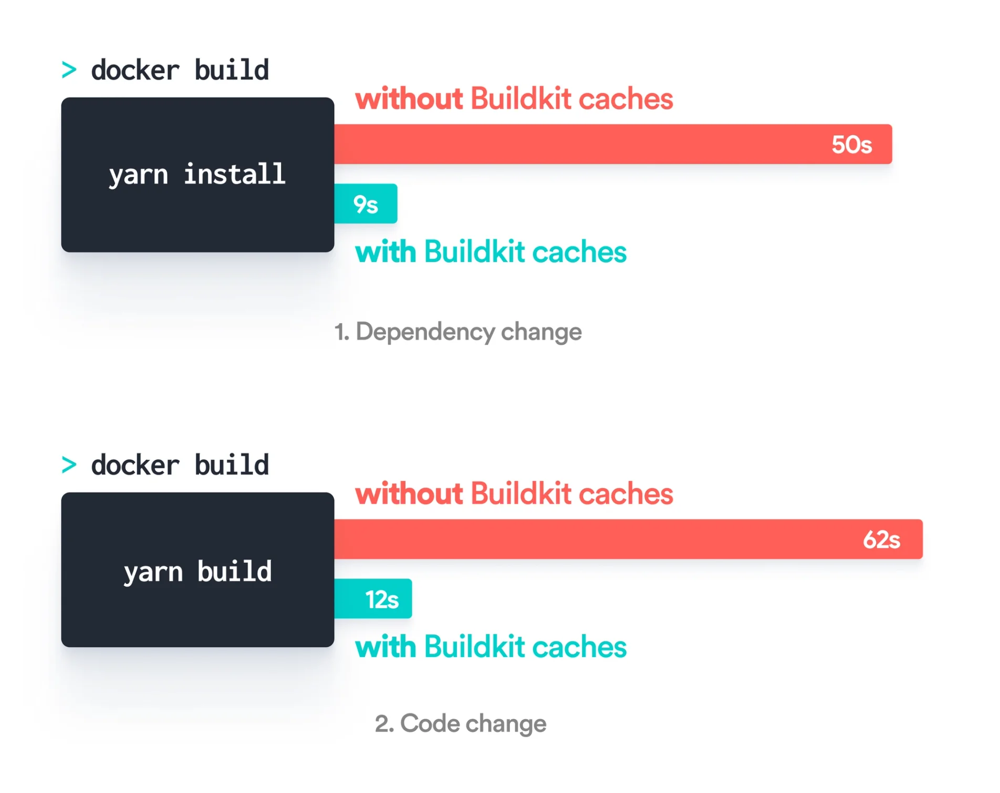

[BuildKit](https://github.com/moby/buildkit) is the builder behind `docker build`: it has been the default in Docker Desktop and Docker Engine since version 23.0. Most Dockerfiles still use only a fraction of what it offers. This article shows how to speed up the image build of a Webpack application with one of those features, [cache mounts](https://docs.docker.com/build/cache/optimize/#use-cache-mounts), with a change of two lines in the Dockerfile.

{/* truncate */}

## Why Build Times Matter

Containers are part of every step of the development cycle. Images are built over and over: by developers on their laptops, in CI pipelines that run the tests, for the preview of every pull request, and by coding agents that need to run the application to check their changes.

Each of those builds is time someone waits before they can see and test a change. The quicker a build finishes, the shorter the testing and review cycles get. We saw it first-hand with the website of Okteto, as the [performance evaluation](#performance-evaluation) shows.

## The Standard Dockerfile for Webpack

This is how a standard Dockerfile for a Webpack application looks:

```dockerfile title="Dockerfile"
FROM node:24 AS build

WORKDIR /usr/src/app

COPY package.json yarn.lock ./
RUN yarn install --frozen-lockfile

COPY . .
RUN yarn build

FROM nginx:alpine
COPY --from=build /usr/src/app/dist /usr/share/nginx/html
EXPOSE 80
```

The `build` stage builds the final artifacts, and the last stage copies them to an `nginx` image.

The Dockerfile copies `package.json` and `yarn.lock` **first**, and installs the dependencies before it copies the rest of the code. Most commits don't change the dependencies, so in those cases the `yarn install` instruction comes from the layer cache. This is a well-known practice, and BuildKit can take it further.

Next, the Dockerfile copies the rest of the files to the `WORKDIR`. Every code change modifies one of these files, so `yarn build` runs on every build, from scratch.

> Configure your `.dockerignore` file. Adding `.git` and `node_modules` to it reduces the time to send the build context to the builder, even more when the build runs on a remote server.

## Optimizing the Standard Dockerfile

BuildKit lets you mount cache folders in the `RUN` instructions of a Dockerfile. The contents of a cache mount persist from one build to the next without invalidating the layer cache. Your build has to work with any contents of the cache folder, including an empty one: another build may overwrite its files, and BuildKit may remove them when it needs storage space.

This Dockerfile uses cache mounts for the [Yarn cache](https://classic.yarnpkg.com/en/docs/cli/cache) and for the [Webpack cache](https://webpack.js.org/configuration/cache/):

```dockerfile title="Dockerfile"
# syntax=docker/dockerfile:1
FROM node:24 AS build

WORKDIR /usr/src/app

COPY package.json yarn.lock ./
RUN --mount=type=cache,target=/root/.yarn \
    YARN_CACHE_FOLDER=/root/.yarn yarn install --frozen-lockfile

COPY . .
RUN --mount=type=cache,target=/usr/src/app/node_modules/.cache/webpack \
    yarn build

FROM nginx:alpine
COPY --from=build /usr/src/app/dist /usr/share/nginx/html
EXPOSE 80
```

When the dependencies change, `yarn install` takes the packages it already downloaded from the cache and only downloads the new ones. When the code changes, Webpack only rebuilds the modules that changed.

Webpack keeps its cache in memory by default, so it needs one setting to write it to `node_modules/.cache/webpack`, the folder of the cache mount:

```js title="webpack.config.js"
module.exports = {
  // ...
  cache: {
    type: 'filesystem',
  },
};
```

If you use npm instead of Yarn, mount its cache folder the same way: `RUN --mount=type=cache,target=/root/.npm npm ci`.

Cache mounts live in the builder, not in the image or in the registry. They speed up every build that runs on the same builder, such as your laptop or a shared BuildKit server. A CI runner that starts from scratch on every job starts with empty cache mounts too.

## Performance Evaluation

These are the build times we measured for the website of Okteto, before and after adding the cache mounts:



The first chart shows a build after a change of dependencies, and the second one a build after a code change.

A code change built 50 seconds faster. If you build your images 100 times a day, that's more than 1 hour and 23 minutes of build time saved every day, with two lines in your Dockerfile.
