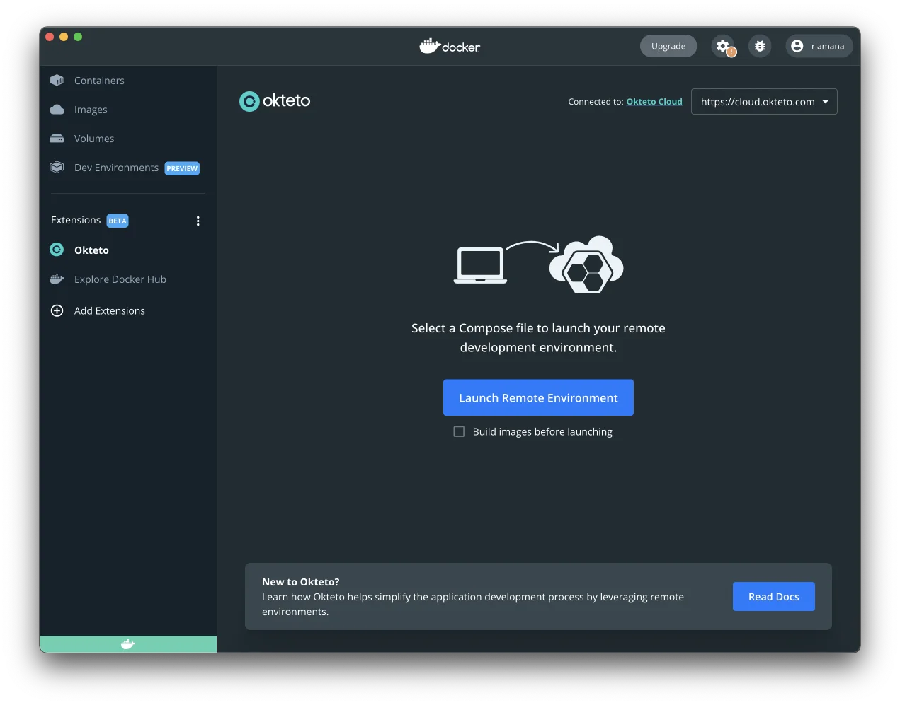

Docker launched in 2013 and since then has revolutionized the way we build and ship code. Docker made containers a part of the modern application development cycle - and a crucial one too! Part of Docker's success is thanks to how simple it made configuring multiple microservices during development.

{/* truncate */}

The concept is very simple yet extremely powerful. You write a Docker Compose file, and then using a single command, `docker compose up`, you have all the microservices you require during development up and running. This has made Docker Desktop and Docker Compose files part of developers' daily toolkit.

## Running Containers ONLY Locally Isn’t an Option Anymore

Over the last few years, modern applications have gotten more and more complex. We have gone from applications consisting of a *couple* of microservices to seeing 30+ of them in a single app! The Docker Compose file still continues to set the standard when it comes to defining these multi-container applications. But relying just on the local machine to bring up all these complex and large numbers of microservices isn't practical anymore. This is where the Okteto extension for Docker Desktop comes to the rescue!

The Okteto extension allows you to run all (or just the ones you want) of your containers on a remote cluster instead of your local machine. A single click to bring up all the microservices you require on the cloud using your already existing Docker Compose files. Leveraging cloud resources makes developing modern cloud-native applications a much easier task than before. You are now **no longer limited** by the computing resources of your local dev machine. Everything, right from the building of the container images to running the actual containers, happens remotely on the cloud and so is extremely quick!

## The Magic Behind the Scenes

All of this, while ensuring you get the same familiar experience you got when running containers locally. This is achieved by Okteto configuring port forwarding rules for you behind the scenes. These rules expose your application on localhost - allowing you to interact with it exactly as you did before. You might also be wondering how you can develop using these containers if they are running remotely? The Okteto extension configures volumes that help synchronize the code you write locally with that running inside the containers on the cluster. So everything continues to be **exactly** like it was before, except that your local machine now has much more resources left to support all the chrome tabs and slack workspaces you have running 😛

You can also combine the two approaches - run some containers locally and some on the cloud using the Okteto extension. This gives you the flexibility in choosing different approaches for different components of your application. A microservice consumes a lot of resources? Run it on the cloud while keeping everything as it is. The beauty lies in the fact that this requires no additional configuration at any step whatsoever!

## Try It Out Yourself!

Using the Okteto extension with Docker Desktop is very simple. Once you have the extension installed, simply point it to the location of the Docker compose file describing your services and click the "Launch Remote Environment" button! In a matter of minutes, all the services you require should be up and running in the cloud.

You can sign up for the extension's Private Beta Program [here](https://www.okteto.com/docker-beta/). Okteto community members who sign up get early access and a chance to win exclusive swag 😉

Everyone who signs up also gets access to all the fun discussions happening under the Docker Desktop Extension category on our **newly launched** [community website](https://community.okteto.com/). Sign up now, and let's continue the discussion there!
