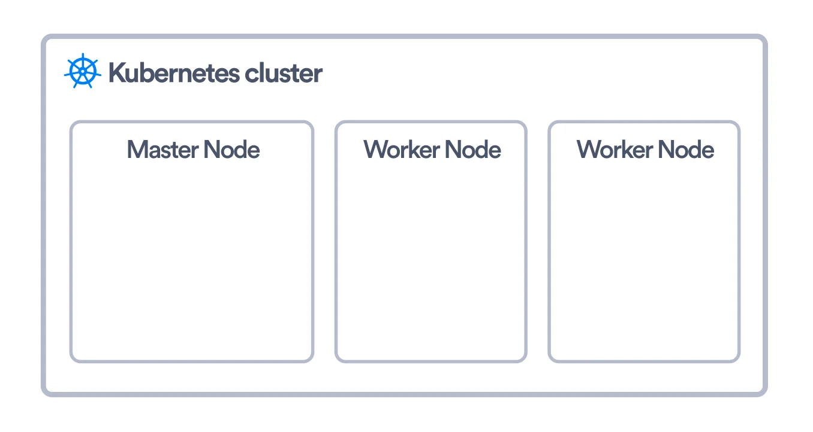
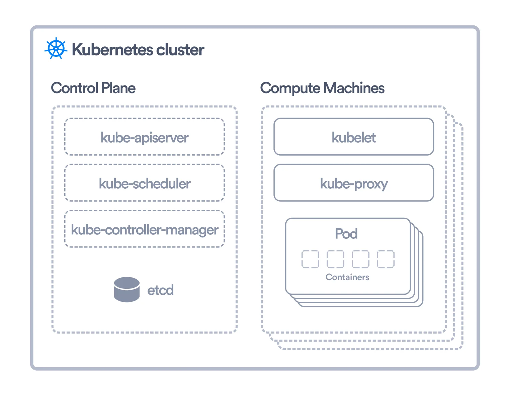
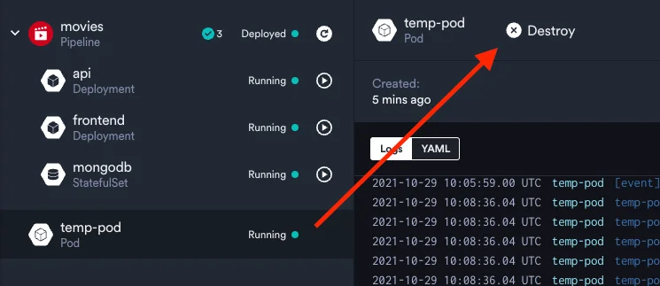
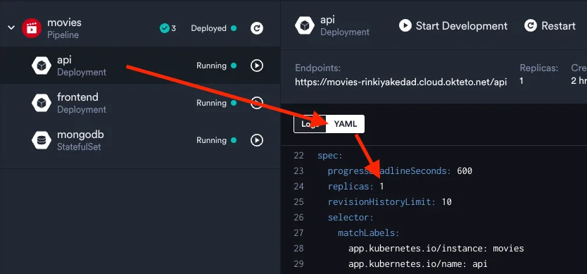
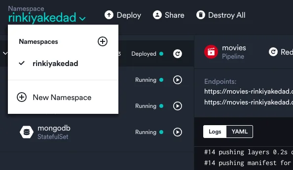
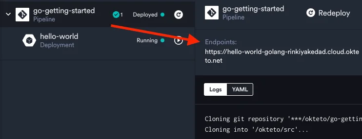
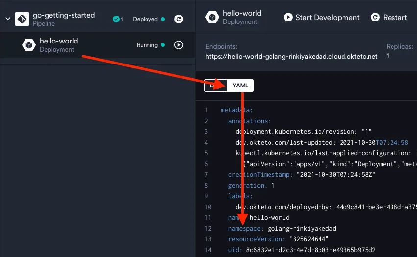
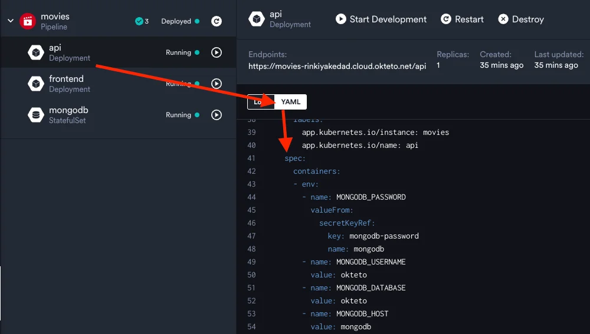
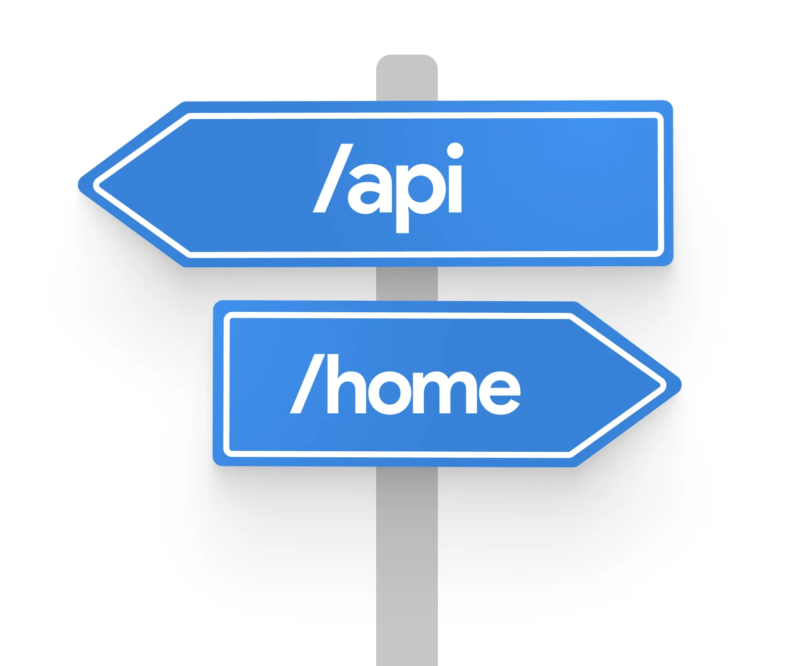
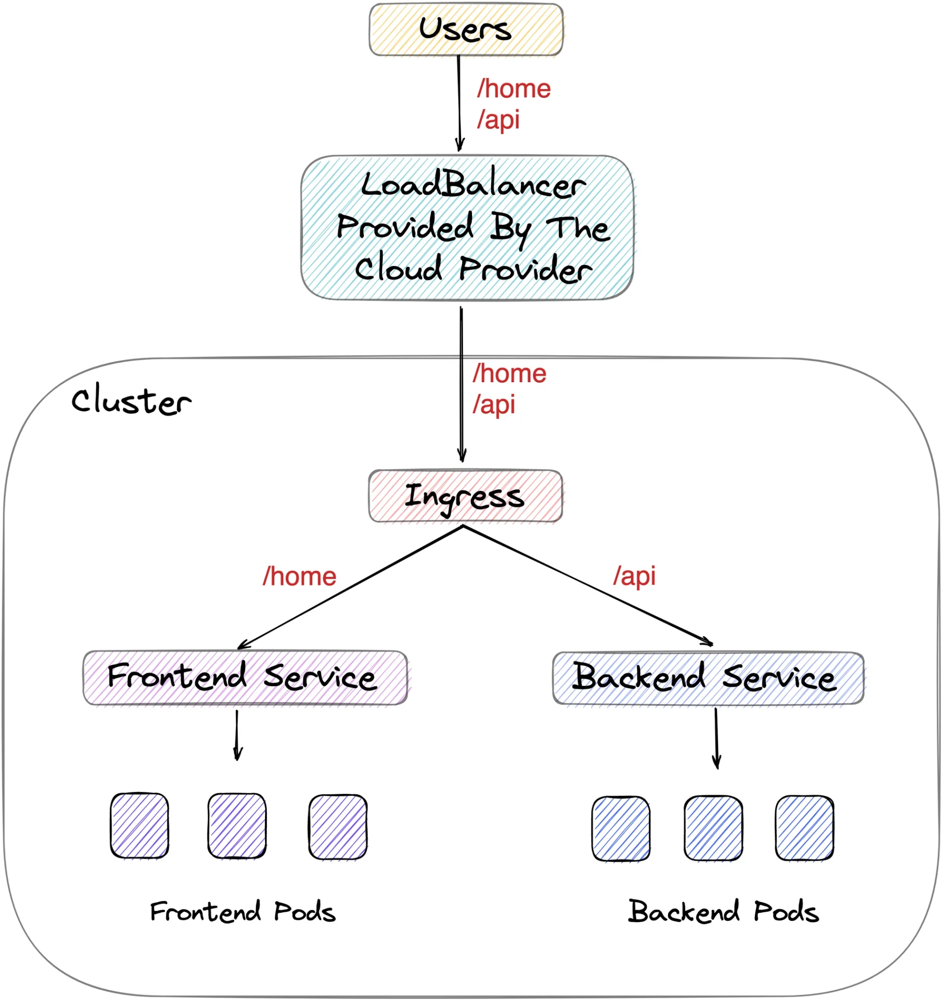

import { CallToAction, YouTube } from '@site/src/components/blog';

Are you tired of listening to everyone in [DevOps](https://www.atlassian.com/devops) talk about "Kubernetes" while you're still struggling with how to pronounce it? Unless you started programming today, I'm pretty sure you have heard the word [Kubernetes](https://www.redhat.com/en/resources/kubernetes-adoption-security-market-trends-overview). Still, you most likely haven't gotten the chance to learn about it - maybe because it seems intimidating or because you aren't sure how it's useful.

{/* truncate */}

<YouTube id={"giMCBnX9Mx0"} />

This Kubernetes Tutorial will take you on a journey from being clueless about Kubernetes to one who has an excellent grasp of all the Kubernetes Basics. In the process, you'll also start appreciating its beauty and usefulness in increasing developer productivity. We have a lot to cover throughout this guide, so let's jump in and learn all about Kubernetes!

## The Death Of "It Works On My Machine!"

It's essential to have an understanding of containers before getting started with Kubernetes. Containers are executable software packages containing all the code and dependencies necessary to run any application. And by anywhere, I mean anywhere - my laptop, your laptop, or even on "the cloud."

Are containers starting to sound similar to virtual machines? Well, they're not, and they're even better! Why? Because, unlike VMs, containers do not contain operating system images. This means they're much more lightweight! To create and run containers locally, you would use a container engine like Docker.

Containers grew in popularity because they genuinely embraced the ideology of write once, run anywhere. Because of how fast and easy it is to deploy containers, they increased developer productivity significantly. A fun fact is that [Okteto also utilizes these containers](https://www.okteto.com/docs/getting-started/#step-4-activate-your-development-container) to give you a live preview of the changes you make while developing locally.

But a new problem arose as more companies started using containers. How do you manage thousands of containers running on distributed systems? And that's where Kubernetes saved the day!

<CallToAction title={"Stay on Top of Kubernetes Best Practices & Trends"} actions={[{"label":"Download the Trend Report","url":"https://www.okteto.com/ebooks/dzone-kubernetes/"}]} />

## What is Kubernetes Used For?

Kubernetes, often abbreviated as K8s, is a [container orchestration platform](https://www.okteto.com/blog/kubernetes-containerization/). Let me explain this in straightforward terms.

Let's say you have your app, which you have containerized. So you run a bunch of containers to serve your app to users. But how do you manage these different containers? The situation is complicated even more by the fact that these containers needn't necessarily be running on the same machine!

This is where K8s comes to the rescue. Kubernetes makes deploying, managing, and scaling containerized workloads a breeze! I want to explicitly call out here that K8s is NOT a **container engine** like Docker. Rather it is a **container orchestrator**.

As a developer, you won't need to worry about "how" Kubernetes does all this orchestration. You will probably not have to set up a Kubernetes cluster for your application. But what you would mostly be doing is interacting with a cluster set up for you by the infrastructure team. So it becomes crucial to learn about the Kubernetes objects you'll be interacting with. We'll focus on that in the later sections of this guide.

Before we do that, let's have a high-level idea about Kubernetes' architecture so that you're not clueless about what is happening under the hood.

## Learn Kubernetes Architecture Basics

In the Kubernetes world, a machine is called a node. A K8s "cluster" is simply a group of nodes that run your containerized application. These nodes may be bare metal servers in your home or instances you're running on a cloud provider. These nodes are also of two types: worker and master.



The worker nodes are where your application's containers would be running. Kubernetes uses an object called Pod to run these containers but more on that in a section below. Three essential things running on a worker node in a Kubernetes cluster are:

1. Container runtime: This should be no surprise since a container runtime is what is responsible for running containers. Kubernetes supports multiple container runtimes, including Docker and containerd.
1. kubelet: This is the agent which is responsible for communicating with the Kubernetes control plane running on the master node. It is responsible for executing any instructions it receives from the control plane. It also makes sure that containers are running in the pods properly.
1. kube-proxy: This is a network proxy running on each node. Not going into much detail, you can think of it as being responsible for network communications within and outside the cluster. We'll be exploring how all these communications happen between pods later in this guide.



The master node is the one that has all the components of the Kubernetes control plane running on it. You can also set up multiple master nodes for high availability. Following are some important control plane components you should be familiar with:

1. kube-apiserver: This exposes the Kubernetes API, which we can use to talk to our K8s cluster. You can think of the kube-apiserver as the frontend for the Kubernetes control plane.
1. etcd: This is the distributed key-value store where all cluster-related data is stored. For security reasons, it is only accessible through the API server. This restriction also helps ensure that the data stored in etcd is consistent.
1. kube-scheduler: This is responsible for scheduling pods on available worker nodes. While scheduling, it takes into consideration the resource requirements of the pod and any other constraints that we specify.
1. kube-controller-manager: A controller in K8s is responsible for observing an object and making sure that the current state of that object matches the desired state we specified. There are various controllers in K8s for different objects. All these are combined into a single binary which is the kube-controller-manager.
1. cloud-controller-manager: This component lets you link your cluster to a cloud provider. This binary contains all the cloud provider-specific controllers. So when something like a node termination happens in the cloud provider, this component will be responsible for handling that.

## Getting Started With Kubernetes

In the Kubernetes world, everything is an object. An object is something you create in Kubernetes to give it a configuration of sorts so that it knows how to run and serve your application. Once you create K8s objects describing your application, the controllers work to ensure that the object's current state matches the desired state.

There are many Kubernetes objects, some of which you already would have come across if you tried the Okteto [Quick Start Guide](https://www.okteto.com/docs/getting-started/). This section will discuss three very important objects: Pods, Deployments, and Namespaces. Trying out the things mentioned here by yourself is highly recommended if you want to be comfortable using K8s.

### Pods

Kubernetes Pods are the smallest and most fundamental of objects in Kubernetes. Instead of running containers directly on nodes, Kubernetes runs them inside pods. So think of a pod basically as a wrapper for your Kubernetes containers. A pod usually runs a single container but can also have multiple containers. What's important to remember is that all the containers of a pod will run on the same node, sharing the same network and resources. Another important thing to remember about Pods is that they are immutable. While you can change the image being used to run the container in the Pod, you can not update fields like the name of the Pod or the name of the namespace.

You would usually containerize your application's frontend and backend parts and have these containers run in separate pods. We saw this in the [Quick Start Guide](https://okteto.com/docs/getting-started/). If you open a terminal and run the command below, you will see these pods. Additionally, you'll see another pod running a MongoDB container used as our application's database.

```
kubectl get pods
```

Each pod has a unique IP address assigned to it. While you can't ping this IP address from outside the cluster, you can ping from within your Kubernetes cluster.

Let's do something exciting, shall we? Let's launch a pod and use that to ping our existing frontend pod. To create an object in Kubernetes, a Pod, in this case, there are two ways: declarative and imperative. The declarative method involves writing a YAML file describing the object, whereas the imperative method uses kubectl. [kubectl](https://kubernetes.io/docs/tasks/tools/) is a command-line tool that allows you to [talk to your Kubernetes cluster](https://www.okteto.com/blog/kubectl-cheat-sheet/). Let's use the imperative way here and run:

```
kubectl run temp-pod --image=busybox -it -- /bin/sh
```

This command does a couple of things for us. `kubectl run` creates a Pod named "temp-pod" and runs a container inside it using the "busybox" [image](https://www.okteto.com/blog/how-to-speed-up-container-image-builds/). The `-it` is used to give us access to a shell inside this pod, and we also specify that we want to run `/bin/sh` as the first command in this shell. You should also be able to see this pod on your Okteto Dashboard. Now let us get the IP address of the frontend pod so we can ping it. To do that, in another terminal, run:

```
kubectl get pods -o wide
```

The `kubectl get` command can get all kubernetes objects of a particular type. Here we use it to get all pods. The `-o wide` flag tells us to provide even more details like the IP addresses of the Pods. Once you copy the IP address of the pod, go back to the shell inside the "temp-pod" and run the command below.

```
wget -O- <IP Address>
```

You should see an output like:

```
Connecting to 10.8.6.136 (10.8.6.136:80)
writing to stdout
<!DOCTYPE html>
<html>
<head>
<title>Movies</title>
<meta charset="utf-8">
<meta name="viewport" content="width=device-width, initial-scale=1.0, maximum-scale=1.0, user-scalable=0"/>
<link rel="icon" href="favicon.png"><script defer src="app.770412f1098441c2c698.js"></script></head>
<body>
<div id="root"></div>
</body>
</html>
-
100% |************************************************************************************************************| 353 0:00:00 ETA
written to stdout
```

How cool, right? To destroy this pod, you can select it in your Dashboard and click "Destroy". If you want to go the `kubectl` route, you can run `kubectl delete pod temp-pod` in your terminal. The `kubectl delete` command works for all Kubernetes objects and takes the object type and name as arguments.



### Deployments

So you might be wondering why Kubernetes doesn't run containers directly instead of running Pods. This is because Pods are ephemeral and having containers in Pods enables easy replication - which is one of the most important features of K8s.

A single Kubernetes pod runs a single instance of your application. You would never create individual pods to serve your application. Why? Because that would mean if the traffic suddenly increases, your Pod will run out of resources, and you will face downtime. Instead, you create a bunch of identical pods. If one of these pods goes down or the traffic increases and you need more pods, Kubernetes will bring up more pods. The deployment controller does this management of multiple similar pods when you create a Deployment object.

I think you can now see why it's recommended to create a [Deployment](https://www.okteto.com/blog/beginners-guide-to-kubernetes-deployments/) instead of Pods. The Deployment object will further create and manage the Pods for you. If you look closely at your Dashboard, you'll see that `api` and `frontend` are Deployments. This is why when you did `kubectl get pods`, the pods were not called `api` and `frontend` and instead had some random string added to the end. This helps tell that the pods were created by the deployment and not us directly.

Let's not take my word for it and verify that Pods are indeed actually managed by their Deployments :)

Go to your terminal and see the name of the pod created by the API deployment. After that, delete the pod by running

```
kubectl delete pod <api pod name>
```

Now run `kubectl get pods` again, and you'll see another pod coming up in its place with a different name. This is because Okteto told Kubernetes to create a deployment that ensures that at least one API pod runs at all times. You can also see this in the YAML used to create the deployment from your Dashboard:



### Namespaces

If you took a closer look at your Okteto Dashboard, you'd see something called "Namespace" in the top right corner. If you click that, you'll also see the option to create a new namespace.



Namespaces in Kubernetes are a way to partition your cluster into multiple virtual clusters. You always deploy K8s objects (like Pods, Deployments, etc) in a particular namespace. Deploying different objects in different namespaces allows you to isolate different projects on the same cluster.

Let's see this in action. Click on "New Namespace" in the dropdown shown above and enter a name - I'm going to go with "golang-rinkiyakedad". Now switch to this namespace from the same menu and deploy using the same steps you followed in the [Quick Start Guide](https://www.okteto.com/docs/getting-started/), except that use https://github.com/okteto/go-getting-started as the repository URL this time.

Once the deployment process is complete, head over to the URL under "Endpoints" in the Dashboard, and you should see a webpage showing "Hello world!".



This means you can work on two completely different projects running on the same cluster. Pretty cool, right? When using Kubernetes directly, we specify the namespace under an object's YAML's `metadata` section. You can see this by selecting the "hello-world" deployment and seeing its YAML:



You can read more about managing your namespaces in Okteto by heading to the [Documentation](https://www.okteto.com/docs/core/namespaces).

<CallToAction title={"Okteto development environments give your team a Developer-friendly approach to Kubernetes."} actions={[{"label":"Download our eBook","url":"https://www.okteto.com/ebooks/how-cloud-dev-environments-accelerate-developer-velocity-and-drive-innovation/"}]} />

## Configuration and Storage in Kubernetes

In this section, we'll first look at two somewhat similar Kubernetes objects which help with configuring our application running in the cluster - ConfigMaps and Secrets. Then we'll move on to look at how storage is handled in Kubernetes using Volumes and Persistent Volumes. So strap in, and let's get started!

### ConfigMaps and Secrets

To inject configuration data into a container, Kubernetes provides us with two objects: ConfigMaps and Secrets. It is highly recommended to separate configuration data from your application code, so you'll see these two objects being used in almost all Kubernetes clusters.

If you see the YAML for a [ConfigMap](https://kubernetes.io/docs/concepts/configuration/configmap/#configmaps-and-pods) or a [Secret](https://kubernetes.io/docs/concepts/configuration/secret/#service-account-token-secrets), you'll notice that both of them are almost similar. They both have a `data` key under which the configuration data provides using key-value pairs. For example,

```yaml
data:
  key1: value1
  key2: value2
```

The difference is in the fact that you should use secrets to hold sensitive data. When writing the YAML for a secret, we wouldn't specify `value1` and `value2` as we would for ConfigMaps. Instead, we would specify the [base64](https://en.wikipedia.org/wiki/Base64) encoded versions of these values.

Pods can refer to a particular ConfigMap and/or Secret and specify a key, and then they would have an environment variable in their container with the corresponding value. This would enable you to refer to these environment variables in your application code.

For the movies app, which we deployed, our API pod needed the credentials for the MongoDB database to connect to it. We provided these using a secret. If you see the YAML for the API deployment you'll see that we're getting an environment variable called `MONGODB_PASSWORD` for our container from a secret called `mongodb`.



If you want to see how the YAML for this secret looks, head over to the terminal and run:

```
kubectl get secret mongodb -o yaml
```

The `-o yaml` flag gets the YAML for a particular Kubernetes object. You'll see that under the `data` key for the returned object, we have the `mongodb-password` key, which we were referring to in our API deployment. To see the actual value for this key, you'll have to decode the base64 encoded value shown.

Now that you know how configuration data is handled in Kubernetes clusters let's move on and look at how data is shared between K8s objects using Volumes and Persistent Volumes.

### Storage in Kubernetes

If you recall, we mentioned that Kubernetes Pods are ephemeral. This means that data generated by the containers running in a Pod will be destroyed when the pod is destroyed. In Kubernetes, Volumes and Persistent Volumes help solve this data loss problem. Apart from this, they also solve another problem - data sharing between containers.

#### Volumes

There are a lot of [volume types](https://kubernetes.io/docs/concepts/storage/volumes/#volume-types) offered by Kubernetes. But thankfully, as developers, we mostly never have to worry about all this stuff. In this section, we'll cover a common volume type that you might run into - `emptyDir`.

The `emptyDir` type has two important use cases. First, it allows us to share data between two containers running in the same pod. The second is that if our container ever crashes, it enables us to retain still all the data created previously. Note that this volume only exists as long as the Pod runs. So if your pod is destroyed for any reason, you **WILL** lose all the data. Let's look at how to configure volumes for Pods:

```yaml
apiVersion: v1
kind: Pod
metadata:
name: my-pod
spec:
  volumes:
    - name: cache-volume
      emptyDir: {}
      containers:
        - image: nginx
          name: my-container
          volumeMounts:
            - mountPath: /cache
              name: cache-volume
```

Under the Pod `spec` we first define our volumes in a list - in the above example, we have one volume called `cache-volume`, which is of type `emptyDir`. Then, while specifying our containers, we refer to this volume under `volumeMounts`. `mountPath` is where Kubernetes will load the data from the volume into the filesystem of the container.

#### Persistent Volumes

We just learned that `emptyDir` volumes won't save our data if our Pod goes down. So you must be wondering how to store data that persists regardless of any changes to the Pod. This is where Persistent Volumes come to save the day.

A Persistent Volume (PV) is a cluster-level storage object. This means that just like Nodes, it is a resource present in the cluster. It is an administrator's job to provision this, so don't worry too much about how it's created. However, we as developers should know how to use this provisioned storage.

To use a Persistent Volume, we create a Persistent Volume Claim (PVC) object and then refer to this claim under the `volumes` key of the Pod YAML, as we saw above. A PVC is nothing but a storage request. This is what a simple PVC object would look like:

```yaml
apiVersion: v1
kind: PersistentVolumeClaim
metadata:
  name: pv-claim
  spec:
    accessModes:
      - ReadWriteOnce
        resources:
          requests:
            storage: 3Gi
```

Once you create this PVC, the Kubernetes control plane will \*bind\* this claim to a suitable persistent volume for you. The above YAML should be pretty simple to understand. We're requesting 3 Gigabytes of storage with the [access mode](https://kubernetes.io/docs/concepts/storage/persistent-volumes/#access-modes) of `ReadWriteOnce`. ReadWriteOnce means that the volume can be mounted as read-write storage but only by a single node.

After you create the PVC, all that you need to do is refer to it in your Pod's YAML as we did for `emptyDir` above.

```yaml
spec:
  volumes:
    - name: pv-storage
  persistentVolumeClaim:
    claimName: pv-claim
```

This concludes our discussion on configuration and storage in Kubernetes. We started by taking a look at ConfigMaps and Secrets and saw how they help provide us with configuration data for our application. Then we looked at how we can leverage Volumes to safeguard our application data in case our container restarts. Finally, we looked at Persistent Volumes, which provide us a way to persist data in a separate resource present in the cluster - thus ensuring that even Pod deletion doesn't lead to a loss of data.

All of this does look intimidating at first but remember that you don't have to fight these battles alone. If you're using a managed Kubernetes environment like Okteto, most of this is already taken care of for you. If not, even then, you should be receiving support from the infra team. But like I said earlier, even as a developer, it is good to have an idea of things, so you're not lost! This article's final section will look at how networking works in Kubernetes.

## Services and Ingresses in Kubernetes

Before starting with this section, I want to congratulate you all for making it here! Learning Kubernetes can be intimidating, especially if you come from a developer background. The fact that you could understand the concepts we talked about in the previous section of this guide is a huge feat. Wrapping your head around so many Kubernetes objects is no easy deal!

In this section, we will see how we can expose Pods running our application using the Service object. This would help us ensure that different parts of our application (backend, frontend, etc.) can communicate within the cluster. Then we will see how we can ease external access to our application by setting up routing using the Ingress object. Lots to cover in this one, so let's begin!

### Services

To understand Services, let's look at what problems they solve. If you recall our discussion of Deployments in the previous section, you'll remember that deployments create and manage multiple pods for us.

So we would have a deployment for the frontend of our application which would manage multiple pods running our containerized frontend code. Now, this code would need to interact with the backend pods. But how does it do that? What IP address should it ping? It clearly can't be the IP address of a particular backend pod because we know pods are ephemeral, so we can't rely on their IP addresses.

This is where Services come into the picture. Services allow us to send traffic to Pods that match the labels we specify when creating the Service. Let us look at the YAML for a simple service to understand things better:

```yaml
apiVersion: v1
kind: Service
metadata:
  name: database-service
spec:
  selector:
    app: database
  ports:
    - protocol: TCP
      port: 80
      targetPort: 9376
```

The above YAML should be pretty easy to understand - it creates a Service that will route all traffic to Pods with the label `app: database` on them. Coming to the `ports` section, which might not be so obvious, we specify a `port` and a `targetPort`. `targetPort` is the port on which the selected pods will be listening. The Service will send requests to the Pods on this particular port. `port`, on the other hand, is simply the port within the cluster on which we want the Service to be exposed. This is needed because we might have different services in our cluster, which we would then expose on different ports. Another thing worth mentioning is that while TCP is the default network protocol for services in Kubernetes, you can use any of the [following](https://kubernetes.io/docs/concepts/services-networking/service/#protocol-support) protocols as well.

So far, so good, right? Looking at the movies app [we deployed](https://www.okteto.com/docs/get-started/deploy-your-app/) on Okteto , we have created a service that exposes the database for our backend pods to talk to. You can confirm that this Service exists by running:

```
kubectl get services
```

To see what the YAML for this Service looks like, you can run:

```
kubectl get service mongodb -o yaml
```

You'll see that we arbitrarily chose to specify `3940` as the value of the `port`. For the `targetPort`, we set `27017` because that is the default port a MongoDB database listens on.

Now, if you look at the [backend code](https://github.com/okteto/movies/blob/ce27d64bd17762559eea6cbdebc28592065790d6/api/server.js#L6) you'll see that we use the name of this Service, which is `mongodb`, to connect to the database. The `url` used to connect to the database is:

```javascript
const url = `mongodb://${process.env.MONGODB_USERNAME}:${encodeURIComponent(process.env.MONGODB_PASSWORD)}@${process.env.MONGODB_HOST}:3940/${process.env.MONGODB_DATABASE}`;
```

It is using the `MONGODB_HOST` environment variable, which is [set to](https://github.com/okteto/movies/blob/a60756c8122643ac65fec2cee837d95a60b02210/chart/templates/api-deployment.yaml#L52-L53) the name of the Service, that is, `mongodb`. After that, we also specify the port which we arbitrarily chose when creating our Service (`3940`).

This is all the K8s magic we need to make different microservices in our application talk to each other. Let's now discuss further and see how we can route incoming traffic to various services.

### Ingresses

So you've containerized your application, you've set up your Deployments and configured Services to enable communication between parts of your application, but what's next? If your application is deployed on a cloud provider, you would set up a load balancer pointing to your services. The load balancer would provide a static IP address accessible from outside the cluster.

But is it cost-effective and manageable to set up different load balancers for each service? This is where Ingresses come to the rescue. Think of an Ingress object as a signboard for vehicles at a cross-section of roads.



The roads in this metaphor are different services in our cluster, and the vehicles are the requests coming to our cluster. An Ingress object we create will tell the incoming requests to the cluster which Service they should go to. Ingresses don't enable external access to our app on their own, but they make it easier. You would now just need one load balancer from your cloud provider, which would point to the Ingress, and then the Ingress will handle the routing of all incoming traffic.



Let's see what the Ingress object for our movies app looks like by running:

```
kubectl get ingress movies -o yaml
```

The output you get should look something like this:

```yaml
spec:
  rules:
    - host: okteto.example.com
  http:
    paths:
      - backend:
  service:
  name: frontend
  port:
  number: 80
  path: /
  pathType: Prefix
    - backend:
      service:
        name: api
        port:
        number: 8080
        path: /api
        pathType: Prefix
```

You'll see that under the `spec` section, we set up two paths for different services in our application that we wanted to expose: the frontend service and the backend service. So requests sent to our cluster at `/api` will be redirected to the backend service, which further directs them to the backend pods serving our application. Any request that doesn't match that prefix will be redirected to the frontend pods via the frontend service. This simplifies the management of different routes significantly when compared to the traditional way of doing this - setting up an NGINX proxy per application. Very convenient, right? :)

To sum our discussion up, Ingress isn't something complicated - it's just a Kubernetes object which allows us to specify routing rules!

However, there is another part to Ingresses that we didn't touch in this article. So far, the K8s objects we've seen (Pods, Deployments, etc) come with their controllers preinstalled in the cluster. This is not true for Ingresses. To create an Ingress object, your cluster admin will need to install an [ingress controller](https://kubernetes.io/docs/concepts/services-networking/ingress-controllers/) in your cluster. I won't be covering how to do that since we rarely have to do it ourselves as developers. If you're using [Okteto](https://www.okteto.com/), the cluster provided to you would already have an Ingress controller installed :)

In this section we learned that different microservices in our application can talk to each other with the help of the Service K8s object. Then we looked at Ingresses, allowing us to route incoming traffic to our cluster to the different Services we've created.

I hope this discussion not only enables you to learn more about this topic but also sparks your curiosity enough to give things a try yourself. A straightforward way to tinker with all this could be to [fork the movies app](https://github.com/okteto/movies), edit the [YAMLs](https://github.com/okteto/movies-with-helm/tree/main/chart/templates) and deploy on Okteto using a [single click](https://www.okteto.com/docs/get-started/deploy-your-app/)!

<CallToAction title={"Making Sense of Cloud Development in a Complicated Kubernetes World  |  Burr Sutter, Dir. Developer Experience at RedHat"} actions={[{"label":"Read now","url":"https://www.okteto.com/docs/"}]} />

## Conclusion

The adoption of Kubernetes as a container orchestrator has been increasing tremendously. While SREs and DevOps engineers are already familiar with it, we saw that there was a gap when it comes to developers' knowledge of Kubernetes. This was the problem we wanted to solve through this Kubernetes tutorial - we wanted to familiarize developers with some essential Kubernetes concepts and show them how they, too, can leverage its benefits!

In the first section, we explored what Kubernetes did and took a little peek under the hood to see the components generally present in a Kubernetes cluster. Then we went on to look at Pods which are the most fundamental object Kubernetes offers. We learned that they are ephemeral and often managed using another Kubernetes object - Deployments. In the third section, we learned how configuration data is passed to a Kubernetes cluster with the help of ConfigMaps and Secrets. We also looked at how Volumes and Persistent Volumes are used in Kubernetes to handle storage. Then in the section article, we looked at two slightly more complicated Kubernetes objects, Services and Ingresses. We saw how to use Services to enable interaction between different microservices parts of our application. We then looked at the Ingress object, which allows us to set up rules to route traffic to other services. And that concluded our tutorial on Kubernetes Basics.

If you want to learn more about Kubernetes, the best way is to start getting your hands dirty. Start containerizing projects you might have made earlier and try deploying them on a Kubernetes cluster. If you run into trouble or need to know more about a particular Kubernetes object - head over to the [Kubernetes documentation](https://kubernetes.io/docs/home/). After going through this guide, you should be able to look up and understand most things in detail from the documentation.

For deploying applications on Kubernetes, there are many ways to go, even if you're looking for a free solution to try things out. One of them is running a K8s cluster locally using Minikube or Kind. Another is using something like [Okteto](https://www.okteto.com/). I'm biased towards the second one 😛 but for a good reason!

If you go the second route, you will get everything you get with a traditional cluster and see how we're leveraging Kubernetes to make lives easy for developers. [Okteto](https://www.okteto.com/) gives you access to a Kubernetes cluster without worrying about the infrastructure and operations. But what makes us unique is that if you install the [okteto cli](https://okteto.com/docs/getting-started/installation/) you can start a [development container](https://www.okteto.com/docs/development/containers/) in Okteto. This allows you to code locally and sees the result live in a version of your application deployed on Kubernetes. In short, we make developing on Kubernetes very, very easy. Do you want to see it in action? We've got a super concise 5-minute [getting started guide](https://www.okteto.com/docs/getting-started/) ready for you!

So that concludes this Kubernetes for Beginners guide. If you have any doubts related to Kubernetes or Okteto, feel free to hop on [our community site](https://community.okteto.com) to talk to us. We'd also love to hear how you found this guide or if you have any suggestions for what we should be covering next. Until next time! 😁

<CallToAction title={"Kubernetes helps you Accelerate Developer Velocity and Drive Innovation."} actions={[{"label":"Download our eBook","url":"https://www.okteto.com/ebooks/how-cloud-dev-environments-accelerate-developer-velocity-and-drive-innovation/"}]} />
