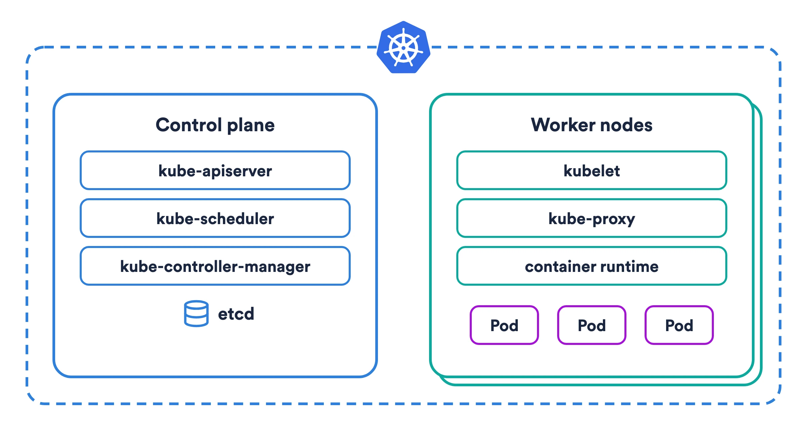
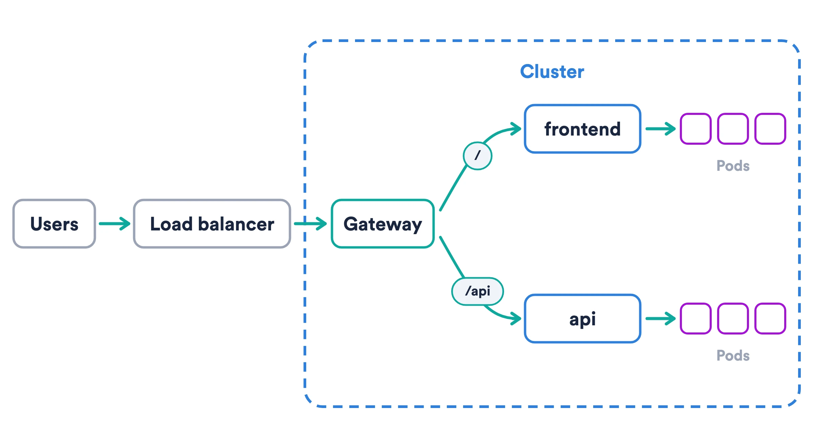

Unless you started programming today, you have heard of [Kubernetes](https://kubernetes.io/). But you may not have had the chance to learn it yet, because it looks intimidating, or because you aren't sure how it's useful to you as a developer.

{/* truncate */}

This tutorial takes you from not knowing Kubernetes to understanding the basics a developer needs: what Kubernetes does, how a cluster is built, and the objects you'll work with every day, with commands you can run on any cluster.

## The Death Of "It Works On My Machine!"

You need to understand containers before you start with Kubernetes. A container is an executable package with all the code and dependencies an application needs to run, and it runs the same way anywhere: on your laptop, on a colleague's laptop, or in the cloud.

Unlike a virtual machine, a container doesn't include a whole operating system: it shares the kernel of the host. That makes containers much lighter and faster to start. You build container images with tools like Docker or Podman.

Containers became popular because they made "build once, run anywhere" real, and because they're fast and easy to deploy. But as companies ran more of them, a new problem appeared: how do you manage thousands of containers running across many machines? That's the problem Kubernetes solves.

## What Is Kubernetes Used For?

Kubernetes is a container orchestration platform.

Say you've containerized your application, and you run several containers to serve it to your users. How do you manage those containers, especially when they run on different machines? Kubernetes deploys, manages, and scales containerized workloads for you. Note that Kubernetes is not a **container engine** like Docker: it's a **container orchestrator**.

As a developer, you probably won't set up a Kubernetes cluster yourself. You'll mostly work with a cluster that the platform team set up for you. So what matters most is to understand the Kubernetes objects you'll work with, which is what most of this guide covers. But first, a quick look at what runs inside a cluster.

## Learn Kubernetes Architecture Basics

In Kubernetes, a machine is called a node, and a cluster is a group of nodes that run your containerized applications. Nodes can be physical servers or virtual machines of a cloud provider. There are two kinds of nodes: the ones that run the control plane, and the worker nodes.



The worker nodes run your application's containers, inside objects called Pods (more on them below). Each worker node runs:

1. **A container runtime**: the software that runs the containers, such as containerd or CRI-O. Kubernetes talks to it through the Container Runtime Interface (CRI).
1. **The kubelet**: the agent that talks to the control plane, runs the Pods assigned to the node, and makes sure their containers are running.
1. **kube-proxy**: a network proxy that implements Services, so traffic sent to a Service reaches its Pods. Some network plugins replace it with their own implementation.

The control plane manages the cluster. In production, it usually runs on several nodes for high availability, and managed Kubernetes services run it for you. Its main components are:

1. **kube-apiserver**: exposes the Kubernetes API. Every interaction with the cluster, including `kubectl`, goes through it.
1. **etcd**: the distributed key-value store where the cluster keeps all its data. Only the API server talks to it.
1. **kube-scheduler**: decides which worker node runs each new Pod, based on the resources the Pod requests and the constraints you set.
1. **kube-controller-manager**: runs the controllers. A controller watches a type of object and works to make its current state match the state you declared.
1. **cloud-controller-manager**: connects the cluster to a cloud provider, for example to create load balancers or to notice when a cloud machine is removed.

## Getting Started With Kubernetes

In Kubernetes, you describe your application with objects: you declare the state you want, and the controllers work to reach it and keep it.

To follow this section, you need a cluster and [kubectl](https://kubernetes.io/docs/tasks/tools/), the command-line tool to talk to it. Any cluster works: one your platform team gives you, a managed one, or a local one created with [kind](https://kind.sigs.k8s.io/) or [minikube](https://minikube.sigs.k8s.io/). The [kubectl cheat sheet](https://www.okteto.com/blog/kubectl-cheat-sheet/) lists the commands you'll use most often.

This section covers three of the most important objects: Pods, Deployments, and Namespaces.

### Pods

A Pod is the smallest object Kubernetes runs. Kubernetes doesn't run containers directly: it runs them inside Pods. A Pod usually runs a single container, but it can run several, and all the containers of a Pod run on the same node and share its network and storage. Most fields of a Pod can't be changed once it's created: to change them, you create a new Pod.

Each Pod gets its own IP address, which other Pods in the cluster can reach. To see it, create a Pod that runs NGINX:

```bash
kubectl run nginx --image=nginx
```

List the Pods with their IP addresses:

```bash
kubectl get pods -o wide
```

Then start a temporary Pod with a shell, and use it to send a request to the NGINX Pod (replace `<IP address>` with the IP of the `nginx` Pod):

```bash
kubectl run temp-pod --rm -it --image=busybox -- sh
wget -qO- <IP address>
```

The output is the HTML of the NGINX welcome page. Type `exit` to leave the shell: the `--rm` flag deletes the temporary Pod when you do. Delete the NGINX Pod too:

```bash
kubectl delete pod nginx
```

`kubectl delete` works for every type of object, and takes the type and the name of the object.

### Deployments

You'll rarely create Pods directly. A Pod runs a single instance of your application: if it fails, or if traffic grows beyond what it can handle, your users get errors. Instead, you create a Deployment, and its controller creates and manages a set of identical Pods for you. If a Pod fails, the Deployment replaces it, and you can change the number of replicas at any time.

This Deployment runs three replicas of NGINX:

```yaml title="deployment.yaml"
apiVersion: apps/v1
kind: Deployment
metadata:
  name: nginx
spec:
  replicas: 3
  selector:
    matchLabels:
      app: nginx
  template:
    metadata:
      labels:
        app: nginx
    spec:
      containers:
      - name: nginx
        image: nginx
        ports:
        - containerPort: 80
```

Create it and list its Pods:

```bash
kubectl apply -f deployment.yaml
kubectl get pods
```

The Pods are called `nginx-` followed by random characters, which shows that the Deployment created them. To check that the Deployment manages them, delete one of them:

```bash
kubectl delete pod <pod name>
kubectl get pods
```

A new Pod, with a different name, takes its place: the Deployment keeps three replicas running at all times.

### Namespaces

Namespaces split a cluster into separate groups of objects. Every Pod, Deployment, or Service lives in a namespace, and objects in different namespaces don't collide, so several teams or projects can share the same cluster. Platform teams also use namespaces to apply access rules, resource quotas, and network policies.

Create a namespace and deploy the same Deployment in it:

```bash
kubectl create namespace my-project
kubectl apply -f deployment.yaml --namespace my-project
kubectl get pods --namespace my-project
```

Without `--namespace`, `kubectl` uses the namespace of your current context, `default` unless you change it. To change it:

```bash
kubectl config set-context --current --namespace=my-project
```

In a YAML file, the namespace of an object goes in its `metadata` section:

```yaml
metadata:
  name: nginx
  namespace: my-project
```

## Configuration and Storage in Kubernetes

This section covers two objects that configure your application, ConfigMaps and Secrets, and how Kubernetes handles storage with Volumes and Persistent Volumes.

### ConfigMaps and Secrets

Keeping configuration out of your application's code is a good practice, and Kubernetes provides two objects for it: ConfigMaps and Secrets. Both hold key-value pairs:

```yaml title="configmap.yaml"
apiVersion: v1
kind: ConfigMap
metadata:
  name: app-config
data:
  LOG_LEVEL: info
```

Use Secrets for sensitive data, such as passwords and tokens. Kubernetes stores the values of a Secret base64-encoded, but base64 is an encoding, not encryption: anyone who can read the Secret can decode it. Access to Secrets is controlled with RBAC, and clusters can encrypt them at rest. The simplest way to create one is with `kubectl`:

```bash
kubectl create secret generic db-credentials --from-literal=password=s3cr3t
```

A container can read a value from a ConfigMap or a Secret as an environment variable:

```yaml
containers:
- name: api
  image: my-api
  env:
  - name: LOG_LEVEL
    valueFrom:
      configMapKeyRef:
        name: app-config
        key: LOG_LEVEL
  - name: DB_PASSWORD
    valueFrom:
      secretKeyRef:
        name: db-credentials
        key: password
```

To see a Secret, run `kubectl get secret db-credentials -o yaml`, and decode the base64 value of its `password` key to read it.

### Storage in Kubernetes

Pods are ephemeral: the files a container writes are lost when the container restarts or the Pod is deleted. Volumes solve this, and they also let the containers of a Pod share data.

#### Volumes

Kubernetes offers many [volume types](https://kubernetes.io/docs/concepts/storage/volumes/#volume-types). A common one is `emptyDir`: an empty directory created when the Pod starts. The containers of the Pod can share it, and its data survives a container restart, but it's deleted with the Pod.

```yaml title="pod.yaml"
apiVersion: v1
kind: Pod
metadata:
  name: my-pod
spec:
  volumes:
  - name: cache-volume
    emptyDir: {}
  containers:
  - name: my-container
    image: nginx
    volumeMounts:
    - mountPath: /cache
      name: cache-volume
```

The `volumes` section of the Pod defines the volume, and the `volumeMounts` section of the container mounts it at `mountPath`.

#### Persistent Volumes

To keep data after the Pod is deleted, use a Persistent Volume (PV): a piece of storage in the cluster that exists independently of any Pod. As a developer, you don't usually create Persistent Volumes. You create a Persistent Volume Claim (PVC), a request for storage, and the cluster provisions a volume for it through a StorageClass:

```yaml title="pvc.yaml"
apiVersion: v1
kind: PersistentVolumeClaim
metadata:
  name: pv-claim
spec:
  accessModes:
  - ReadWriteOnce
  resources:
    requests:
      storage: 3Gi
```

This claim requests 3 GiB of storage with the [access mode](https://kubernetes.io/docs/concepts/storage/persistent-volumes/#access-modes) `ReadWriteOnce`: a single node can mount it for reading and writing. Then use the claim as a volume of the Pod:

```yaml
spec:
  volumes:
  - name: pv-storage
    persistentVolumeClaim:
      claimName: pv-claim
```

## Services and the Gateway API in Kubernetes

This section covers how the parts of your application talk to each other with Services, and how traffic from outside the cluster reaches them with the Gateway API.

### Services

A Deployment manages Pods that come and go, each with a different IP address. So how does your frontend reach your backend? Not through the IP of a backend Pod, because that Pod can be replaced at any moment.

A Service gives a set of Pods a stable name and IP address, and sends the traffic it receives to the Pods that match its selector. This Service sends traffic to the Pods with the label `app: nginx`:

```yaml title="service.yaml"
apiVersion: v1
kind: Service
metadata:
  name: nginx
spec:
  selector:
    app: nginx
  ports:
  - protocol: TCP
    port: 80
    targetPort: 80
```

`targetPort` is the port the Pods listen on, and `port` is the port where the Service receives traffic. Other Pods in the same namespace reach the Service by its name, `http://nginx`, and Pods in other namespaces by `http://nginx.<namespace>`, thanks to the DNS of the cluster.

Apply it and test it from your machine with a port forward:

```bash
kubectl apply -f service.yaml
kubectl port-forward service/nginx 8080:80
```

Open `http://localhost:8080` in your browser to see the NGINX welcome page. TCP is the default protocol of a Service, but it also supports [UDP and SCTP](https://kubernetes.io/docs/reference/networking/service-protocols/). The [Load Balancer Service guide](https://www.okteto.com/blog/kubernetes-load-balancer-service/) explains the types of Services and how to expose one outside the cluster.

### The Gateway API

A Service of type `LoadBalancer` exposes one Service outside the cluster with its own load balancer. With many services, that gets expensive and hard to manage. The [Gateway API](https://gateway-api.sigs.k8s.io/) is the Kubernetes standard for routing incoming traffic, and the successor of Ingress: a single Gateway receives the traffic, usually through one load balancer, and HTTPRoutes send each request to a Service by hostname, path, or headers.



This HTTPRoute sends the requests for `/api` to the `api` Service, and every other request to the `frontend` Service:

```yaml title="route.yaml"
apiVersion: gateway.networking.k8s.io/v1
kind: HTTPRoute
metadata:
  name: app
spec:
  parentRefs:
  - name: web-gateway
  hostnames:
  - app.example.com
  rules:
  - matches:
    - path:
        type: PathPrefix
        value: /api
    backendRefs:
    - name: api
      port: 8080
  - backendRefs:
    - name: frontend
      port: 80
```

Like Ingress before it, the Gateway API needs an implementation installed in the cluster, such as Envoy Gateway, Istio, or Cilium, which your platform team usually sets up along with the Gateway. As a developer, you mostly write HTTPRoutes. If your cluster still uses Ingress, read [how to migrate from Ingress NGINX to the Gateway API](https://www.okteto.com/blog/ingress-nginx-controller-deprecation-your-migration-guide-to-kubernetes-gateway-api/).

## Conclusion

You've seen what Kubernetes does and what runs inside a cluster, and the objects you'll use most as a developer: Pods and Deployments to run your application, Namespaces to organize it, ConfigMaps, Secrets, and volumes to configure it and store its data, and Services and the Gateway API to connect it.

The best way to learn more is to use them: containerize a project of yours, deploy it to a cluster, and look up each object in the [Kubernetes documentation](https://kubernetes.io/docs/home/) as you need it. The other posts of this series cover [kubectl](https://www.okteto.com/blog/kubectl-cheat-sheet/), [Network Policies](https://www.okteto.com/blog/kubernetes-network-policies/), and the [Load Balancer Service](https://www.okteto.com/blog/kubernetes-load-balancer-service/) in more detail.
