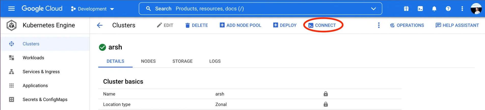
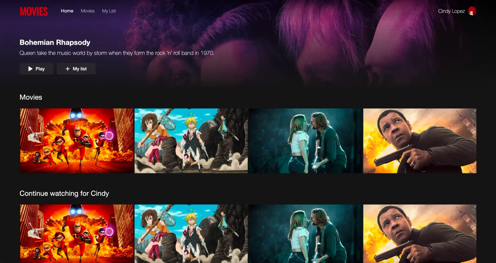
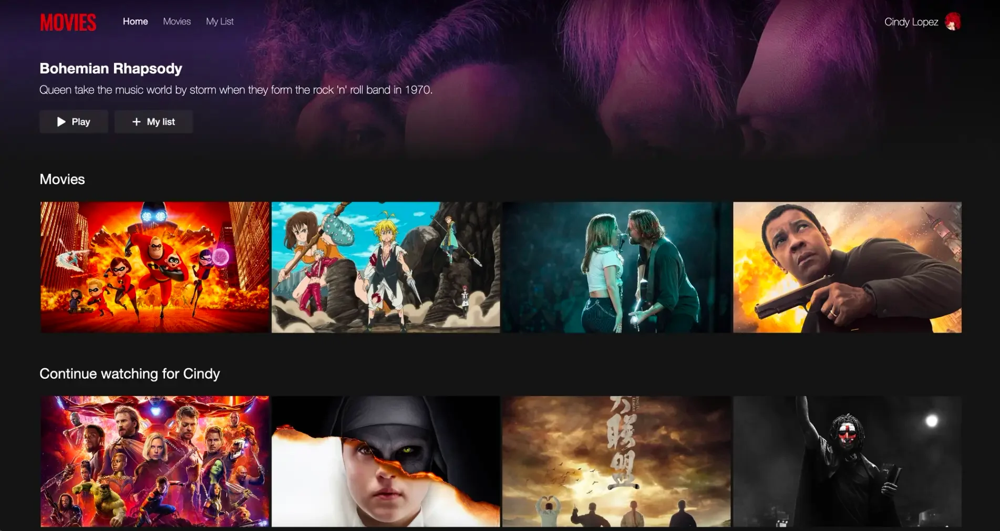

import { CallToAction } from '@site/src/components/blog';

Let me jog your memory with how we used to develop applications not so long ago. We would bring up the application, write some code, hit save, see our changes, and iterate accordingly. It was fun, no?

{/* truncate */}

Huge jumps in deployment practices changed the game, however. Two problems emerged:

- We started breaking down our monoliths into multiple microservices. This meant it was no longer one single command to bring up the application during development. These microservices required configuration with each other, and we, as developers, had to start spending more and more time on this phase of setting up our development environment.
- Even after doing all the hard work we talked about when we coded our changes, we lost that sense of certainty we had earlier - that our changes would work in production as expected. This is because bringing the microservices up locally no longer mimics the production environment. With [Kubernetes](https://www.okteto.com/blog/kubernetes-basics/) in the picture, replication of the production environment during development became tougher and tougher.

But what if I tell you there is a free and open source solution for both these woes? The solution I’m talking about is [Okteto CLI](https://github.com/okteto/okteto).

<CallToAction title={"Stay on Top of Kubernetes Best Practices & Trends"} actions={[{"label":"Download the Trend Report","url":"https://www.okteto.com/ebooks/dzone-kubernetes/"}]} />

Okteto CLI deploys your microservices to a [Kubernetes](https://www.okteto.com/blog/kubernetes-basics/) cluster and allows you to develop them directly there - so basically, hot reloading on Kubernetes clusters! It combats both the problems we discussed:

- With Okteto CLI, you can bring up all the microservices you require during development with just one single command. No configuration is required by developers since it uses already existing manifests - the ones that are used to deploy to the production Kubernetes clusters.
- Once you have your microservices deployed, Okteto CLI allows you to develop them directly on a Kubernetes cluster. So you’ll make a code change, hit save, and immediately see the results in the deployed version of your application. Since the results you see are on an actual Kubernetes cluster, you can be sure that what you’re seeing is what you’ll get when you push to production.

## Setting Up Our Arsenal

Now that you know what Okteto CLI is and how it helps, let’s see all of this in action. In this article, we’ll use a [GKE cluster](https://cloud.google.com/kubernetes-engine) and develop a simple application consisting of a couple of microservices using Okteto CLI. But this works for any Kubernetes cluster (even [minikube](https://minikube.sigs.k8s.io/docs/start/)!) and regardless of the number of microservices your application has!

> Looking to refresh your K8s knowledge? Check out our [Kubernetes Basics tutorial](https://www.okteto.com/blog/kubernetes-basics/)!

The first step is installing Okteto CLI. You can install Okteto CLI for macOS and Linux by simply running:

```
curl https://get.okteto.com -sSfL | sh
```

For detailed install instructions, you can check out the [documentation](https://www.okteto.com/docs/getting-started/#installing-okteto-cli).

Once you have Okteto CLI installed, you’ll need to configure it to work with your GKE cluster (or any other Kubernetes cluster you might be using). Okteto CLI uses [contexts](https://www.okteto.com/docs/reference/cli/#context) to manage which clusters you want to launch your [dev environments](https://www.okteto.com/docs/reference/development-environments/) with. Any clusters part of your [kubeconfig](https://kubernetes.io/docs/concepts/configuration/organize-cluster-access-kubeconfig/) are automatically picked up by Okteto CLI. So let’s first add the entry for our GKE cluster to our kubeconfig.

If you head over to your cluster in your GKE console, you should see a button called “Connect” at the top, which will prompt you to the command you need to run in order to add the cluster to your kubeconfig.



Once you do that, you should be able to see it in the lists of contexts when you run:

```
$ kubectl config get-contexts
CURRENT   NAME                                        CLUSTER                                     AUTHINFO                                    NAMESPACE
*         gke_development-xyz                         gke_development-xyz                         gke_development-xyz
```

You should now also be able to see it under your Okteto contexts now by running:

```
$ okteto ctx ls
Name                                       Namespace     Builder                                 Registry
https://okteto.example.com *               rinkiyakedad  tcp://buildkit.okteto.example.com:1234  registry.okteto.example.com
gke_development-xyz                        default       docker                                  -
```

You might or might not see other contexts based on your configuration. You can switch to the one you want (the GKE one in this case) by running:

```
$ okteto ctx use gke_development-xyz
```

## Launching Our Development Environment

Okay, now that we have all our setup done, we’re ready to do the fun bits of developing our application. For this article, we’ll be using a simple Movies application, the code for which is present at: [https://github.com/okteto/movies-with-vanilla-k8s](https://github.com/okteto/movies-with-vanilla-k8s)

Along with the code making up all the microservices in this application, the repository also contains a [Helm](https://helm.sh/) [chart](https://helm.sh/docs/topics/charts/) for each microservice. These are the same helm charts used to deploy the application to production. Okteto CLI will also rely on them to deploy the microservices to the Kubernetes cluster we just connected it to. Using the same manifests as prod is what makes sure that our development environment is exactly like production.

Let’s first clone our application code locally:

```
$ git clone https://github.com/okteto/movies-with-vanilla-k8s.git
$ cd movies-with-vanilla-k8s
```

Now let’s launch our Kubernetes based development environment by running:

```
$ okteto up
```

This is the one single command I mentioned earlier that replaces all the exhausting setup developers usually need to do these days to get started developing. On running this command, Okteto CLI first checks if all required microservices have been deployed to the cluster or not. If not, like in this case, it first deploys them. If you look at the logs carefully, you’ll see exactly this:

```
i  Deploying development environment 'movies-with-vanilla-k8s'...
i  To redeploy your development environment manually run 'okteto deploy' or 'okteto up --deploy'
i  Images were already built. To rebuild your images run 'okteto build' or 'okteto deploy --build'
i  Running helm upgrade --install movies chart --set api.image=${OKTETO_BUILD_API_IMAGE} --set frontend.image=${OKTETO_BUILD_FRONTEND_IMAGE}
Release "movies" does not exist. Installing it now.
NAME: movies
LAST DEPLOYED: Thu Aug  4 12:52:18 2022
NAMESPACE: default
STATUS: deployed
```

Once Okteto CLI is done deploying, it will prompt you to choose which one of your microservices you want to develop:

```
Select the development container you want to activate:
Use the arrow keys to navigate: ↓ ↑ → ←
  ▸ api
    frontend
```

Let's select the `api` one for now. Once you do that, you'll see that Okteto CLI will replace the container running for that microservice in the Kubernetes cluster with a development container. What's special about this development container is that it syncs all the code changes we make on our local machine with the code running in the cluster. This means as soon as we hit save, we would be able to see the result of our changes in a deployed version of our application.

Another thing you'll notice is that Okteto CLI has also given you access to a shell in the container running our microservice. The shell is currently already running [nodemon](https://nodemon.io/) for us. Having a shell in the container is useful because it ensures that you still have the ability to launch all the commands you would run on your local terminal when developing.

## Developing Our Application

Before we develop our application, let's see how it looks. Based on our deployment manifests, we would have an [ingress resource](https://kubernetes.io/docs/concepts/services-networking/ingress/) called `movies` where we should be able to go and visit our application. You might need to wait a couple of minutes before your ingress is ready. Run the following command to get the ingress address we need to visit:

```
$ kubectl get ingress
NAME     CLASS    HOSTS   ADDRESS         PORTS   AGE
movies   <none>   *       34.110.194.92   80      5m31s
```

If you visit the `ADDRESS` shown, you should be able to see your application.



But something doesn’t look quite right here, does it? The list of movies shown is the same in both cases. Let’s now use our newly launched development environment to fix this. If you look at line 43 in `api/server.js`, you might spot what’s going wrong. The list of movies displayed under “watching” is also being pulled from the “movies” database collection. Let’s change that to the “watching” collection and see what happens. Edit line 43 to:

```javascript
db.collection('watching').find().toArray( (err, results) =>{
```

and hit save. Now go back to your browser and refresh the page!



Notice how the list got updated automatically. The cool thing is that this is in the deployed version of the application running on the GKE cluster. This is what I’ve been referring to since the start of the article: hot reloading on Kubernetes clusters!

## Conclusion

What I just showed you was a very simple application with just two microservices. But imagine when your application consists of 15 or more microservices. Getting feedback for your changes then becomes almost impossible without spending a lot of time configuring things. And all this time spent on configuration takes a massive hit on developer productivity.

The beauty of this approach is that developing applications this way ensures that the feedback process is not only instantaneous but also genuine. Because we see the results for the changes we make on an actual Kubernetes cluster, we can be sure that nothing will break when we push to the production Kubernetes cluster. Okteto CLI uses the same manifests you use to deploy to production, so you can be sure that what you see is what you’ll get when you push to production.

We have always agreed that it is best to develop in an environment as close to production as possible. Since Kubernetes came into the picture, we started failing in our attempts to improve the development environment. Instead, we resorted to CI pipelines and staging environments to ensure that the code we ship works. But the problem with those approaches is that they are far from the developer - they give you feedback after you’re done writing and committing your code. Okteto CLI improves on that by allowing you to develop in an environment that is exactly like production and gives you instantaneous feedback as soon as you hit save!
