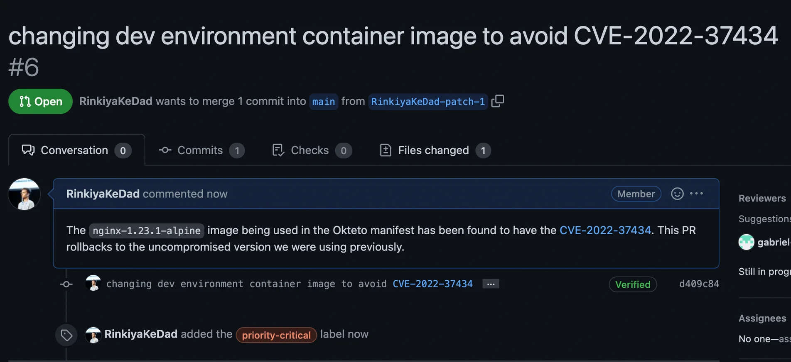

import { Tweet } from '@site/src/components/blog';

GitOps refers to the practice of using Git repositories as the single source of truth for provisioning and managing your infrastructure. Everyone in the industry agrees upon how much more convenient GitOps principles have made [continuous delivery](https://en.wikipedia.org/wiki/Continuous_delivery). Wouldn’t it be great if we could apply those very same principles to our development environments too?

{/* truncate */}

## The Challenge Kubernetes Created

GitOps emphasizes a declarative state for your infrastructure stored in a version control system. But why would we need to apply this to development environments? Why can’t we simply just continue writing code the way we did before?

One reason is that the modern applications we work on these days have multiple components. Because of this, developers now have a really hard time setting up their development environment. They have to go through numerous READMEs, full of instructions about setting up dev infrastructure, which they might not even fully understand or run hacky bash scripts, which might fail and are tough to maintain. All of this leads to developers spending hours of pre-work to get to the “code writing” phase. This makes for a terrible developer experience in teams. It is not fair to expect developers to configure and debug things in “Kubernetes land” instead of writing code.

Today’s reality is that developers have two options:

- To continue developing locally. Which meant they would not get genuine feedback when developing since locally bringing up applications is impossible to reflect production of microservice applications.
- Or to spend hours configuring a production-like development environment for themselves. This is not only wasted dev time but also requires developers to keep up with the ever-growing cloud native ecosystem of tools.

<Tweet id={"1303858170155081728"} />

## GitOps to the Rescue

Okteto solves the problems we discussed above by leveraging GitOps principles. Using Okteto, you can have all the configuration required to set up a **production-like** development environment defined, as code, **in a version control system**. Once that is done, any developer on your team can simply run a single command to get right to the “code writing” phase without worrying about the nuts and bolts of configuring Kubernetes.

Okteto deploys your application to an actual Kubernetes cluster using the same manifests you use in production and then allows you to [develop it there directly](https://www.okteto.com/blog/developing-microservices-by-hot-reloading-on-kubernetes-clusters/). The best part is that just like GitOps advocates, the entire configuration for your dev environment is stored in Git. Okteto leverages the idea of “development environments as code” by allowing you to specify all the configuration needed to spin up a dev environment in a single file: [the Okteto manifest](https://www.okteto.com/docs/reference/manifest/). This file is committed along with the application source code to a version control system. Once that is done, any developer on your team can simply clone the repository, run `okteto up`, and have a production-like environment ready for them to develop in.

Utilizing GitOps principles for your dev environments significantly improves developer experience by making things simple for everyone:

- The infrastructure team now only has to manage a single file per application where all the configuration for development environments lives
- Updating the dev environment is now as simple as making a change in your Okteto manifest and sending a PR
- Developers have to spend ZERO time configuring things and can have the dev environment launched in one command

## Benefits

With Okteto, just like in GitOps, a single source of truth can power development environments for all developers on your team. This approach has numerous benefits which make working on cloud native applications a lot easier than before:

1. **Developer Experience** 
   When the entire configuration needed to spin up a development environment has been defined as code, developers on your team don’t have to spend hours with configuration or spent cognitive load. A single command gets you right to the code writing phase. This also enables new developers on your team to get up to speed much more quickly than possible before!
1. **Consistency**
   Having a single file power every developer’s dev environment ensures that there is consistency in workflows across your entire team. This leads to easier debugging and more effective collaboration because the focus can now be shifted to the actual application problems instead of worrying about infrastructure and configuration related issues.
1. **Reliability**
   Since your development environment is defined as code and stored in Git, you can leverage all the benefits of working with a version control system. From having a log of all the changes made to being able to easily revert back in case of things going wrong, this approach ensures you always have a safety net to fall back on.
1. **Security** 
   Having developers write code in secure environments is very important. Using vulnerable container images during development can be a huge risk compromising the security of your organization. With Okteto, you can periodically check the committed manifest for vulnerabilities and ensure that your mean time to recovery is minutes and not hours in case of an incident. Fixing things for everyone on your team is as simple as raising a pull request which updates your Okteto manifest!

A couple of years ago, the benefits you would get from “GitOpsifying” your development environments wouldn’t have been that significant. But now, I would say that if you’re looking to unblock dev productivity, it’s absolutely essential for you to have your development environments as code in a version control system. Go try our [Getting Started Guide](https://www.okteto.com/docs/getting-started/) to see how Okteto helps with this!
