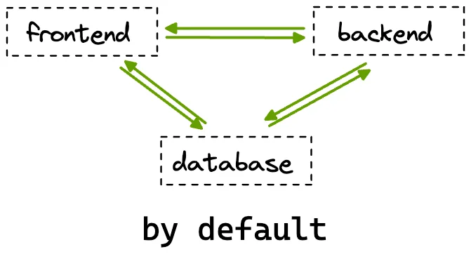
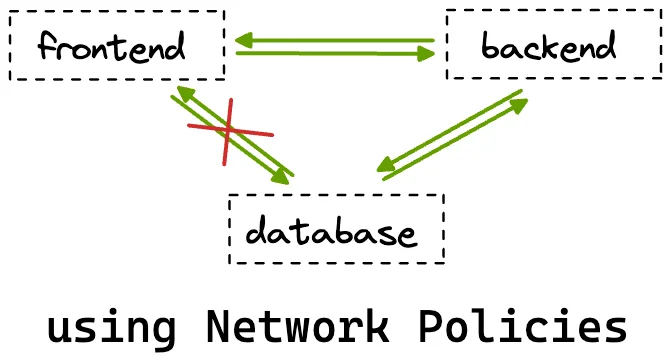

import { CustomerQuote, YouTube } from '@site/src/components/blog';

Everyone agrees that [Kubernetes clusters are not secure by default](https://www.darkreading.com/cloud-security/why-kubernetes-clusters-are-intrinsically-insecure-what-to-do-about-them-). But the good thing is that Kubernetes gives you the tools to make it so.

{/* truncate */}

<CustomerQuote quote={"Teams new to Kubernetes often deploy clusters in an insecure way by default because they don't know what they don't know. Unless you've got a team of battle-hardened Kubernetes experts, you're bound to run into trouble."} author={"Robert Brennan"} role={"Director of Open Source Software, Fairwinds"} />

In this article, we’re going to learn about one of such resources K8s provides right out of the box to make your deployed applications a bit more secure: Kubernetes Network Policies.

<YouTube id={"ehj0Qdq1qdA"} />

## Why Network Policies in Kubernetes Are Important

When learning about something new, I often find it easier to understand if I start with learning the “why” it was needed, even before knowing “what” it actually is. Let’s do the same with Network Policies, and I’m sure you’ll have a much easier time understanding them! :)

By default, [Kubernetes allows traffic](https://kubernetes.io/docs/concepts/services-networking/#the-kubernetes-network-model) from all pods to reach all other pods. But this isn’t something you’d want in production. Why? Because this way, if a pod gets compromised, it will be able to affect other pods and potentially compromise the security of your entire application. Network Policies provide a way to restrict traffic in your cluster so that only legitimate traffic can flow - where the term “legitimate traffic” is for you to decide based on your application.

For example, if you’ve deployed a full-stack application by default, the frontend pods will be able to communicate with the backend as well as the database pods. But we know that the frontend pods don’t actually need to talk to the database pods directly.



In this scenario, it would be ideal for us to leverage Kubernetes Network Policies to allow traffic from the frontend pods only to the backend pods. This way, even if the frontend pods get compromised, we can be sure that our database won’t be affected!



Now that you have an understanding of what utility Network Policies serve let’s start learning about them in more detail.

## What Exactly Are Kubernetes Network Policies

Network Policies are a resource in Kubernetes responsible for controlling traffic *to and from* [pods](https://www.okteto.com/blog/kubernetes-basics/#pods) running in a cluster. With Network Policies, you select pods using labels and then specify rules for these selected pods. You can utilize a combination of the following three to precisely control traffic:

- Other pods: You can select other pods using labels that should be allowed to talk to the selected pods.
- [Namespaces](https://www.okteto.com/blog/kubernetes-basics/#namespaces): You can select complete namespaces as well. In this case, all pods in the namespace would be able to communicate with the selected pods.
- IP blocks: You can specify [CIDR ranges](https://aws.amazon.com/what-is/cidr/) from or to which traffic is allowed for the selected pods.

### Kubernetes Network Policy Example

Let’s look at a Network Policy example resource and then see how we can define network policies in K8s. Warning: things aren’t as scary as they might look at first glance! :P

```yaml
apiVersion: networking.k8s.io/v1
kind: NetworkPolicy
metadata:
  name: sample-network-policy
spec:
  podSelector:
    matchLabels:
      role: db
  policyTypes:
    - Ingress
    - Egress
  ingress:
    - from:
        - namespaceSelector:
            matchLabels:
              project: firstproject
        - podSelector:
            matchLabels:
              role: client
      ports:
        - protocol: TCP
          port: 4614
  egress:
    - to:
        - namespaceSelector:
            matchLabels:
              project: secondproject
      ports:
        - protocol: TCP
          port: 1010
```

Like most other K8s resources, the `NetworkPolicy` resource also has the usual `apiVersion`, `kind`, `metadata`, and `spec` fields. The `spec` field is where things get interesting! You’ll mostly see the following things under this field:

#### podSelector

This is where we select the pods we want the policy to get applied to.

#### policyType

NetworkPolicies have two types: Ingress and Egress. A NetworkPolicy resource can be of any of the two types (or even both!). Ingress refers to the traffic entering the pods we select under the `podSelector`, whereas Egress refers to the traffic leaving the pods. The `policyType` field indicates whether we will specify ingress rules or egress rules, or both for the pods we’ve selected in our NetworkPolicy resource.

#### ingress

Ingress is where we list rules for what traffic is allowed to enter the selected pods. All the listed rules get `OR`ed.

```yaml
ingress:
  - from:
    - namespaceSelector:
        matchLabels:
          project: firstproject
    - podSelector:
        matchLabels:
          role: client
```

The above section in a network policy would allow traffic to the selected pods:

- from all pods in the namespace with the label "project: firstproject" and,
- from all pods with the label "role: client" regardless of which namespace they are present in.

In case you wanted a combination of both of these rules, your ingress section would look something like this:

```yaml
ingress:
  - from:
    - namespaceSelector:
        matchLabels:
          project: firstproject
      podSelector:
        matchLabels:
          role: client
```

Now, this would allow traffic only from pods with the “role: client” label present in the namespace with the “project: firstproject” label.

The selection capabilities are quite powerful, no?

The `ports` section simply specifies the ports on which the selected traffic is allowed.

#### egress

Similar to ingress in terms of selecting things, the only difference being that egress is where we select where traffic is allowed to go from our selected pods.

```yaml
egress:
    - to:
        - namespaceSelector:
            matchLabels:
              project: secondproject
```

So in the above example, the selected pods are allowed to send traffic to all pods in the namespace with the label “project: secondproject”. The selection rules for egress get `AND`ed and `OR`ed, similar to ingress rules. The `ports` section, too, like in the case of ingress, specifies what ports the rules are valid on.

Now that you have a general idea of what a NetworkPolicy does and looks like let’s see things in action!

## Working With Network Policies

We’ll keep things simple in this section but, at the same time, ensure that you’re able to understand Network Policies in detail. We’ll work with two pods: frontend and backend, and test the connectivity between them before and after creating some Network Policies.

Let’s first create both our pods:

```
$ kubectl run frontend --image=nginx
$ kubectl run backend --image=nginx
```

If you want to learn more about common [kubectl commands check this blog out](https://www.okteto.com/blog/kubectl-cheat-sheet/)!

Next, let’s just expose both these pods by creating cluster internal services so that its easier for us to check the connectivity between them:

n commnandsn

```
$ kubectl expose pod frontend --port 80
$ kubectl expose pod backend --port 80
```

Confirm that everything is working as expected by running `kubectl get all`:

```
NAME           READY   STATUS    RESTARTS   AGE
pod/backend    1/1     Running   0          3m10s
pod/frontend   1/1     Running   0          3m18s

NAME                 TYPE        CLUSTER-IP      EXTERNAL-IP   PORT(S)   AGE
service/backend      ClusterIP   10.120.37.122   <none>        80/TCP    67s
service/frontend     ClusterIP   10.120.39.94    <none>        80/TCP    72s
service/kubernetes   ClusterIP   10.120.32.1     <none>        443/TCP   257d
```

Now, if you remember, at the start, I mentioned that by default, all pods in K8s are allowed to interact with each other. Let’s confirm this by trying to ping the backend pod, using the cluster IP of its service, from the frontend pod by running the `exec` [command](https://kubernetes.io/docs/tasks/debug/debug-application/get-shell-running-container/):

```
$ kubectl exec frontend -- curl 10.120.37.122
```

You should get the following output:

```html
<!DOCTYPE html>
<html>
<head>
<title>Welcome to nginx!</title>
<style>
html { color-scheme: light dark; }
body { width: 35em; margin: 0 auto;
font-family: Tahoma, Verdana, Arial, sans-serif; }
</style>
</head>
<body>
<h1>Welcome to nginx!</h1>
<p>If you see this page, the nginx web server is successfully installed and
working. Further configuration is required.</p>

<p>For online documentation and support please refer to
<a href="<http://nginx.org/>">nginx.org</a>.<br/>
Commercial support is available at
<a href="<http://nginx.com/>">nginx.com</a>.</p>

<p><em>Thank you for using nginx.</em></p>
</body>
</html>
```

We see the HTML output for the NGINX starter page, which confirms that we were successfully able to ping the backend pod.

You can also try this the other way around as well by running:

```
$ kubectl exec backend -- curl 10.120.39.94
```

Let’s now create a very common policy called “Default deny”. Once this is created, it will restrict **ALL** traffic for **ALL** pods in your cluster. This is a very convenient and common way to begin thinking about networking rules in your cluster. You begin by stopping all traffic and then create more network policies only for the traffic you want to allow.

Here's an example of a default deny network policy:

```yaml
apiVersion: networking.k8s.io/v1
kind: NetworkPolicy
metadata:
  name: default-deny
spec:
  podSelector: {}
  policyTypes:
  - Ingress
  - Egress
```

Specifying `{}` for `podSelector` simply selects all pods and not writing an ingress or egress section **while mentioning them both** under `policyTypes` blocks all traffic.

Try running the `kubectl exec` commands we ran before now. You’ll notice that it doesn’t show the HTML and just keeps loading. This is because of the Network Policy that we just created!

Now let’s make sure our frontend pod is able to communicate with the backend pod. For this, we would need to create two rules:

- One egress rule which allows outgoing traffic from the frontend to the backend
- One ingress rule which allows incoming to the backend from the frontend

The following policy will select the frontend pods and allow outgoing traffic from them to reach the backend pods:

```yaml
apiVersion: networking.k8s.io/v1
kind: NetworkPolicy
metadata:
  name: frontend-policy
spec:
  podSelector:
    matchLabels:
      run: frontend
  policyTypes:
    - Egress
  egress:
    - to:
        - podSelector:
            matchLabels:
              run: backend
```

Try rerunning the following command to test if things are working or not:

```
$ kubectl exec frontend -- curl 10.120.37.122
```

You’ll notice that it still doesn’t work. And that’s expected! Right now, we’ve only created a policy that allows traffic to leave from the frontend pods to the backend pods. The backend pods still need an ingress rule to allow incoming traffic from the frontend pods. Let’s create another policy to achieve this:

```yaml
apiVersion: networking.k8s.io/v1
kind: NetworkPolicy
metadata:
  name: backend-policy
spec:
  podSelector:
    matchLabels:
      run: backend
  policyTypes:
    - Ingress
  ingress:
    - from:
        - podSelector:
            matchLabels:
              run: frontend
```

Once you’ve created both of these policies, try pinging the backend pods again, and it should work! You can also try pinging the frontend pods from the backend ones and confirm that it still does not work because of our default deny policy.

## Wrap Up

I think you can now start to appreciate how Network Policies can play a crucial role in helping you ship secure applications. We learned why Network Policies are needed and how they work and then saw them in action. If there is one piece of advice I want to leave you with before concluding, it's that when managing traffic in your clusters, it is best to **only** allow the required traffic and **block everything else**!

Okteto allows developers to work on their applications in a production-like environment. This means you can use Kubernetes resources like Network Policies right **during the development phase**. This allows developers to be sure that the code they write is secure and won’t break in production. Check out our [Getting Started](https://www.okteto.com/docs/getting-started/) guide to learn more!
