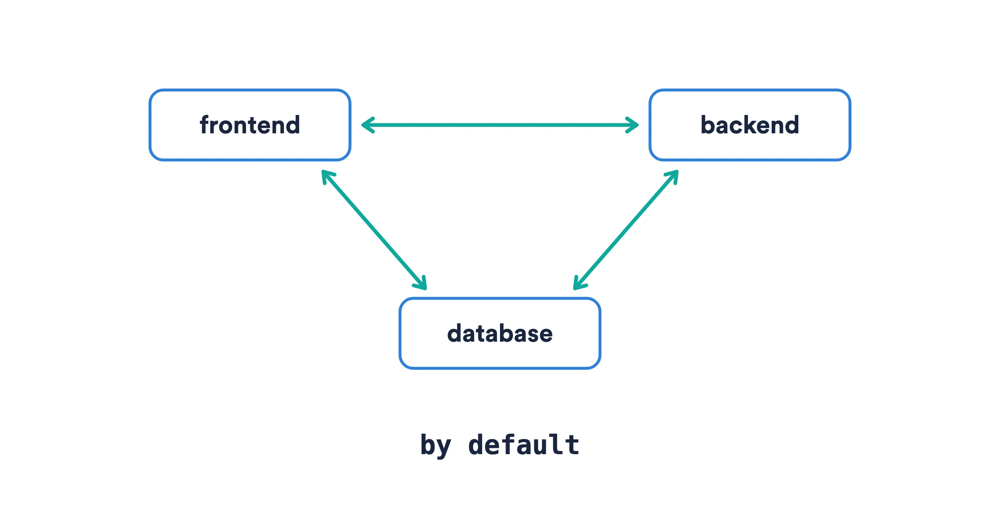
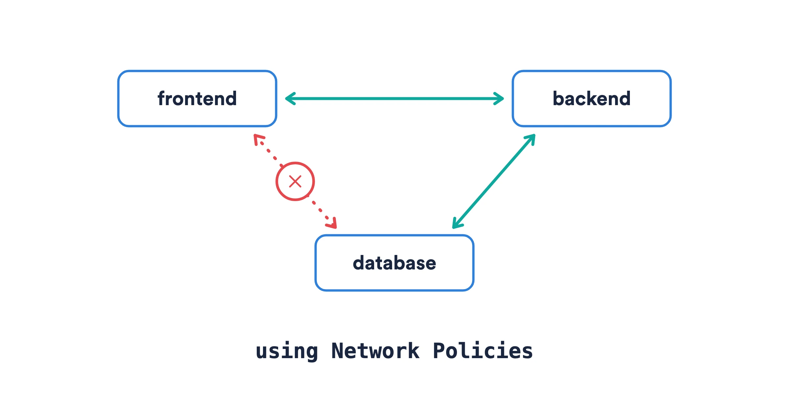

[Kubernetes clusters are not secure by default](https://www.darkreading.com/cloud-security/why-kubernetes-clusters-are-intrinsically-insecure-what-to-do-about-them-), but Kubernetes gives you the tools to make them secure. This article covers one of them, available in every cluster: Network Policies.

{/* truncate */}

## Why Network Policies Matter

By default, [Kubernetes allows traffic](https://kubernetes.io/docs/concepts/services-networking/#the-kubernetes-network-model) from every pod to every other pod. That isn't something you want in production: if one pod is compromised, it can reach every other pod and compromise your entire application. Network Policies restrict the traffic in your cluster so that only the traffic you decide is legitimate can flow.

For example, when you deploy a full-stack application, the frontend pods can talk to the backend pods and to the database pods. But the frontend never needs to talk to the database directly.



A Network Policy can allow traffic from the frontend pods only to the backend pods. Even if a frontend pod is compromised, it can't reach the database.



## What Kubernetes Network Policies Are

A Network Policy is a Kubernetes resource that controls the traffic *to and from* the [pods](/blog/kubernetes-basics/#pods) of a namespace. It selects pods by their labels, and it sets rules for the selected pods with a combination of:

- **Other pods:** pods, selected by their labels, that can talk to the selected pods.
- **[Namespaces](/blog/kubernetes-basics/#namespaces):** all the pods of the selected namespaces can talk to the selected pods.
- **IP blocks:** [CIDR ranges](https://aws.amazon.com/what-is/cidr/) that the selected pods can receive traffic from or send traffic to.

The cluster's network plugin is the one that enforces Network Policies. Plugins such as Calico and Cilium enforce them. If your cluster's plugin doesn't, Kubernetes accepts the policies but they have no effect, so check it before you rely on them.

### A Network Policy Example

```yaml title="sample-network-policy.yaml"
apiVersion: networking.k8s.io/v1
kind: NetworkPolicy
metadata:
  name: sample-network-policy
spec:
  podSelector:
    matchLabels:
      role: db
  policyTypes:
    - Ingress
    - Egress
  ingress:
    - from:
        - namespaceSelector:
            matchLabels:
              project: firstproject
        - podSelector:
            matchLabels:
              role: client
      ports:
        - protocol: TCP
          port: 4614
  egress:
    - to:
        - namespaceSelector:
            matchLabels:
              project: secondproject
      ports:
        - protocol: TCP
          port: 1010
```

Like other Kubernetes resources, a `NetworkPolicy` has the `apiVersion`, `kind`, `metadata`, and `spec` fields. The rules go under `spec`, in these fields.

### podSelector

The pods the policy applies to, selected by their labels. An empty `podSelector` (`{}`) selects every pod of the namespace.

### policyTypes

A Network Policy can restrict two types of traffic: `Ingress`, the traffic that enters the selected pods, and `Egress`, the traffic that leaves them. `policyTypes` lists the types the policy restricts: one of them or both.

### ingress

The rules for the traffic allowed to enter the selected pods. A connection is allowed if it matches any of the rules.

```yaml
ingress:
  - from:
    - namespaceSelector:
        matchLabels:
          project: firstproject
    - podSelector:
        matchLabels:
          role: client
```

This section allows traffic to the selected pods:

- from all the pods of the namespaces with the label `project: firstproject`, and
- from all the pods with the label `role: client` in the same namespace as the policy.

To allow only the traffic that matches both conditions, put them in the same element of the list:

```yaml
ingress:
  - from:
    - namespaceSelector:
        matchLabels:
          project: firstproject
      podSelector:
        matchLabels:
          role: client
```

This section allows traffic only from the pods with the label `role: client` in the namespaces with the label `project: firstproject`.

The `ports` section sets the ports where the traffic is allowed.

### egress

The rules for the traffic allowed to leave the selected pods, with the same selectors as `ingress`.

```yaml
egress:
  - to:
    - namespaceSelector:
        matchLabels:
          project: secondproject
```

This section allows the selected pods to send traffic to all the pods of the namespaces with the label `project: secondproject`. The `ports` section works the same way as in `ingress`.

## Working With Network Policies

This example uses two pods, frontend and backend, and tests the connection between them before and after adding Network Policies. Run it in a namespace of a cluster whose network plugin enforces Network Policies.

Create both pods. `kubectl run` labels each pod with `run: <name>`, and the policies of this example select the pods by that label:

```bash
kubectl run frontend --image=nginx
kubectl run backend --image=nginx
```

The [kubectl cheat sheet](/blog/kubectl-cheat-sheet/) lists other common `kubectl` commands.

Expose both pods with a service inside the cluster, to test the connection between them:

```bash
kubectl expose pod frontend --port 80
kubectl expose pod backend --port 80
```

Check that everything is running with `kubectl get all`:

```
NAME           READY   STATUS    RESTARTS   AGE
pod/backend    1/1     Running   0          3m10s
pod/frontend   1/1     Running   0          3m18s

NAME                 TYPE        CLUSTER-IP      EXTERNAL-IP   PORT(S)   AGE
service/backend      ClusterIP   10.120.37.122   <none>        80/TCP    67s
service/frontend     ClusterIP   10.120.39.94    <none>        80/TCP    72s
service/kubernetes   ClusterIP   10.120.32.1     <none>        443/TCP   257d
```

By default, every pod can reach every other pod. Confirm it with a request from the frontend pod to the cluster IP of the backend service (use the IP of your own output):

```bash
kubectl exec frontend -- curl -s --max-time 5 10.120.37.122
```

The output is the HTML of the NGINX welcome page:

```html
<!DOCTYPE html>
<html>
<head>
<title>Welcome to nginx!</title>
...
```

The request also works the other way around, from the backend pod to the frontend service:

```bash
kubectl exec backend -- curl -s --max-time 5 10.120.39.94
```

### Default Deny

Start with a common policy, "default deny", which blocks **all** the traffic of **all** the pods of the namespace where you create it. From there, you add a policy for each connection you want to allow.

```yaml title="default-deny.yaml"
apiVersion: networking.k8s.io/v1
kind: NetworkPolicy
metadata:
  name: default-deny
spec:
  podSelector: {}
  policyTypes:
  - Ingress
  - Egress
```

The empty `podSelector` selects every pod of the namespace. The policy lists both types in `policyTypes` and has no `ingress` or `egress` rules, so it allows no traffic in either direction. This includes the DNS requests of the pods, which is why the commands of this example use the IPs of the services and not their names.

Apply it:

```bash
kubectl apply -f default-deny.yaml
```

Run the `kubectl exec` commands again: both of them time out.

### Allowing Traffic From the Frontend to the Backend

To let the frontend pod reach the backend pod, you need two rules:

- An egress rule that allows the traffic to leave the frontend pod for the backend pod.
- An ingress rule that allows the traffic from the frontend pod to enter the backend pod.

This policy selects the frontend pod and allows its traffic to the backend pod:

```yaml title="frontend-policy.yaml"
apiVersion: networking.k8s.io/v1
kind: NetworkPolicy
metadata:
  name: frontend-policy
spec:
  podSelector:
    matchLabels:
      run: frontend
  policyTypes:
    - Egress
  egress:
    - to:
        - podSelector:
            matchLabels:
              run: backend
```

Apply it and test the connection:

```bash
kubectl apply -f frontend-policy.yaml
kubectl exec frontend -- curl -s --max-time 5 10.120.37.122
```

It still times out: the traffic can leave the frontend pod, but the default deny policy blocks it at the backend pod. This policy selects the backend pod and allows the traffic from the frontend pod:

```yaml title="backend-policy.yaml"
apiVersion: networking.k8s.io/v1
kind: NetworkPolicy
metadata:
  name: backend-policy
spec:
  podSelector:
    matchLabels:
      run: backend
  policyTypes:
    - Ingress
  ingress:
    - from:
        - podSelector:
            matchLabels:
              run: frontend
```

Apply it and test the connection again:

```bash
kubectl apply -f backend-policy.yaml
kubectl exec frontend -- curl -s --max-time 5 10.120.37.122
```

Now the frontend pod gets the NGINX welcome page. The other direction, from the backend pod to the frontend pod, still times out: no policy allows it.

## Wrap Up

Network Policies let you allow only the traffic your application needs and block everything else. Start with a default deny policy, and add a policy for each connection your pods need.

Test your policies where you develop, not only in production. A policy that blocks a connection your code needs breaks the application, and you want to find that out before the change is merged. That's one of the reasons to develop in [an environment that runs on Kubernetes](https://www.okteto.com/kubernetes-application-environments/), with the same policies as production. With [Okteto](/docs/getting-started/), each developer and each coding agent gets an environment in a namespace of your cluster, under the network policies the platform team defines.
