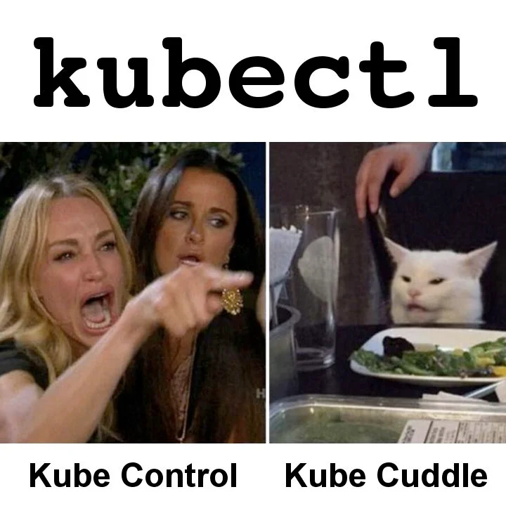

import { CustomerQuote, YouTube } from '@site/src/components/blog';

Things can be overwhelming when you are [new to Kubernetes](https://www.reddit.com/r/kubernetes/comments/13f57ta/is_it_just_me_or_is_kubernetes_supposed_to_be/). You’d think that understanding all the [different objects](https://www.okteto.com/blog/kubernetes-basics/#getting-started-with-kubernetes) Kubernetes has to offer would be the end of it. But no, when it comes to actually interacting with K8s clusters, things get even more confusing for beginners. This is where our kubectl cheat sheet will come in handy!

{/* truncate */}

<YouTube id={"zn0ieFdYsl4"} />

## Introduction to kubectl

The most common tool to interact with a Kubernetes cluster is [kubectl](https://kubernetes.io/docs/tasks/tools/#kubectl). This allows you to interact with the objects you create, view logs, etc. But as anyone who’s just starting to learn K8s will agree, THERE ARE JUST [TOO MANY KUBECTL COMMANDS](https://kubernetes.io/docs/reference/kubectl/quick-reference/) TO KEEP TRACK OF!

<CustomerQuote quote={"When I was learning K8s personally, I had to maintain a diary of all the commands I came across and used to revise them every day before taking my Certified Kubernetes Administrator exam. I hope this Kubernetes command cheat sheet makes things easier for you so that you don't have to struggle like I did."} author={"Arsh Sharma"} role={"Developer Experience Engineer"} />

But don’t worry; this kubectl cheat sheet is going to be my attempt to simplify things. We’ll go over the most common commands you’d find yourself using throughout your K8s journey. Here’s a meme to ease you in before getting started.

Also, if you’re completely new to Kubernetes, you might want to check out our [Kubernetes for Beginners](https://www.okteto.com/blog/kubernetes-basics/) blog before proceeding. Now let's begin with our Kubernetes command cheat sheet!

## Cluster Info and Configuration

Often you need to get information, not about the application but the [cluster itself](https://www.vmware.com/topics/kubernetes-cluster). Here are a few Kubernetes commands in our cheat sheet which help with that:

- `kubectl version`: Gives information about what version of Kubernetes the client and server are on.
- `kubectl cluster-info`: Displays the endpoint of the Kubernetes control plane.
- `kubectl config get-contexts`: Lists all the contexts present in the current kubeconfig.
- `kubectl config use-context <context name>`: Allows you to set the default context for all the kubectl commands you’ll run.

## Namespaces

[Namespaces](https://www.okteto.com/blog/kubernetes-basics/#namespaces) play a very important role in clusters. No kubectl cheat sheet can be complete without including commands which help you work with them. They act as a way to organize and isolate the different resources your application might need. By default, you’re in the `default` namespace (surprise, surprise!), and the resources Kubernetes needs for its functioning are in the `kube-system` namespace. Here are some other commands related to namespaces you’ll find yourself using frequently:

- `kubectl get namespaces`: Often, you’ll find that you’ve lost track of all the namespaces you’ve created. This command will help you out by listing them all.
- `kubectl create namespace <namespace name>`: This command would create a new namespace for you. Note that it will not set that namespace as the default one, though. So all resources you create will still be created in the `default` namespace unless you specify the `--namespace` flag explicitly.
- `kubectl config set-context --current --namespace=<namespace name>`: This allows you to change the default namespace for all the commands you’ll run while still keeping the same context. Just remember that the default namespace is called `default` in case you ever want to switch back.
- `kubectl delete namespace <namespace name>`: This deletes the specified namespace and **all resources under the namespace!** The deletion of resources is an asynchronous process, so don’t be surprised if you see your namespace in the “Terminating” state for a while before it’s completely gone.

## Pods, Deployments, Secrets, etc

Now there is a certain set of commands which you’ll find yourself using a lot when interacting with most of the [Kubernetes resources](https://www.okteto.com/blog/kubernetes-basics/#getting-started-with-kubernetes). Just put in the resource name instead of `X`, and you should be good to go with these:

- `kubectl get X`: Lists all resources of that particular type **in the current namespace**.
- `kubectl create X <name> <other properties>`: Creates the “X” resource in the current namespace with the specified name. In most cases, you would have to specify some additional flags to actually create that particular resource.
- `kubectl delete X <name>`: Deletes the “X” resource with the given name in the current namespace.
- `kubectl describe X <name>`: You’ll find yourself using this one a lot when debugging things. This provides details and events related to the resource you specify.
- `kubectl edit X <name>`: This command will allow you to edit the specified resource directly without having to deal with any YAML. Remember to make the changes to your YAMLs once you’re satisfied with your edits because the edits don’t persist once the resource gets deleted!

## Nodes

Next up in our kubectl cheat sheet are commands related to nodes. Nodes are what build your cluster, so it’s no surprise that you’ll often find yourself interacting with them. The following commands are worth keeping a note of:

- `kubectl get nodes`: Shows a list of all the nodes along with their role (`control-plane`, `worker`, etc.) and the version of K8s they are running.
- `kubectl top node <node name>`: Shows the CPU and memory usage of the specified node.
- `kubectl cordon/uncordon node <node name>`: Cordoning nodes means marking them as unschedulable; that is, no pods will be placed on that particular node. This is useful when you want to isolate a node for something like updating its version or debugging.
- `kubectl drain node <node name>`: You’ll find yourself using this command when doing maintenance tasks for your cluster. Draining a node, cordons it as well, and deletes all pods running on it. If those pods are being managed by a Deployment, DaemonSet, etc., they will be recreated on the remaining nodes.

## Other Common Kubectl Cheat Sheet Commands

Finally to finish our kubectl cheat sheet let's discuss some commands which don’t exactly fit into any single category, but you’ll find yourself using them a lot.

- `kubectl apply -f <filename.yaml>`: If you’re creating K8s resources using YAML files, then this is the command you should be using to apply those YAMLs. If the resource specified in the YAML already exists, then this command would update that resource with the latest configuration specified in the YAML file.
- `kubectl delete -f <filename.yaml>`: This command deletes all the resources specified in the particular YAML file.
- `kubectl port-forward <pod name> <local port>:<remote port>`: Relying on [services](https://www.okteto.com/blog/beginner-s-guide-to-network-policies-in-kubernetes/) to expose your application to external traffic isn’t always convenient, especially when you’re debugging. The `port-forward` subcommand provides you with a simple way to do this by letting you forward a local port to a specified port in the mentioned pod.
- `kubectl logs <pod name>`: This is a very useful command for debugging your deployed application. This command prints the logs for the container running in the specified pod. If your pod is running more than one container, you can additionally specify the `--container` flag to mention which container’s logs you want to see.

## Who Are These Kubectl Cheat Sheet Commands For?

While we discussed some common Kubernetes commands in the form of a cheat sheet that you’d find yourself using when working with K8s, I believe that it is not developers who should be taking care of these K8s related tasks. Having developers deal with the infrastructure and deployment side of things during the development process takes a massive hit on productivity and also leads to a poor developer experience. With Okteto, you can define all the things you need to spin up your dev environment in a YAML and have developers skip right to the code-writing phase by running just one single command. Try our [Getting Started Guide](https://www.okteto.com/docs/getting-started/) to see the magic for yourself!
