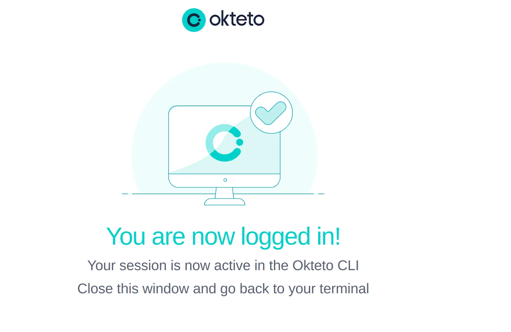
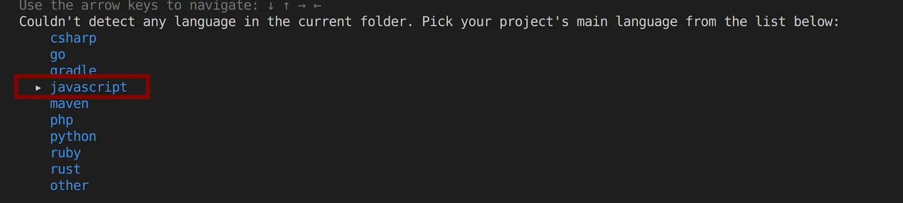
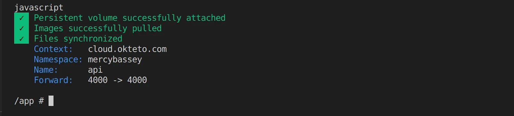
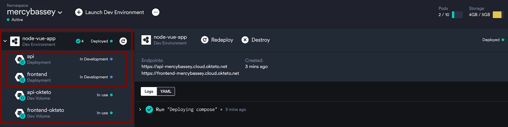
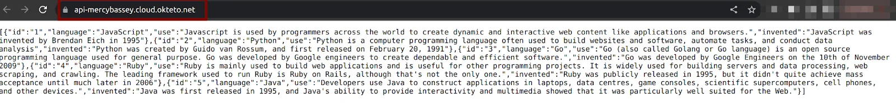
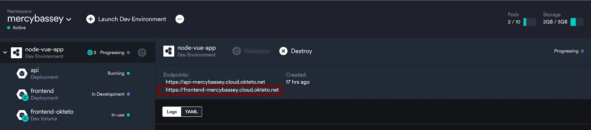
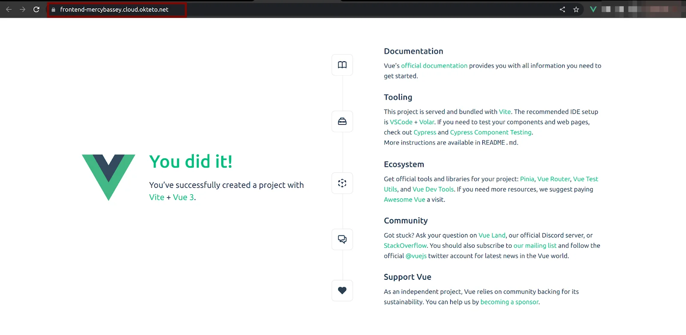
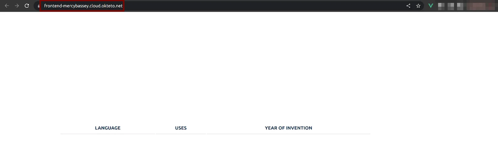
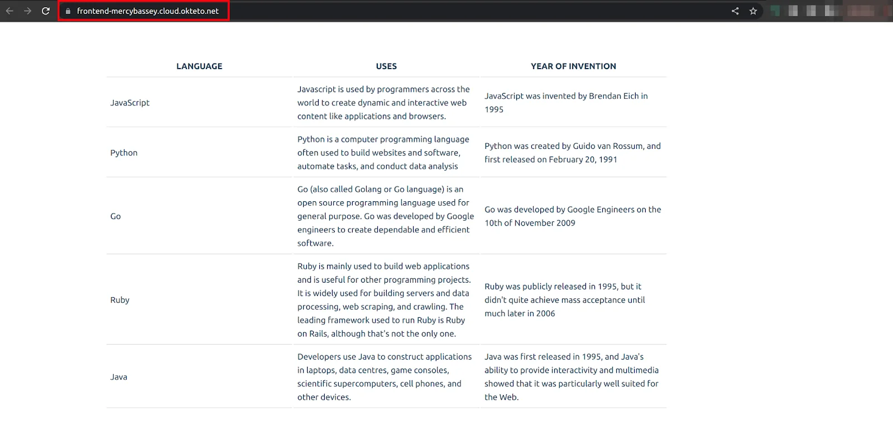

Kubernetes is a feature-rich tool to solve all kinds of problems of the cloud, but it has a steep learning curve, and applications set up in Kubernetes can be quite complex. Because your development and production environments are isolated from each other, they typically have different configurations and thus may not behave the same way.

{/* truncate */}

The best way to develop cloud native applications is in a development environment in the cloud which is where Okteto comes in.

With the Okteto development environment, you can now develop right inside the cloud and see how your application performs in the cloud.

In this tutorial, you will learn how to develop a full-stack application that comprises a VueJS front-end and a NodeJS back-end with Okteto.

**Prerequisites**

To follow along in this tutorial, it is required that you have:

- A basic understanding of JavaScript and the [VueJS](https://vuejs.org/) framework.
- A basic understanding of [NodeJS](https://nodejs.org/en/).
- Access to an [Okteto instance](https://www.okteto.com/docs/).
- [Okteto CLI](https://www.okteto.com/docs/getting-started/#installing-okteto-cli) installed on your machine.

## Setting Up Your Dev Environment

To build and develop your applications in Okteto, you’ll need to first, connect your local machine to Okteto.<br />
Run the command below to configure your Okteto context.

```
okteto context use https://okteto.example.com
```

Once your context is configured successfully, a new tab will open with the below output:



This output shows you are now connected to Okteto from your local machine. So, you can now develop your application with Okteto.

## Initializing the Full-Stack Application With Okteto

To see the power of Okteto, you’ll initialize the full-stack application from the ground up with Okteto.

Create a working directory called node-vue-app:

```
mkdir node-vue-app
cd node-vue-app
```

Add a *docker-compose.yaml* file and paste in the following configuration settings:

The Okteto CLI will use this file to deploy the full-stack application.

```yaml
version: "3.8"
services:
  api:
    build: ./node-backend
    container_name: node_c
    ports:
      - '4000:4000'
    volumes:
      - ./node-backend:/app
  frontend:
    build: ./vue-frontend
    container_name: vue_c
    ports:
      - '8080:8080'
    volumes:
      - ./vue-frontend:/app
```

Inside the *node-vue-app* directory, create two other directories *node-backend* and *vue-frontend* to house the NodeJS backend and VueJS frontend application respectively:

```
mkdir node-backend
mkdir vue-frontend
```

In the *node-backend* directory, add a *Dockerfile* with the below code snippets:

You’ll need to do this so that Okteto would know what image to use and what to build.

```
FROM node:18-alpine

RUN npm install -g nodemon

WORKDIR /app

COPY package.json ./

RUN npm install

COPY .  .

EXPOSE 4000

CMD ["npm", "run", "dev"]
```

Go into the *vue-frontend* folder, create a *Dockerfile* and add the below code snippets:

```
FROM node:17-alpine

WORKDIR /app

COPY package*.json .

RUN npm install

COPY . .

EXPOSE 8080

CMD [ "npm", "run", "dev" ]
```

## Initializing the Node.js Application with Okteto

Now run the Okteto command below to set up the NodeJS application with a development container. The command below, will deploy the services that were set in the docker-compose file (*api* and *frontend*) and spin up a development container for any of the services you specify.

```
okteto up
```

The command above will display an output asking you to select the development container you’d like to activate, firstly press *Enter* to start the development container for the *api* service. The *api* service in this case houses the NodeJS backend application:

```
~/node-vue-app$ okteto up
 i  Using mercybassey @ okteto.example.com as context
 i  Development environment 'node-vue-app' already deployed.
 i  To redeploy your development environment run 'okteto deploy' or 'okteto up [devName] --deploy'
Select the development container you want to activate:
Use the arrow keys to navigate: ↓ ↑ → ← 
  ▸ api
    frontend
```

You can also bypass these questions by executing the *okteto up service\_name* command.

Next, you will be asked if you’d like to infer defaults for the *'.stignore'* file? Type in *y* to continue. The *.stignore* file tells Okteto CLI which files not to synchronize to your development environment. If you're familiar with *.gitignore, or .dockerignore, .stignore* has a similar function.<br />
Lastly, select the programming language for the *api* service, which in this case is  - Javascript:



Wait for a while for your Okteto development container for the *api* service to be ready. Once it is ready, you should have the below output which indicates that you can now develop the NodeJS application in Okteto:



## Initializing the Vue.js application with Okteto

Since you have already initialized the NodeJS backend with Okteto, you now need to do the same for the *frontend* service that houses the VueJS frontend application.

Open a separate terminal and run the below Okteto command to activate the development container for the *frontend* service:

```
okteto up frontend
```

Head over to your [Okteto](https://www.okteto.com/docs/) dashboard to view the services created by Okteto using the docker-compose file you created:



You are now ready to develop your application in Okteto.

## Developing the Node.js Application in Okteto

[NodeJS](https://nodejs.org/en/) is an asynchronous event-driven JavaScript runtime that is used to run JavaScript code outside the browser.

In this tutorial, you’ll be using NodeJS on the backend to handle asynchronous requests from the frontend.

Inside the *api* development container, run the following command to create a file called *index.js.* This file will contain all the backend code for the NodeJS application:

```
touch index.js
```

Paste in the following code snippets:

The code below will simply output a list of some programming languages, their uses, and when they were created on the home route that listens on port *4000*.

```javascript
const express = require('express')
const cors = require('cors')

const app = express()

app.use(cors())

app.get('/', (req, res) => {
 res.json([
   {
     "id":"1",
     "language":"JavaScript",
     "use":"Javascript is used by programmers across the world to create dynamic and interactive web content like applications and browsers.",
     "invented":"JavaScript was invented by Brendan Eich in 1995"
   },
   {
     "id":"2",
     "language":"Python",
     "use":"Python is a computer programming language often used to build websites and software, automate tasks, and conduct data analysis",
     "invented":"Python was created by Guido van Rossum, and first released on February 20, 1991"
   },
   {
     "id":"3",
     "language":"Go",
     "use":"Go (also called Golang or Go language) is an open source programming language used for general purpose. Go was developed by Google engineers to create dependable and efficient software.",
     "invented":"Go was developed by Google Engineers on the 10th of November 2009"
   },
   {
       "id":"4",
       "language":"Ruby",
       "use": "Ruby is mainly used to build web applications and is useful for other programming projects. It is widely used for building servers and data processing, web scraping, and crawling. The leading framework used to run Ruby is Ruby on Rails, although that's not the only one.",
       "invented":"Ruby was publicly released in 1995, but it didn't quite achieve mass acceptance until much later in 2006"
   },
   {
       "id":"5",
       "language":"Java",
       "use":"Developers use Java to construct applications in laptops, data centres, game consoles, scientific supercomputers, cell phones, and other devices.",
       "invented":"Java was first released in 1995, and Java's ability to provide interactivity and multimedia showed that it was particularly well suited for the Web."
   },
 ])
})

app.listen(4000, () => {
 console.log('listening for requests on port 4000')
})
```

Create a *package.json* file to track the dependencies for the NodeJS backend.

```
npm init -y
```

In the *package.json* file add a new script *dev* as shown below:

This script will use a library called [Nodemon](https://www.javatpoint.com/nodemon) to watch for changes when the *dev* script is run.

```json
"scripts": {
   "test": "echo \"Error: no test specified\" && exit 1",
   "dev": "nodemon -L index.js"
 },
```

Now run the following command to spin up the Node.js backend:

```
npm run dev
```

Go to your Okteto dashboard, and click on the *api* service endpoint, you should see the NodeJS application with the endpoint provided by Okteto:



Since you now have the NodeJS application working as expected on your local machine and in the cloud press *ctrl c*, to stop the  NodeJS application and press *exit* to exit the development container.

Now, run the command below to deactivate the development container for the NodeJS application:

```
okteto down api
```

## Developing the Vue.js Application in Okteto

[VueJS](https://vuejs.org/) is a JavaScript framework that is used to build single-page applications and user interfaces.<br />
To initialize a VueJS project, you will use Vite which is a tool for setting up development environments for JavaScript libraries and frameworks.

Since you already have the *frontend* development container activated, run the command below to create a VueJS app. Type in *y* to allow npm to install the vite package, type in (.) so the vite package gets installed into the current directory (*vue-frontend*), and give it a package name. This tutorial uses *vue* as the package name.

Also, select *No* for other configuration settings to continue.

```
npm create vue@3
```


Now, run the *npm install* command so Vite can run your VueJS application

```
npm install
```

Setting up the VueJS application with Vite empties the folder you try to set it up in. If you head back to the *vue-frontend* folder, you’ll discover that the *Dockerfile* has been deleted. This is Vite-specific, so you’ll need to add the *Dockefile* again.

```
touch Dockerfile
```


Add the code snippets into the *Dockerfile*:

```
# Choose the Image which has Node installed already
FROM node:17-alpine

# make the 'app' folder the current working directory
WORKDIR /app

# copy both 'package.json' and 'package-lock.json' (if available)
COPY package*.json .

# install project dependencies
RUN npm install

# copy project files and folders to the current working directory (i.e. 'app' folder)
COPY . .

EXPOSE 8080

CMD [ "npm", "run", "dev" ]
```

Go into the *package.json* file, and edit the *dev* value inside the *script* block to look like the below:

```json
"scripts": {
   "dev": "vite –-port 8080",
   "build": "vite build",
   "preview": "vite preview"
 },
```

The reason you’ll need to do is so that Okteto can serve up your frontend application. As the Okteto development environment listens on port 8080.<br />
Go into the *vite.config.js* file and edit the configuration settings to look like the following, so that Okteto can serve up the frontend application:

```
import { fileURLToPath, URL } from 'node:url'

import { defineConfig } from 'vite'
import vue from '@vitejs/plugin-vue'

// https://vitejs.dev/config/
export default defineConfig({
  plugins: [vue()],
  server: {
    watch: {
      usePolling: true,
    },
    host: true,
    strictPort: true,
    port: 8080
  },
  resolve: {
    alias: {
      '@': fileURLToPath(new URL('./src', import.meta.url))
    }
  }
})
```

Now, confirm the VueJS frontend application is accessible over the browser by running the following command:

```
npm run dev
```

Now head over to your Okteto dashboard and click on the frontend endpoint to see the VueJS application:



Once you have clicked on the frontend endpoint, you should have the following output:



Now you will further develop the VueJS frontend application, by building a UI to serve up the NodeJS backend application.

Paste the code snippet below into the *vue-frontend/src/App.vue* file.

```
<script>
import {ref,onMounted} from 'vue'
export default {
 setup() {
  const languages = ref([])
  onMounted(() => {
      getResponse()
    })
  
   const getResponse = async () => {
    fetch('http://localhost:4000/') 
    .then((res) => res.json())
    .then(data => {
      languages.value = data;
      console.log(languages.value)
    })
    .catch(err => console.log(err.message)) }
   return {getResponse, languages}
 }
}
</script>

<template>
  <div>
    <table>
      <tr>
        <th>LANGUAGE</th>
        <th>USES</th>
        <th>YEAR OF INVENTION</th>
      </tr>
      <tr v-for="language in languages" :key="language.id" >
        <td>{{language.language}}</td>
        <td>{{language.use}}</td>
        <td>{{language.invented}}</td>
      </tr>
    </table>
  </div>
</template>


<style scoped>
div{
  margin: auto;
  width: 1000px;
}
table {
  margin: 0% auto;
  width: 100%;
}
th{
  font-weight: bolder;
}
td{
  width: 150px;
}
th, td {
  border-bottom: 1px solid #ddd;
  padding: 7px;
}
</style>
```

Head over to your Okteto dashboard and refresh your Frontend service endpoint to see your app.

You could notice that Okteto has picked up the changes in the VueJS application, and it keeps watching out for changes as you develop. This applies to the NodeJS backend too.

For the VueJS application, you should have it look like the below:



The VueJS application couldn’t display the NodeJs application because you deactivated the development container for the *api* service. As the NodeJS application listens on localhot:4000 which is only available on your local machine and not a public endpoint that is available over the internet.

To have the VueJS frontend serve up the NodeJS backend you’ll need to restart the development container for the *api* service.

Run the Okteto command below to spin up the development container for the *api* service.

```
okteto up api
```

Run the command below to start the NodeJS application:

```
npm run dev
```

Now, refresh the VueJS application in Okteto. You should see the below output:



## Conclusion

In this article, you have gotten a good grasp of how you can use the Okteto development environment to develop a full-stack application in the cloud. You have learned how to use docker-compose to deploy applications to Okteto. You now have the opportunity to see how your application behaves in a production-like environment with Okteto at your fingertips.

If you’d like to see the code used in this article, you can find it on [GitHub](https://github.com/mercybassey/node-vue-app-with-okteto).
