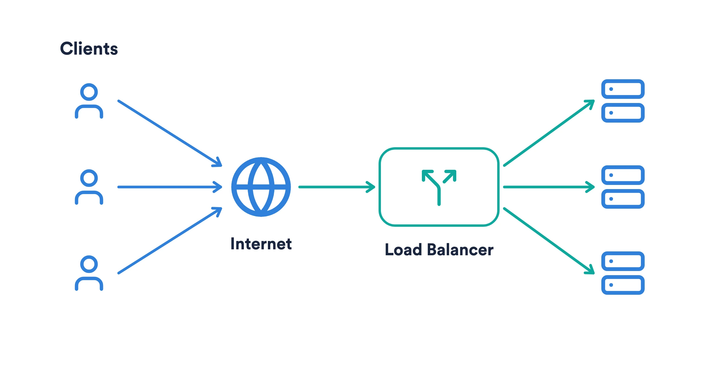
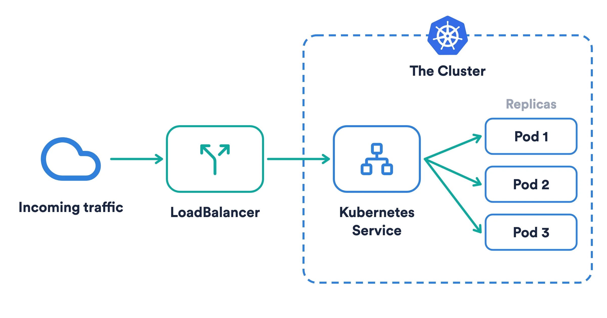
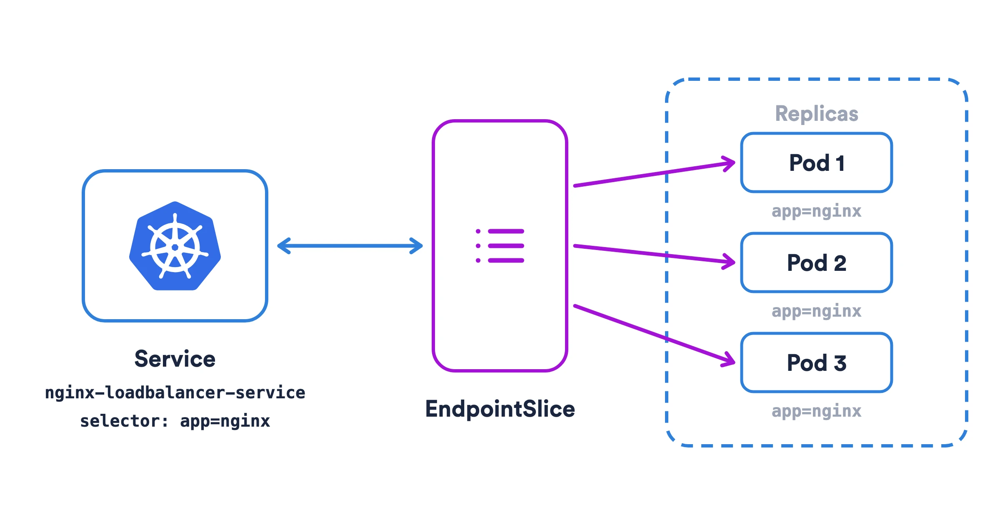
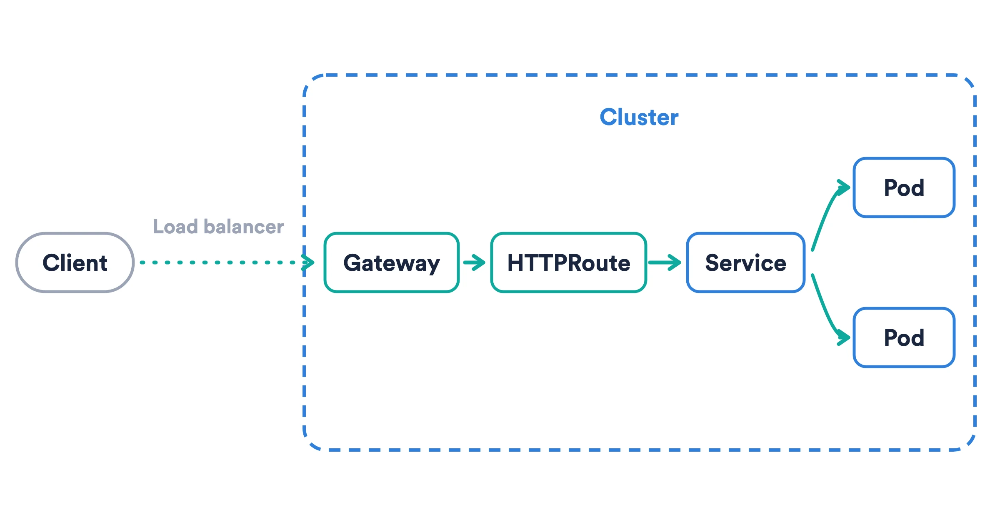

A [pod](/blog/kubernetes-basics/#pods) is the smallest unit Kubernetes runs: one or more containers that share a network namespace. Pods come and go. Higher-level objects such as Deployments, StatefulSets, and DaemonSets create, replace, and delete them to match the state you declare, and each new pod gets a new IP address.

{/* truncate */}

So you can't rely on the IP address of a pod to reach your application. You need a stable address in front of a changing set of pods, and that's what a Kubernetes [Service](https://kubernetes.io/docs/concepts/services-networking/service/) provides. A Service is a single entry point to a set of pods: clients talk to the Service, and it sends each request to one of the pods, without the clients knowing their individual addresses or state.

The main types of Services are:

- **ClusterIP**: a stable IP address inside the cluster. It's the default type.
- **NodePort**: a port open on every node of the cluster, on top of a ClusterIP.
- **LoadBalancer**: an external load balancer in front of the Service, on top of a NodePort and a ClusterIP.

This guide covers the LoadBalancer type: how it works, an example with three replicas of NGINX, and when to put the Gateway API in front of your Services instead.

## How a Load Balancer Works and Why It Is Useful

Imagine your website gets thousands of requests per minute. A single server can't keep up with that demand, and your users get slow responses and unpredictable downtime.



A load balancer distributes the requests across a pool of servers, so no single server is overloaded.

In Kubernetes, a Service of type `LoadBalancer` exposes a set of pods outside the cluster through a load balancer of the underlying infrastructure, for example the load balancer of your cloud provider. The load balancer sends the incoming traffic to the Service, and the Service distributes it across the pods, for better performance and high availability.



The load balancer gives your application a single, stable external address that doesn't change when pods are replaced.

Kubernetes doesn't create the load balancer itself. When you create a Service with `type: LoadBalancer`, a controller of your infrastructure detects it and provisions the load balancer, outside the cluster. Managed clusters include one, such as the [AWS Load Balancer Controller](https://docs.aws.amazon.com/eks/latest/userguide/aws-load-balancer-controller.html) on EKS. On bare metal you need a project like [MetalLB](https://metallb.io/), and on a local cluster like minikube, a command like `minikube tunnel`.

This is a Service of type `LoadBalancer` for pods with the label `app: nginx`:

```yaml title="service.yaml"
apiVersion: v1
kind: Service
metadata:
  name: nginx-loadbalancer-service
spec:
  selector:
    app: nginx
  type: LoadBalancer
  ports:
  - name: http
    port: 80
    targetPort: 80
    protocol: TCP
```

`port` is the port the Service exposes, and `targetPort` is the port the containers listen on: 80 for NGINX.

Until the load balancer is ready, the `EXTERNAL-IP` column shows `<pending>`. If it stays that way, nothing in your cluster provisions load balancers:

```bash
kubectl get service nginx-loadbalancer-service
```

```
NAME                         TYPE           CLUSTER-IP       EXTERNAL-IP   PORT(S)        AGE
nginx-loadbalancer-service   LoadBalancer   10.101.132.164   <pending>     80:30998/TCP   16m
```

The `80:30998` in the `PORT(S)` column shows the NodePort (30998) that Kubernetes opens on every node for the load balancer to send traffic to.

## Understanding the Kubernetes Load Balancer Service With an Example

Suppose you want to run NGINX with three replicas. This Deployment creates three pods, each one running NGINX, with the label `app: nginx`:

```yaml title="deployment.yaml"
apiVersion: apps/v1
kind: Deployment
metadata:
  name: nginx-loadbalancer-deployment
spec:
  replicas: 3
  selector:
    matchLabels:
      app: nginx
  template:
    metadata:
      labels:
        app: nginx
    spec:
      containers:
      - name: nginx
        image: nginx:latest
        ports:
        - containerPort: 80
```

Apply the Deployment and the Service from the previous section:

```bash
kubectl apply -f deployment.yaml -f service.yaml
```

The Service uses its selector to find the pods with the matching label. List the three pods with their IP addresses (the [kubectl cheat sheet](/blog/kubectl-cheat-sheet/) covers this and other common commands):

```bash
kubectl get pods --output=wide
```

```
NAME                                             READY   STATUS    RESTARTS   AGE   IP           NODE       NOMINATED NODE   READINESS GATES
nginx-loadbalancer-deployment-544dc8b7c4-bhh5h   1/1     Running   0          58m   172.17.0.6   minikube   <none>           <none>
nginx-loadbalancer-deployment-544dc8b7c4-n25fn   1/1     Running   0          58m   172.17.0.8   minikube   <none>           <none>
nginx-loadbalancer-deployment-544dc8b7c4-wqkn2   1/1     Running   0          58m   172.17.0.7   minikube   <none>           <none>
```

Kubernetes keeps track of the addresses of those pods in [EndpointSlices](https://kubernetes.io/docs/concepts/services-networking/endpoint-slices/), objects that list the IP addresses and ports a Service sends its traffic to. Kubernetes updates them automatically when pods that match the selector are added, replaced, or removed.



Describe the Service to see the addresses it sends traffic to:

```bash
kubectl describe service nginx-loadbalancer-service
```

```
Name:                     nginx-loadbalancer-service
Namespace:                default
Labels:                   <none>
Annotations:              <none>
Selector:                 app=nginx
Type:                     LoadBalancer
IP Family Policy:         SingleStack
IP Families:              IPv4
IP:                       10.101.132.164
Port:                     http  80/TCP
TargetPort:               80/TCP
NodePort:                 http  30998/TCP
Endpoints:                172.17.0.6:80,172.17.0.7:80,172.17.0.8:80
Session Affinity:         None
External Traffic Policy:  Cluster
Events:                   <none>
```

The EndpointSlices of a Service carry the label `kubernetes.io/service-name` with the name of the Service:

```bash
kubectl get endpointslices -l kubernetes.io/service-name=nginx-loadbalancer-service
```

```
NAME                               ADDRESSTYPE   PORTS   ENDPOINTS                          AGE
nginx-loadbalancer-service-7x2kq   IPv4          80      172.17.0.6,172.17.0.7,172.17.0.8   58m
```

As pods are replaced, the EndpointSlice changes with them, and the Service keeps sending traffic to the pods that are running.

## Kubernetes Load Balancers and the Gateway API

A Service of type `LoadBalancer` is a good choice when you have a few services to expose. With many services, it has limitations:

- Each Service gets its own load balancer, with its own address and its own cost.
- It works at the connection level: it can't route requests by hostname or URL path.
- Features such as TLS termination depend on the annotations of each cloud provider.

When you expose many services, put the [Gateway API](https://gateway-api.sigs.k8s.io/) in front of them. It's the Kubernetes standard for routing incoming traffic, and the successor of Ingress (the most popular Ingress controller, Ingress NGINX, [has been retired](/blog/ingress-nginx-controller-deprecation-your-migration-guide-to-kubernetes-gateway-api/)). A Gateway receives the traffic, usually through a single load balancer, and HTTPRoutes send each request to a Service by hostname, path, or headers.



The Gateway API provides:

- Routing by hostname and URL path
- Routing by headers and query parameters
- [TLS termination](https://www.f5.com/glossary/ssl-termination), configured the same way on every implementation
- URL rewrites and redirects
- Traffic splitting between versions of a service

The Gateway API needs an implementation installed in your cluster, such as Envoy Gateway, Istio, Cilium, or the one of your cloud provider. Each implementation provides a GatewayClass. For the NGINX example, a Gateway and an HTTPRoute look like this (replace `example` with the GatewayClass of your implementation):

```yaml title="gateway.yaml"
apiVersion: gateway.networking.k8s.io/v1
kind: Gateway
metadata:
  name: web-gateway
spec:
  gatewayClassName: example
  listeners:
  - name: http
    protocol: HTTP
    port: 80
---
apiVersion: gateway.networking.k8s.io/v1
kind: HTTPRoute
metadata:
  name: nginx-route
spec:
  parentRefs:
  - name: web-gateway
  hostnames:
  - nginx.example.com
  rules:
  - matches:
    - path:
        type: PathPrefix
        value: /nginx
    filters:
    - type: URLRewrite
      urlRewrite:
        path:
          type: ReplacePrefixMatch
          replacePrefixMatch: /
    backendRefs:
    - name: nginx-loadbalancer-service
      port: 80
```

The HTTPRoute sends the requests for `nginx.example.com/nginx` to the `nginx-loadbalancer-service` Service, without the `/nginx` prefix. With a Gateway in front, the Service doesn't need its own load balancer anymore: change its type to `ClusterIP`, and the Gateway's load balancer serves all your services.

## Conclusion

A Service of type `LoadBalancer` is the simplest way to expose a set of pods outside the cluster: it gives them a stable external address, and it distributes the traffic across them as pods come and go. When you expose many services, put a Gateway in front of them and route each request with an HTTPRoute. The same pattern, one entry point and a route for each environment, gives every developer, pull request, and coding agent its own URL in [application environments on Kubernetes](https://www.okteto.com/kubernetes-application-environments/). To learn more about Kubernetes concepts, read our [Kubernetes Tutorial for Beginners](/blog/kubernetes-basics/).
