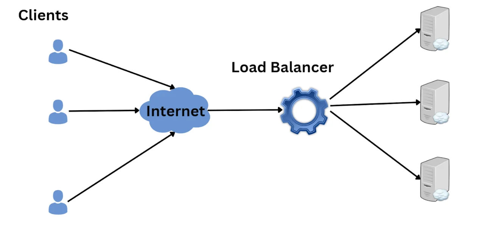
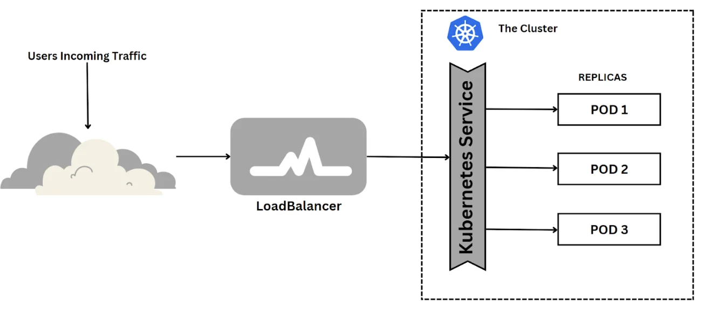
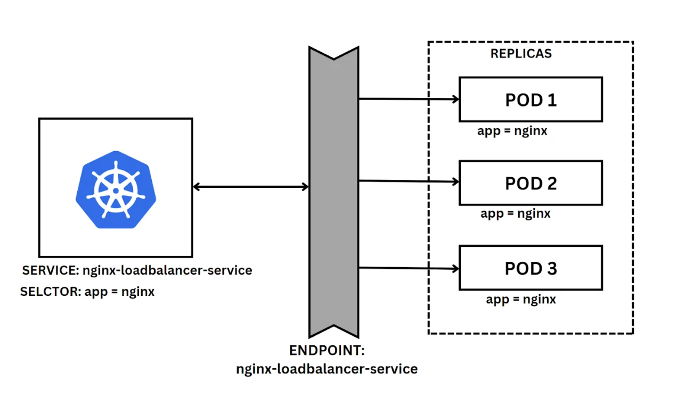
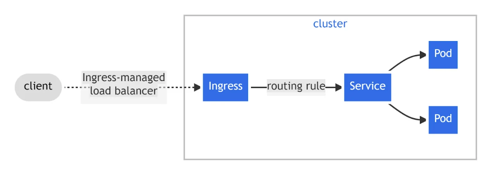

import { CallToAction, Video } from '@site/src/components/blog';

<Video src={"https://cdn.sanity.io/files/6icyfeiq/production/5ef471e2fdf6e5394c6d39e7298081eceaeb9cb5.mp4"} />

A [pod](https://www.okteto.com/blog/kubernetes-basics/#pods) is Kubernetes’ smallest and simplest unit representing a single instance of a running process in a Kubernetes cluster. Pods contain one or more containers. They share the same network namespace to allow containers within the same pod to communicate with each other. However, a pod is updated and deleted based on the desired state defined by higher-level objects such as [Deployments](https://www.okteto.com/blog/beginners-guide-to-kubernetes-deployments/), StatefulSets, DaemonSets, and ReplicationControllers.

{/* truncate */}

When such actions are performed, the pod IP address changes or is removed based on the pod state. You cannot guarantee that this pod IP will exist in the future. Pod IP addresses in Kubernetes are assigned dynamically and can change under different certain circumstances.

Therefore, you need a reliable identifier. This is where the Kubernetes Load Balancer service comes to rescue. This Kubernetes service provide stable Kubernetes endpoints for accessing applications.

It creates everlasting IP addresses for exposing applications both internally and externally. A service acts as a single entry point to a set of pods. This allows clients to communicate with the application without knowing the individual pod IP addresses or their current state.

The major types of [services](https://kubernetes.io/docs/concepts/services-networking/) in Kubernetes are:

- ClusterIP
- NodePort
- LoadBalancer

In this guide, you will learn how to use Kubernetes Load Balancer service to expose applications running in Kubernetes Pods internally and externally.

## How a Load Balancer Works and Why It Is Useful

Imagine your website has thousands of different clients per minute. It is not easy for a single server to keep up with the requests demand. This creates a bad user experience with unpredictable downtimes.



A load balancer helps you distribute the requests to the different servers in the resource pool. This ensures no single server becomes overloaded at any single time.

In Kubernetes, a Load Balancer Service is a crucial component for deploying and managing applications in Kubernetes. It exposes a service externally in the underlying infrastructure (for example, a cloud provider's load balancer).

The Kubernetes Load Balancer Service provides load-balancing abilities for incoming traffic to distribute evenly across multiple pods for better performance and high availability.




A Kubernetes LoadBalancer provides external network access to a set of pods to achieve high availability in a cluster. This creates a single and stable IP address for accessing the application without being affected by the pods' state.

Kubernetes uses the Load Balancer service to automatically create a load balancer in the underlying infrastructure. The infrastructure being used must have the capacity to provision a LoadBalancer. This is common when using cloud providers such as [AWS](https://docs.aws.amazon.com/eks/latest/userguide/aws-load-balancer-controller.html) to provision your applications and route incoming traffic to the pods in a Kubernetes cluster.

Cloud provider uses their own control manager to automatically detect `spec.LoadBalancer`. The Load Balancer is then provisioned within the cluster to load balance incoming traffic across multiple pods.

This can be used alongside large-scale applications, such as e-commerce apps requiring handling many concurrent requests from external users. A Kubernetes Load Balancer Service creates a unique IP address that is accessible by external networks. It then redirects incoming traffic, and its IP address is the only entry to the Kubernetes cluster.

```yaml
apiVersion: v1
kind: Service
metadata:
  name: nginx-loadbalancer
spec:
  selector:
    app: nginx
  type: LoadBalancer
  ports:
  - name: http
    port: 80
    targetPort: 8080
```

If you have defined how to expose the service externally, it will display EXTERNAL-IP as pending:

```
> kubectl get service nginx-loadbalancer
NAME              TYPE           CLUSTER-IP       EXTERNAL-IP   PORT(S)          AGE
nginx-clusterip   LoadBalancer   10.101.132.164   <pending>     80:30998/TCP     16m
```

## Understanding Kubernetes Load Balancer Service With an Example

Suppose you want to create a cluster to run the Nginx server with three instances. You need to create ReplicaSet that has three Pods, each of which runs the Nginx server. Below is a simple deployment you can leverage to get a cluster started:

```yaml
apiVersion: apps/v1
kind: Deployment
metadata:
  name: nginx-loadbalancer-deployment
spec:
  replicas: 3
  selector:
    matchLabels:
      app: nginx
  template:
    metadata:
      labels:
        app: nginx
    spec:
      containers:
      - name: nginx
        image: nginx:latest
        ports:
        - containerPort: 80
```

Now, this deployment requires a service object to expose the application. You can use the previously created Load Balancer service object.

```yaml
apiVersion: v1
kind: Service
metadata:
  name: nginx-loadbalancer-service
spec:
  selector:
    app: nginx
  type: LoadBalancer
  ports:
  - name: http
    port: 80
    targetPort: 8080
    protocol: TCP
```

In this case, the Kubernetes service will use a selector to map the service to the corresponding three pods with matching labels. Nginx will have three pods, run the following [Kubernetes command](https://www.okteto.com/blog/kubernetes-cheat-sheet-must-know-commands-and-examples/) to see them:

```
> kubectl get pods --output=wide
NAME                                             READY   STATUS    RESTARTS   AGE   IP           NODE       NOMINATED NODE   READINESS GATES
nginx-loadbalancer-deployment-544dc8b7c4-bhh5h   1/1     Running   2          58m   172.17.0.6   minikube   <none>           <none>
nginx-loadbalancer-deployment-544dc8b7c4-n25fn   1/1     Running   2          58m   172.17.0.8   minikube   <none>           <none>
nginx-loadbalancer-deployment-544dc8b7c4-wqkn2   1/1     Running   2          58m   172.17.0.7   minikube   <none>           <none>
```


It uses Kubernetes Endpoints as an object to update the IP addresses of each pod. Each service creates its own Endpoint object. Thus, the cluster can automatically track the matching pods' IP addresses accordingly.



You can describe your service and check how Kubernetes Endpoints lists the matching pods:

```
> kubectl describe service nginx-loadbalancer-service
Name:                     nginx-loadbalancer-service
Namespace:                default
Labels:                   <none>
Labels:                   <none>
Annotations:              <none>
Selector:                 app=nginx
Type:                     LoadBalancer
IP Family Policy:         SingleStack
IP Families:              IPv4
IP:                       10.101.132.164
Port:                     http  80/TCP
TargetPort:               80/TCP
NodePort:                 http  30998/TCP
Endpoints:                172.17.0.6:80,172.17.0.7:80,172.17.0.8:80
Session Affinity:         None
External Traffic Policy:  Cluster
Events:                   <none>
```

The Kubernetes Endpoints keep the list of IP addresses up to date for the service to forward its traffic. Endpoints are updated automatically if pods are added, updated, or removed from the service selector. This allows the Service to route network traffic to the correct pods, as the Endpoints can save the address the application need to route to.

Every endpoint that represents the pod network IP and port is defined with the same name as that of the service as follows:

```
> kubectl describe endpoints nginx-loadbalancer-service
Name:         nginx-loadbalancer-service
Namespace:    default
Labels:       <none>
Annotations:  endpoints.kubernetes.io/last-change-trigger-time: 2023-02-02T09:29:12Z
Subsets:
  Addresses:          172.17.0.6,172.17.0.7,172.17.0.8
  NotReadyAddresses:  <none>
  Ports:
    Name  Port  Protocol
    ----  ----  --------
    http  80    TCP

Events:  <none>
```

Endpoints create a stable network identity for a Replicaset of pods. They change dynamically as the pods' state changes to load balance network traffic to a dynamic set of pods in a consistent pattern.

<CallToAction title={"Stay on Top of Kubernetes Best Practices & Trends"} actions={[{"label":"Download the Trend Report","url":"https://www.okteto.com/ebooks/dzone-kubernetes/"}]} />

## Kubernetes Load Balancers and Ingresses

LoadBalancer service type is a good choice when you have a few services to expose. However, with many services, it can be hard to manage. It has limitations such as:

- Limited URL routing
- Cloud provider dependent
- Lacks SSL termination
- It doesn't support URL rewriting and rate limiting.

With an extensive pool of services to load balance, you need to explore other alternatives outside the LoadBalancer Kubernetes service. [Ingress](https://kubernetes.io/docs/concepts/services-networking/ingress/) defines rules for incoming traffic, such as routing based on the URL path and hostname. This allows you to expose multiple services using a LoadBalancer and manage incoming network traffic to your cluster.



Unlike LoadBalancer Kubernetes service, it provides:

- Advanced URL routing,
- URL path-based routing,
- Hostname-based routing,
- [SSL termination](https://www.f5.com/glossary/ssl-termination),
- URL rewriting, and
- Rate limiting.

In the Nginx example, a basic Ingress resource can be defined as follows:

```yaml
apiVersion: networking.k8s.io/v1
kind: Ingress
metadata:
  name: nginx-ingress
  annotations:
    nginx.ingress.kubernetes.io/rewrite-target: /
spec:
  rules:
  - host: nginx.you_url.com
    http:
      paths:
      - path: /nginx
        pathType: Prefix
        backend:
          service:
            name: nginx-loadbalancer-service
            port:
              number: 8080
              name: http
```

This will allow your cluster maps incoming traffic for `nginx.you_url.com/nginx` to the `nginx-loadbalancer-service` service you created using the service resource.

## Conclusion

To sum up, LoadBalancer is a powerful tool that can help you optimize your Kubernetes deployments. It provides several benefits, including load balancing, scalability, security, and ease of use. If you are looking to improve the performance and reliability of your Kubernetes deployments, LoadBalancer is definitely worth considering. If you want to learn more about Kubernetes concepts check out our [Kubernetes Tutorial for Beginners](https://www.okteto.com/blog/kubernetes-basics/)!
