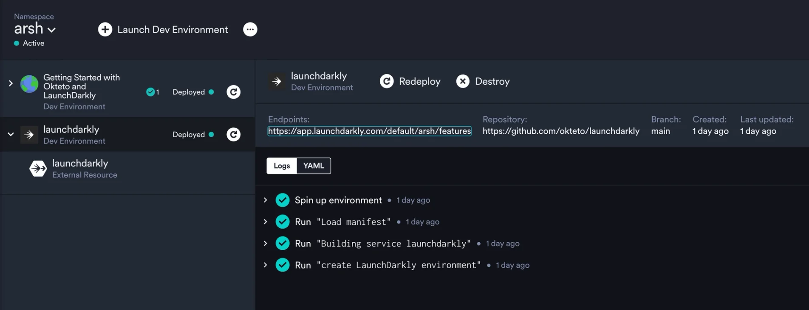
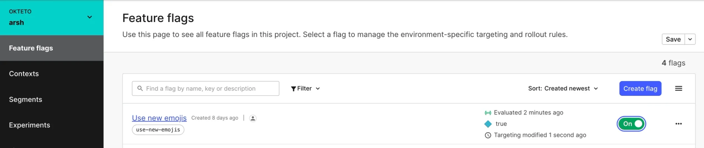

import { CallToAction, Highlight, YouTube } from '@site/src/components/blog';

## What Are Feature Flags

Feature flags allow developers to enable or disable features in an application without deploying a new version. This enables teams to release new features gradually and test them with a subset of users before rolling them out completely. In today's world, feature flagging has become a standard practice in modern software development. [LaunchDarkly](https://launchdarkly.com/) is a popular feature flagging service that allows developers to manage their features and rollouts with ease.

{/* truncate */}

## What Does Okteto Do

Okteto is a platform for modern development experience automation on Kubernetes. One of the features we offer is provisioning and de-provisioning environments that are exactly like production. At Okteto, we've always believed in providing developers with a realistic development environment that's set up instantly and has everything they need for development. Our goal is to give developers the ultimate experience when developing modern applications.

This means that if you use feature flags in production, you should be able to work with them during development as well. As part of this philosophy, we recently launched a new feature to our platform: External Resources. This feature makes working with LaunchDarkly during development a breeze.

## Why Develop Using LaunchDarkly With Okteto

Developers are already using LaunchDarkly's SDK to write code with feature flags. However, a common problem they face is the difficulty of testing these feature flags during development. A major issue is having to manually set up a LaunchDarkly environment with pre-populated flags for every developer who wants to work on the application or test features. This process takes time away from coding and can lead to a poor developer experience. Additionally, there is no easy way to replicate the same feature flags present in the production environment for each developer.

Using LaunchDarkly dashboards as External Resources with Okteto solves both of these problems by:

- Automatically provisioning (and deprovisioning) feature flag dashboards
- Cloning existing environments, which ensures that the LaunchDarkly environment during development is pre-populated with all necessary flags

## How To Use LaunchDarkly Dashboards As External Resources

You can configure a feature flag dashboard in LaunchDarkly to be set up for each developer when they spin up their development environment. This dashboard is already configured to work with the application being developed and requires no configuration from the developer’s side. It has all the flags you want to include from your existing production environments.

<Highlight>

To demonstrate the power of using LaunchDarkly as an External Resource in your development environments, we’ve put together a sample application for you to try out: [https://github.com/okteto/external-resources-launchdarkly](https://github.com/okteto/external-resources-launchdarkly)

</Highlight>

This simple application demonstrates how easy External Resources make working with services that live outside your Kubernetes cluster, a LaunchDarkly dashboard in this case.

The application displays some text with an emoji. If you look at the code, you’ll see we use LaunchDarkly’s SDK to change the text and emoji when the feature flag is enabled. When you deploy the application using Okteto, Okteto not only deploys the app itself but also provisions a feature flag dashboard for you in LaunchDarkly. You can view this right from your Okteto dashboard.

If you visit the endpoint shown for the LaunchDarkly dashboard, you should be able to toggle the “Use new emojis” feature flag on and off. Refreshing your application should show you the replaced text and emoji.

The power of this feature is that developers can work in a running development environment that already has all the feature flags that the application uses without needing to set anything up. They don't have to create a dashboard in LaunchDarkly every time or manually clone all the flags they need from the production environment. Another benefit of External Resources is that, like your dev environments, they're ephemeral. This means that when you destroy your dev environment, the LaunchDarkly dashboard will also be destroyed with it. This makes it easier for platform engineers and team leads to manage resources without having to worry about chasing people around.

## Conclusion

Leveraging feature flags during development with LaunchDarkly and Okteto can help teams release new features gradually and test them with a subset of users before rolling them out completely. By using this combination:

- developers can easily manage feature flags in their development environments
- ensure that their code is working correctly before releasing it to production
- save a lot of time and effort during development by allowing developers to connect to resources that their application depends on without having to set them up locally.

Check out this video demonstrating the benefits you get from using LaunchDarkly dashboards as an External Resource in Okteto:

<YouTube id={"FdD7Tw1ZgXQ"} />

<CallToAction title={"Find this interesting?"} actions={[{"label":"Try out the sample!","url":"https://github.com/okteto/external-resources-launchdarkly"}]} />

For more information about External Resources, check out our [press release post](https://www.okteto.com/blog/okteto-extends-developer-experience-to-all-resources/) announcing the feature or head to the [docs](https://www.okteto.com/docs/cloud/external-resources/)!
