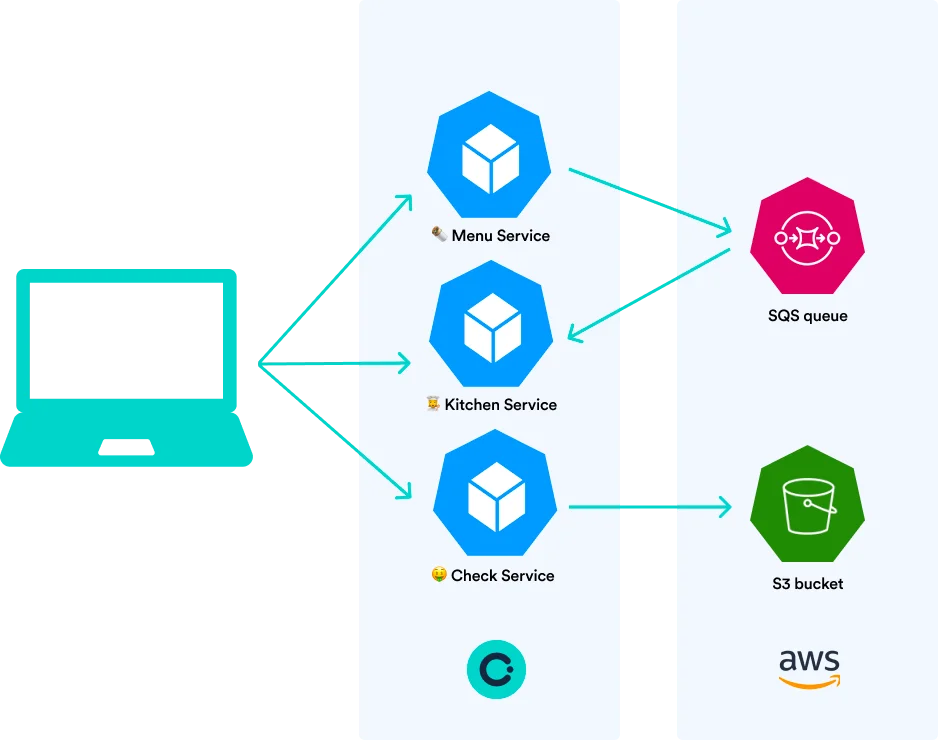
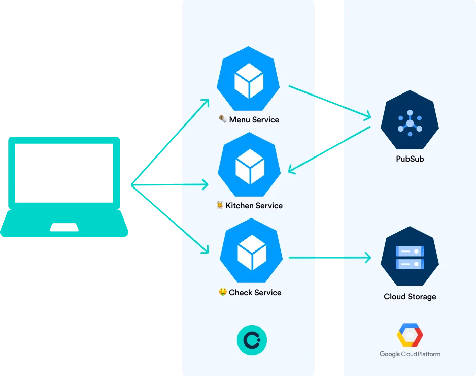
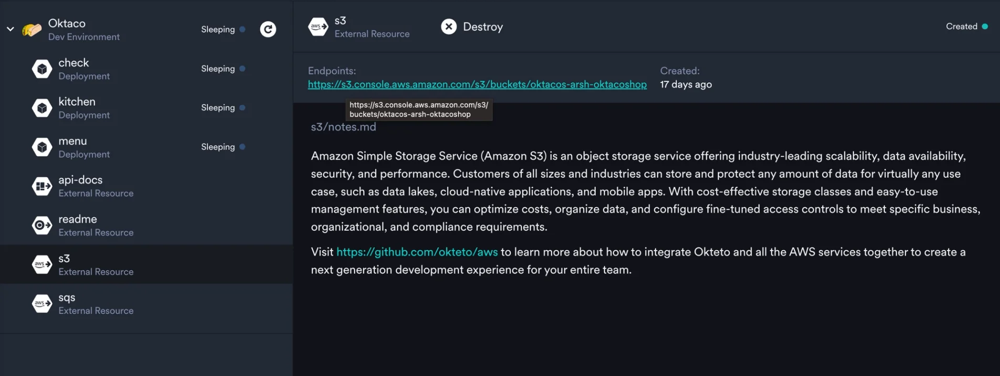

import { Highlight } from '@site/src/components/blog';

## How Modern Applications Use Cloud Resources

It is very common for the cloud-native microservices we code these days to utilize resources deployed on different cloud platforms, be it AWS, GCP, Azure or any other. Some common resources which we see being used in modern applications are:

{/* truncate */}

- Databases services like Amazon RDS, Google Cloud SQL or Azure SQL Database
- Object storage services like Amazon S3, Google Cloud Storage or Azure Blob Storage
- Message queue services like AWS SQS, Google Cloud Pub/Sub or Azure Service Bus

These resources have become such an integral part of the applications we work on that it is impossible to imagine how we can develop and deploy microservices without them. But using these resources complicate things during development because providing access to them for every developement and test environment isn’t an easy task.

## What Does Okteto Do

Okteto is a platform for modern development experience automation. Platform and Development Experience teams define, control, and govern modern development experience and environments. One of the features we offer is provisioning and de-provisioning full stack Kubernetes dev environments that are exactly like production. At Okteto, we've always believed in providing developers with a realistic development environment that’s set up instantly and has everything they need for modern app development.

This means that if your Kubernetes deployed microservices are dependent on resources by any cloud provider, you should be able to work with them during development and testing as well. As part of this philosophy, we recently launched a new feature to our platform: Okteto External Resources. This feature makes working with resources outside of your Kubernetes development cluster a breeze.

<Highlight>

Read our blog annoucing the release of Okteto External Resources [here](https://www.okteto.com/blog/how-platform-teams-can-deliver-a-great-development-experience-for-modern-app-developers/).

</Highlight>

## Why Use Cloud Resources With Okteto During Development

If your microservices use resources from a cloud platform, it makes sense to make these resources available to developers during development as well. However, teams often struggle with implementing this in a way that's efficient and effective. Developers are often forced to manually configure these resources themselves, using makeshift bash scripts or seeking help from the platform team. This not only wastes time, but also creates a bad development experience. Additionally, debugging becomes more difficult when developers are working with multiple cloud providers they may not be experts in.

Okteto's External Resources can help alleviate these issues. Here's how:

- They allow platform engineers to automate a development experience that automatically provisions and de-provisions cloud resources for developers. Developers get Kubernetes development environments with one click, and all the necessary cloud resources are already configured for them.
- They give the platform and DevX team full control over the lifecycle of these resources. This means developers can have their cloud resources automatically deleted whenever they delete their development or preview environment. This makes it easier to manage resources without having to worry about chasing people around.
- They also ensure secure access to these cloud resources, only allowing access for those who need it. This is especially important when working with user data stored in cloud resources needed during development.

## How To Use Cloud Resources As External Resources

To demonstrate how you can use cloud resources as external resources, we have prepared a sample application running on Kubernetes development cluster for you. This app mimics modern applications and highlights the power of External Resources. The application is a restaurant portal consisting of three microservices:

- The menu service for ordering food
- The kitchen service to track order completion
- The cheque service to generate the bill for the order

We have prepared two different versions of this application to show the flexibility external resources offer. One uses resources from AWS: [https://github.com/okteto/external-resources-aws](https://github.com/okteto/external-resources-aws)

and the other uses GCP: [https://github.com/okteto/external-resources-gcp](https://github.com/okteto/external-resources-gcp)

The application uses a message queue and object storage from both cloud providers. Once you launch an environment for the application using Okteto, these cloud services will be deployed for you. You will also see endpoints that you can visit to see these services.

The power of this feature is that developers can work in a running Kubernetes development environment that already has all the cloud resources that the application uses, without needing to set anything up. They don't have to create the message queue or object storage every time. Another benefit of External Resources is that they're ephemeral, just like your Okteto development environments. This means that when you destroy your dev environment, the cloud resources created will also be destroyed with it. This makes it easier for platform engineers and team leads to manage resources without having to worry about chasing people around.

## Conclusion

Being able to use any cloud resource during development with Okteto can help teams work in realistic environemnts Without wasting any time on setting up services and resources or controlling them. By using cloud resources as External Resources in Okteto:

- save a lot of time and effort during development by allowing developers to connect to resources that their application depends on without having to set them up manually each time
- work in an exactly production like modern environment
- be more confident in the code quality and ensure that their application is working correctly before pushing the code

<Highlight>

If you find this interesting and are more curious, you can try out the sample application for yourself and play around with it:

- AWS: [https://github.com/okteto/external-resources-aws](https://github.com/okteto/external-resources-aws)
- GCP: [https://github.com/okteto/external-resources-gcp](https://github.com/okteto/external-resources-gcp)

</Highlight>

For more information about Okteto External Resources, check out:

- our [press release](https://www.okteto.com/blog/okteto-extends-developer-experience-to-all-resources/) announcing the feature
- read the [documentation](https://www.okteto.com/docs/cloud/external-resources/)
