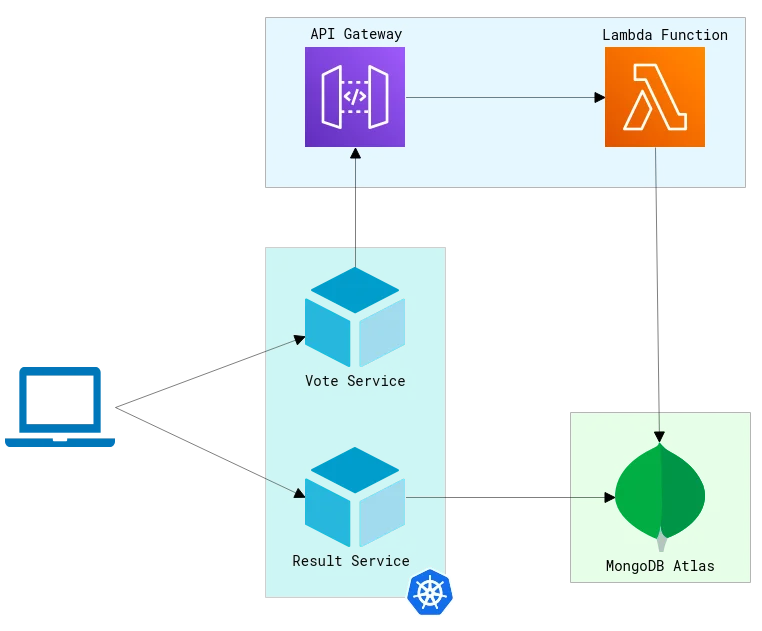
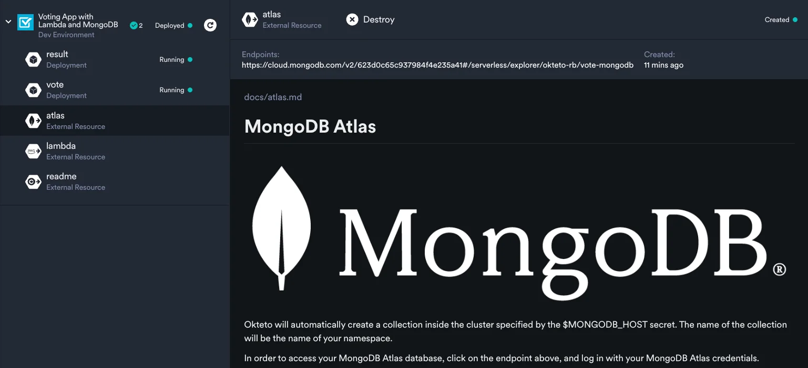

import { Highlight } from '@site/src/components/blog';

## What Is MongoDB Atlas

MongoDB Atlas is a cloud database service that allows teams to deploy and manage MongoDB databases with ease. Its streamlined experience simplifies application building by providing data distribution and mobility across AWS, Azure, and Google Cloud. The service has built-in automation for resource and workload optimization and features like automatic scaling, backup and recovery, and a robust security model, ensuring that data is always safe and available.

{/* truncate */}

Many teams are already using MongoDB Atlas to build modern applications. But the question is if you're using MongoDB in cloud production platforms, why not leverage it during cloud-native app development as well?

## What Does Okteto Do

Okteto is a platform for modern development experience automation. Platform and Development Experience teams define, control, and govern modern development experience and environments. One of the features we offer is provisioning and de-provisioning full stack Kubernetes dev environments that are exactly like production. At Okteto, we've always believed in providing developers with a realistic development environment that's set up instantly and has everything they need for modern app development.

This means that if your microservices are dependent on a cloud database service like MongoDB Atlas, you should be able to work with it during development and testing as well. As part of this philosophy, we recently launched a new feature to our platform: Okteto External Resources. This feature makes working with any resources and cloud service outside of the running Kubernetes development cluster during development a breeze.

<Highlight>

Read our blog announcing the release of Okteto External Resources [here](https://www.okteto.com/blog/how-platform-teams-can-deliver-a-great-development-experience-for-modern-app-developers/).

</Highlight>

## Using MongoDB Atlas With Okteto During Development

If your microservices based application relies on a MongoDB Atlas, it's important to make this service available to developers with their Kubernetes development environment to execute a full production like stack. However, platform and DevX teams often struggle with implementing this in an efficient and effective way. They often end up writing hacky bash scripts for spinning up and down the cloud database service, which developers are then left to make work and debug. With Okteto, microservices deployed in Kubernetes can access MongoDB Atlas as the production cloud service and manage all your data workloads during dev and test. Then the developer experience is extended for offering easier management and better metrics for the data part of your application.

Using MongoDB Atlas with Okteto governed Kubernetes development environments provides even more benefits to the development experience:

- It allows developers to work with realistic production data during development by easily cloning databases. This is difficult to replicate when working locally with a non-cloud-based database.
- It simplifies the management and sharing of databases between developers. With MongoDB Atlas and Okteto, you can easily and securely share access to different databases during development according to your needs.
- It provides full control over the lifecycle of the database during microservice development. This means that if you want to, you can have your MongoDB Atlas database deleted whenever you delete your development or preview environment. This makes it easier to manage resources without having to worry about chasing people around.

## How To Use MongoDB Atlas As an External Resource in Okteto

To demonstrate how you can use MongoDB Atlas databases as external resources, we have prepared a sample cloud-native application for you: [https://github.com/okteto/voting-app-with-external-resources](https://github.com/okteto/voting-app-with-external-resources)

This app mimics modern applications in Kubernetes and highlights the power of Okteto External Resources. The application is a voting portal consisting of three microservices:

- The voting service for casting your vote
- The worker service to process the votes
- The result service to show the final results

The vote services interacts with an API Gateway in AWS to store the data in a MongoDB Atlas database.

Once you spin up a modern environment for the application using Okteto, the Atlas database will be deployed for you. You will also see endpoints that you can visit to see these resources.

<Highlight>

Depending on your needs, you can even configure the newly created database to be pre-populated with sample data that is relevant to your application.

</Highlight>

The power of this feature is that developers can work in a running Kubernetes development environment that already has all the resources that the application uses, without needing to set anything up. They don't have to create the Atlas database or the Lambda function in AWS every time. Another benefit of Okteto External Resources is that they're ephemeral, just like your development environments. This means that when you destroy your dev environment, the resources created will also be destroyed with it.

## Conclusion

Enabling any cloud database like MongoDB Atlas with Okteto during modern development can help platform and DevX teams deliver the best development experience freeing developers from wasting time on services and resources set-up and control. By using MongoDB Atlas as an external resource in Okteto, developers can:

- Work with realistic data in a production-like Kubernetes environment.
- Be more confident in their code and ensure that their application is working correctly before pushing it to production.
- Save time and effort during development by easily connecting to resources that their application depends on without having to set them up manually each time.

<Highlight>

If you find this interesting and are more curious, you can try out the sample application for yourself and play around with it: [https://github.com/okteto/voting-app-with-external-resources](https://github.com/okteto/voting-app-with-external-resources)

</Highlight>

For more information about Okteto External Resources:

- check out our [press release](https://www.okteto.com/blog/okteto-extends-developer-experience-to-all-resources/) announcing the feature
- read the [documentation](https://www.okteto.com/docs/cloud/external-resources/)
