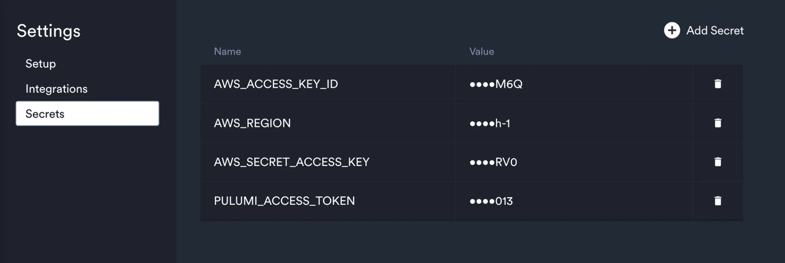
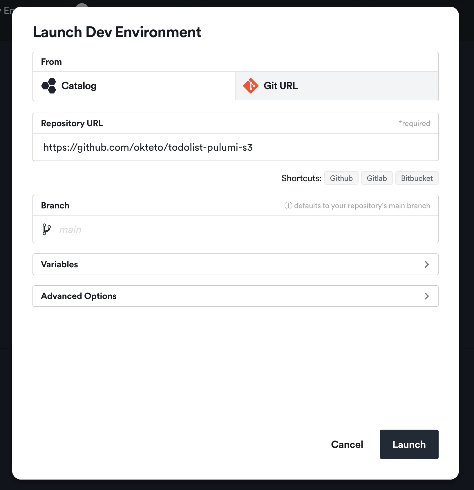
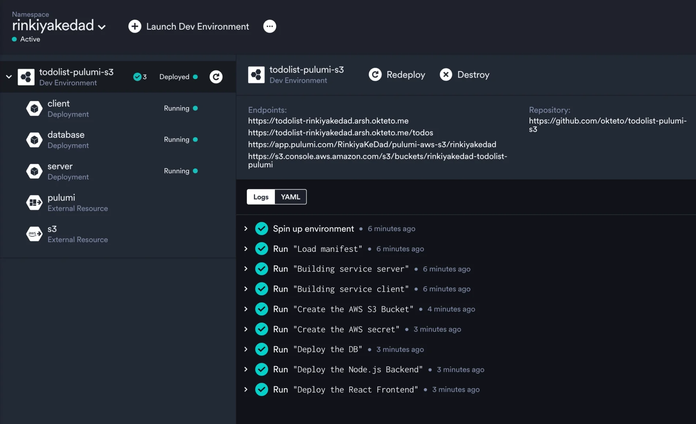

import { CallToAction } from '@site/src/components/blog';

## The Value

It is common in today's landscape to build microservices-based applications that leverage resources like RDS databases, storage buckets, etc from different cloud platforms. Consequently, it becomes imperative to grant developers access to these resources during the development phase. Failing to do so would mean expecting developers to code in an unrealistic environment, which often leads to difficulties and introduces bugs.

{/* truncate */}

However, teams frequently encounter challenges in efficiently and effectively implementing this practice. Developers are often burdened with manually configuring resources themselves, relying on makeshift bash scripts or constantly seeking assistance from the platform team. This not only wastes valuable time, but also creates a subpar development experience, as any dependency on the platform team by developers inevitably leads to delays.

To tackle this challenge, platform engineers should prioritize automating the process. This will empower developers to effortlessly provision self-service environments that also include any cloud resources required by the application. In this article, we will delve into how this can be facilitated effortlessly with the aid of Pulumi and Okteto.

## What is Pulumi?

[Pulumi](https://www.pulumi.com/) is an open source infrastructure as code tool that allows you to define, deploy and manage cloud resources on any cloud provider using popular programming languages like Python, TypeScript, Go, etc. This means that instead of replying on hacky bash scripts or typical configuration manifests, platform engineers can use the languages they are already familiar with to define the infrastructure for developers. Another benefit is that since developers are already familiar with these languages it is easier for them as well to understand and make changes as needed. Pulumi also provides a consistent workflow across different clouds including AWS, Azure, and Google Cloud Platform, making it a versatile tool for any team.

## What is Okteto?

Okteto is a cloud-native automation platform that empowers platform engineers to automate the modern development experience. It enables them to effortlessly create self-serviced, production-like development environments for developers. With Okteto, developers can easily replicate their production environment, including all necessary cloud resources. This eliminates the need for manual resource configuration or reliance on the platform team, as developers can have their own self-service development environments. Our [recent launch](https://www.okteto.com/blog/bring-any-cloud-resource-to-your-modern-app-dev-workflow/) of "[External Resources](https://www.okteto.com/docs/cloud/external-resources/)" introduces a new feature that allows platform engineers to define the provisioning and deprovisioning of any cloud resource as well during development.

## How Pulumi and Okteto Work Together

Pulumi and Okteto seamlessly gel together to automate the creation of development infrastructure for microservices-based applications. Okteto's "External Resources" feature allows you to utilize any existing Pulumi configuration you have for production for creating the development infrastructure as well. Let's explore this further by examining the sample app I have prepared.

<CallToAction title={"See Sample App"} actions={[{"label":"GitHub","url":"https://github.com/okteto/todolist-pulumi-s3"}]} />

If you check out the app, you'll see that it's a todo list app with a backup feature. When you hit the "Save" button, all your current todos get saved in an S3 bucket.

Before diving into the code, to make this app work, you have to define the following [Okteto Secrets](https://www.okteto.com/docs/cloud/secrets/) on your dashboard:



The first three are for Pulumi to communicate with your AWS account and create resources. The last one is the [Pulumi access token](https://www.pulumi.com/docs/pulumi-cloud/access-management/access-tokens/) needed to create the stack and communicate with Pulumi cloud.

If you take a look at the code, you'll see that the Pulumi configuration for creating the S3 bucket is in the `pulumi-aws-s3` folder, specifically in the `index.ts` file. I personally used TypeScript to write the code, but the cool thing about Pulumi is that it supports multiple languages, so feel free to use whichever language you're comfortable with!

```typescript
// index.ts

import * as pulumi from "@pulumi/pulumi";
import * as aws from "@pulumi/aws";

// Define Pulumi config variables
const config = new pulumi.Config();
const bucketName = config.require("bucketName"); // You can set this in your Pulumi config

// Create an AWS S3 bucket
const todosBucket = new aws.s3.Bucket("todos_bucket", {
    bucket: bucketName,
    forceDestroy: true,
});

// Export the bucket name for reference
export const bucketNameOutput = todosBucket.id;
```

Here, we have a crucial requirement: the "bucketName" needs to be passed in via config values. Remember this, as it will become relevant later on. Now, let's dive into our Okteto Manifest and explore further!

When using Okteto, all the configuration for your development environment is stored in a single file called okteto.yaml. A typical okteto.yaml has three sections:

- build: This part tells how to build images for different services in your application.
- deploy: Here, you specify how Okteto deploys your application to set up your development environment.
- dev: This section has the configuration for development containers for each of your microservices.

We won't dive into all the details of the entire Okteto manifest for this application in this blog. Instead, let's focus only on the Pulumi relevant sections. If you want to learn more about how the Okteto manifest for this application was written, you can check out this other blog.

If you check out the first command in the deploy section, you'll see that's where all the magic happens for automating the creation of the bucket with Pulumi:

```yaml
# okteto.yaml

...
- name: Create the AWS S3 Bucket
    command: |
      set -e
      cd pulumi-aws-s3
      resourceName="${OKTETO_NAMESPACE}-todolist-pulumi"
      
      pulumi stack init "${OKTETO_NAMESPACE}"
      yarn install
      pulumi config set bucketName $resourceName
      pulumi up --yes

      # create the URL for the Pulumi Dashboard
      pulumi_about_json=$(pulumi about --json)
      fully_qualified_name=$(echo "$pulumi_about_json" | grep -o '"fullyQualifiedName": "[^"]*' | awk -F'": "' '{print $2}')
      stack_url="https://app.pulumi.com/$fully_qualified_name"
      
      s3Dashboard="https://s3.console.aws.amazon.com/s3/buckets/${resourceName}"

      # make the values available to the following steps and the dashboard
      {
        echo "OKTETO_EXTERNAL_S3_ENDPOINTS_BUCKET_URL=$s3Dashboard"
        echo "OKTETO_EXTERNAL_PULUMI_ENDPOINTS_STACK_URL=$stack_url"
        echo "S3_BUCKET_NAME=$resourceName"
      } >> "$OKTETO_ENV"
...
```

The script is pretty straightforward to understand. All we need to do is navigate to the folder containing our Pulumi configuration and execute the commands as usual to create the resources. One useful trick here is leveraging the `${OKTETO_NAMESPACE}` variable. It allows us to generate a unique name for the stack we create part of each each development environment. This variable is automatically populated by Okteto with the name of the current namespace where the developer deploys the application.

After that, we generate the URL for the stack on the Pulumi cloud dashboard using some clever bash techniques. Another important point to note is that once all the commands are executed, we export the bucket name, S3 dashboard, and Pulumi dashboard URL to the `${OKTETO_ENV}` variable. This special variable allows us to reference the exported values in subsequent commands and set up external resources. If you're interested in learning more about configuring External Resources with Okteto, please refer to our [documentation](https://www.okteto.com/docs/cloud/external-resources/).

If you look at the commands after this step, you’ll see that we proceed by creating a secret using AWS credentials. This will allow our application code to establish communication with the newly created bucket and deploy the microservices component of our application. Make sure to also review the `destroy` section in the code, which functions similarly to `deploy`, but is specifically responsible for deleting the bucket and associated stack when a developer is terminating their development environment. This step is crucial in ensuring that no unused buckets are [left behind](https://www.okteto.com/blog/slash-your-kubernetes-costs-during-development/).

## Seeing It In Action

Once you have prepared your Okteto manifest and added the AWS credentials and Pulumi access token as Secrets in your Okteto dashboard, you are ready to deploy the application. It is worth noting that as Platform Engineers, Okteto also offers the option of setting these Secrets at a cluster level, eliminating the need for each developer to log into any cloud provider console. When it comes to deploying the application, you can make it available by preconfiguring it as part of the [Catalog](https://www.okteto.com/docs/administration/catalog/) of applications. For the purpose of this tutorial, we can simply use the [Git URL](https://www.okteto.com/docs/cloud/deploy-from-git/) option:



Notice how Okteto seamlessly handles the execution of Pulumi configuration and the creation of the S3 bucket. But that's not all, the developer dashboard also provides direct access to the S3 console and Pulumi stack dashboard. Furthermore, I've incorporated [READMEs](https://github.com/okteto/todolist-pulumi-s3/blob/main/okteto.yaml#L57) to provide information about the bucket and Pulumi dashboard. You can add any product-specific configuration here. This approach greatly simplifies onboarding for new developers by consolidating all the necessary information in one convenient location.



## Conclusion

And that's it! This is how simple it is to use Pulumi with Okteto to automate the creation of any infrastructure your application requires and provide developers with the necessary access during development. It is crucial to provide developers with a realistic environment that automates the creation and deletion of application resources, and both Pulumi and Okteto excel at this task. With Pulumi, you can write the infrastructure configuration in languages familiar to both platform engineers and developers. Meanwhile, Okteto takes care of automating the creation and deletion of this infrastructure. If you found this article interesting, why not try deploying the [sample app](https://github.com/okteto/todolist-pulumi-s3) and witness it in action for yourself? Get started by signing up for a [free trial](https://www.okteto.com/free-trial/) of Okteto!
