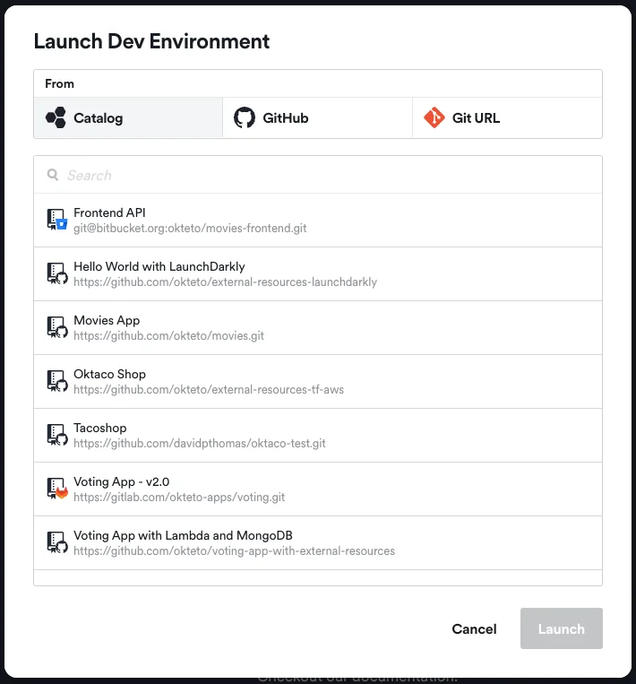
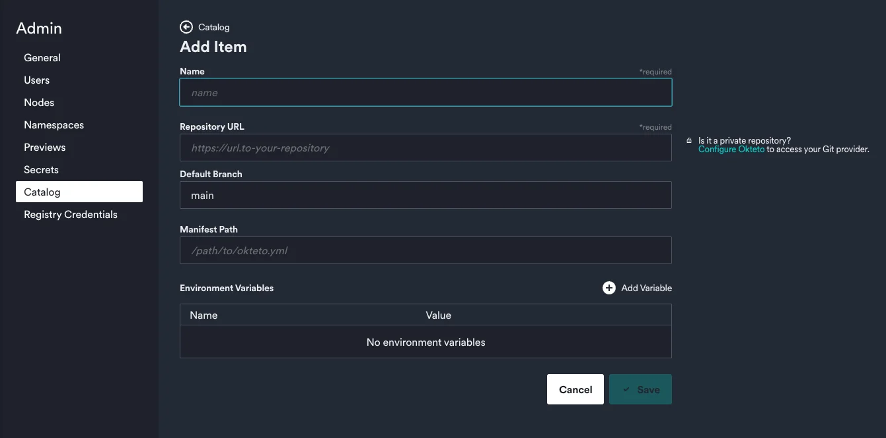

Platform engineering is all about creating "golden paths" for developers. These golden paths are streamlined processes that allow developers to focus on building products and creating value, without getting bogged down by complexities of configuring their development environments. In this article, we'll explore how Okteto Catalog can enable platform engineers to simplify this process for developers and help them get started faster.

{/* truncate */}

## What Is the Catalog

The Catalog feature empowers platform engineers to pre-configure a list of applications directly from the intuitive Okteto web interface. As a result, developers gain effortless access to their applications with all the correct configuration settings already applied when they launch a development environment from the Catalog. This convenient functionality streamlines the process of accessing different versions with different configurations of applications, eliminating the need for developers to manually configure anything themselves. It helps platform engineers have better governance over the environments, making sure all applications are configured in a consistent and secure way that is compliant with all your organization's policies.

## The Value It Provides

By pre-configuring Catalog entries, platform engineers can toil from the lives of developers so they can focus on what they do best: writing code and creating value! This saves time that would have traditionally been wasted by developers in trying to get the correct configuration and apply it to their environments.

Consider the following example: your application relies on a RDS database that needs to be provisioned on your cloud provider or you maybe you need to get a secret from Vault. While Okteto will automate the actual processes (checkout our [External Resources](https://www.okteto.com/blog/bring-any-cloud-resource-to-your-modern-app-dev-workflow/) feature!), it still requires the appropriate credentials. Depending on individual credentials or multiple ad hoc user roles created by developers isn't ideal, as they might lack the correct permissions or be forgotten, posing security risks. As a platform engineer, you've established a single role with the necessary permissions to be used for all development needs of this particular application. The Catalog feature allows you to add these credentials as environment variables, ensuring they are included in each developer's environment in a secure way while keeping the scope specific to the app launched from the Catalog.

Just like this example, there are multiple use cases where you need standardization and governance over the configuration that developers use as part of their environments. And the Catalog shines in these scenarios: it seamlessly facilitates governance and standardization for development environments. It allows you, as the platform admins, to predefine the options available to the developers on your team, so that they don't need to spend time configuring their environment settings manually, and can instead focus on creating value.

By empowering platform engineers with granular control over the developer experience, Okteto enables teams to accelerate their development process and deliver high-quality software with utmost efficiency. Benefits for Platform Engineers:

- Pre-configure catalog entries to reduce developers' time to get to the coding phase.
- Eliminate concerns about misconfigurations by developers when launching development environments.
- Provides greater control over the developement experience by ensuring that the deployment environment is pre-configured as intended.
- Ensures standardization across all developer environments by making sure every environment is running with the same configuration as intended.
- Facilitates easy governance of applications and versions by allowing to specify the exact branch for each catalog entry with the correct environment variables already set.

## How It Works

Configuring the Catalog to display different applications with different configurations based on your requirements is a straightforward process. By accessing the admin interface in the settings, you only need to complete a few fields to add a Catalog entry.

- Name (required) - Provide a unique and recognizable name for your catalog entry. If you're adding multiple versions of the same application, specify the configuration differences.
- Repository URL (required) - Include the URL to your Git repository.
- [Default Branch](https://www.okteto.com/docs/administration/catalog/#define-a-default-branch) - Specify the default branch to be used if no specific branch is mentioned when launching a development environment. Developers will still have the option to change this when launching a development environment from the Catalog.
- [Manifest Path](https://www.okteto.com/docs/administration/catalog/#define-a-manifest-path) - Specify the relative path to your Okteto manifest file if it's not located in the root of your repository. This is particularly useful if you have multiple Okteto manifests for your application based on your use case.
- [Environment Variables](https://www.okteto.com/docs/administration/catalog/#add-environment-variables) - Configure the necessary environment variables for your application using key-value pairs. Each environment variable will be injected into the containers running the application and any development containers launched by developers.

That's it! This is all the configuration required to add an entry to the Okteto Catalog. Once you're finished, save the changes and the developers on your team will see the newly added entry when launching a development environment from the Catalog.

## Summary

In conclusion, the Okteto Catalog is a feature that empowers both platform engineers and developers, facilitating pre-configurations of applications and significantly reducing the time to dive into coding. It ensures standardization across all developer environments, eradicates worries about misconfigurations, and removes friction from the development process. With a seamless workflow, Okteto enables teams to accelerate their development process and deliver quality software efficiently.

We highly encourage you to explore this feature out youself. Why not take advantage of our free trial and see firsthand how the Catalog can simplify your development processes? [Sign up for our free trial](https://www.okteto.com/free-trial/) today and let Okteto take care of the rest. Happy coding!
