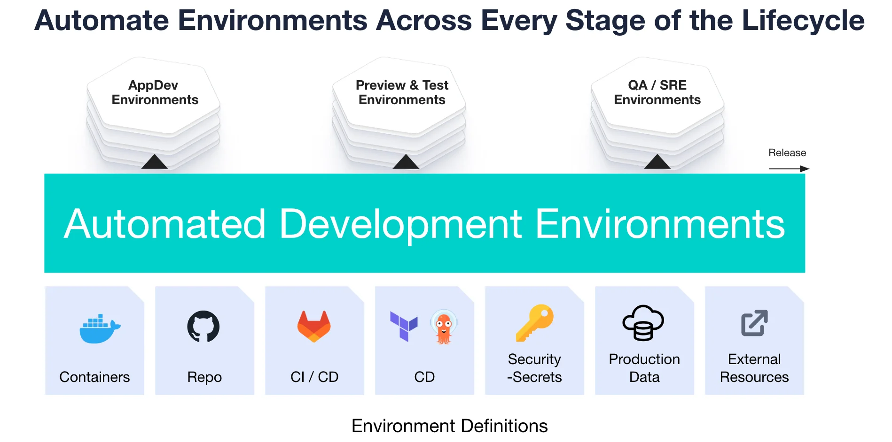
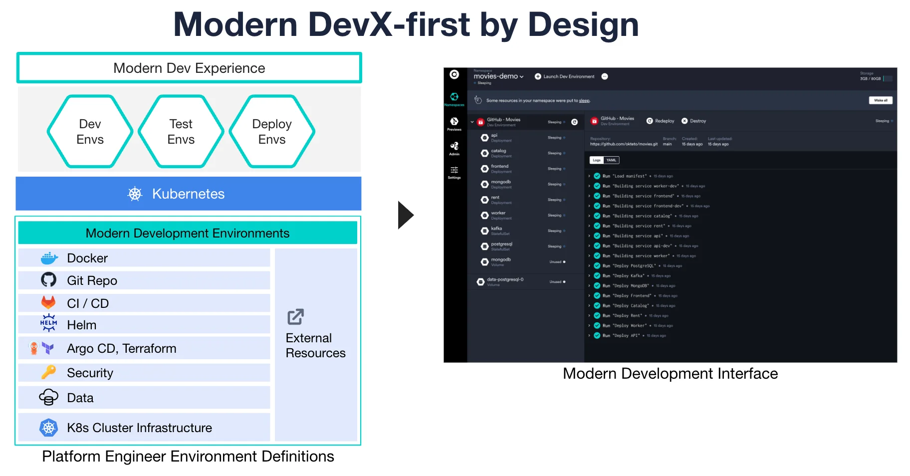
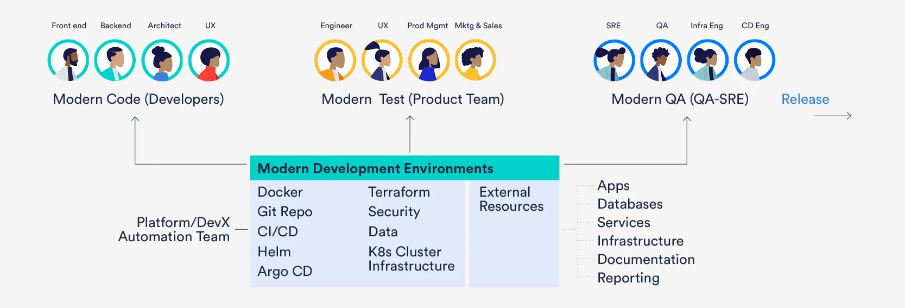

import { CallToAction, Video, YouTube } from '@site/src/components/blog';

<Video src={"https://cdn.sanity.io/files/6icyfeiq/production/31422695f66a635fbb2e593678540b64d3a4f115.mp4"} />

*Before automating environments for the ultimate modern development experience, platform providers (builders) need a vision and game plan. This guide aims to streamline the process of improving the velocity of development in your organization by building a better DevEx.*

{/* truncate */}

## What is development velocity?

Development velocity is the time it takes to complete building, testing, and releasing modern software products ready for customer usage. A product can be an entire cloud-native application, a new microservice feature, or a fix to a defect. The ability to maintain a continuous creative process and stream of high quality apps is the desired state of velocity for most software engineering teams.

Development velocity is a desired state and result of experiencing a continuous, high quality stream of creative value for the benefit of customers.  It is measured across the development lifecycle including developers, test execution, QA, and running live in production.

It is also often confused with developer velocity. Developer velocity refers to an individual developer's time to build, test, and release their specific work, whereas development velocity encompasses the broader efforts and output of the entire team. Increased developer velocity is often a byproduct of an organization's enhanced development velocity.

Developer Experience (DevX or DevEx) has a key role to play in development velocity. If you're able to provide a great experience for your developers by giving them the right tools to be productive, an increase in development velocity is sure to follow.

## What are the current roadblocks to development velocity?

There is an automation gap between cloud-native development and production environments that significantly slows down creativity and development of [microservices apps](https://www.okteto.com/blog/how-developers-can-seamlessly-collaborate-when-building-microservice-apps/), and consequently, is getting in the way of delivering innovation into the hands of real customers. There is no tooling made available that removes the friction and toil associated with creating cloud-native applications.

The most exciting project in platform engineering today is the automation of a modern development experience. The experience designs a new abstraction interface and modern development stages for developers to automate the execution of cloud-native environments that are production-like. This [self-service development experience](https://www.adaptavist.com/blog/why-self-service-is-key-to-your-developer-experience) is a critical foundation for speeding up the creativity and delivery of microservice applications, from development-to-production.

Development experience automation is the process of "productizing" a modern abstraction interface as the design centerpiece for unifying, executing, and governing cloud-native environments.

<CallToAction title={"Ready to scope your cloud native DevX automation project?"} actions={[{"label":"5 step guide","url":"https://www.okteto.com/ebooks/5-steps-to-scoping-your-cloud-native-devx-automation-project/"}]} />

## How to automate developer experience (DevX) and increase creativity?

Cloud architects and production teams are deploying cloud-native infrastructure platforms like [Kubernetes](https://thenewstack.io/streamline-platform-engineering-with-kubernetes/) to improve on-demand service delivery, scalability, and the quality of service.  Now, platform teams are designing environments to mirror production environments and shift left the ability to preview, test and qualify features and microservices to development.

However, development teams must now reduce friction, shorten execution time, lower the complexity of [modern app development](https://www.okteto.com/blog/bring-any-cloud-resource-to-your-modern-app-dev-workflow/) and testing, and close the gaps between development and production environments. Using local platforms, DevOps pipelines, and scripted provisioning have lead to increased friction, development toil, and reduced velocity and confidence.

> "The ultimate goal is to create joyful development teams that can increase innovation for their customers."

### Designing a self-service DevEx

The opportunity to automate environments in a self-service manner from dev-to-prod is now a reality. This is due to the new levels of abstraction and runtime architecture alignment resulting from the [growing usage of containers](https://www.datadoghq.com/container-report/), microservices, Kubernetes, and cloud-native infrastructure tools and automation.

Platform engineers can design a new interface that provides a self-service, end-to-end developer experience and an environment execution architecture that is more unified, automated, and governed than previous versions of local, siloed environments.

Using a self-service modern interface frees both platform engineers and developers from the need to build and maintain custom automation software, which makes more time available for automating developer experiences.

## How taking a DevX first Approach enables Development Velocity

Automating the [end-to-end provisioning](https://www.okteto.com/blog/automate-provisioning-any-dev-resource-on-any-cloud-provider-with-pulumi-and-okteto/) and de-provisioning lifecycle is just one aspect of achieving a modern DevX. You need to adopt an approach that focuses on bridging the gaps between developer creativity, application delivery, and full-stack application configuration administration. This design approach aims to standardize the user experience by using unified, intuitive, and automated concepts, functions, and lifecycle-specific workflows.  The goal is to make the need for  development environment administration totally automated and transparent.

With an automation platform, development-to-production environments can be managed without burdening developers, testers, and delivery engineering teams. By standardizing and modernizing the development experience, the interface and platform adoption increase the visibility, trust, and control of configured development-to-production environments for the entire development team. This allows "The Developers (i.e., the Consumers)" and "The [Platform Engineers](https://www.okteto.com/blog/platform-engineering-devops/) (i.e., the Providers)" to focus on increasing creativity, confidence, and collaboration.  [The result](https://www.okteto.com/blog/platform-engineering-benefits/) is increased development velocity and shipping modern apps.

## How to plan for the DevX Consumer and DevX Provider

**DevEx Consumers (Users)**

DevEx consumers (users) include application and container developers, test and QA engineers, extended product team members, staging and SRE engineers, and production engineers. They all require environments for development, delivery, and production. Consumers also include automation software / tools that require runtime environment deployments via APIs. For example, provisioning environments enabled with every pull request (PR) for test automation.

**DevEx Providers**

DevEx providers are the platform/devX engineering teams that design and implement platform automation to deliver execution environments that provide the next modern development experience across every stage of the modern lifecycle. These providers are responsible for both provisioning environments to their entire development and deployment team and engineering the next modern experience platform.

## Summary

This playbook is a valuable tool for platform and DevX engineers and architects who are aiming to close gaps that slow down progress towards achieving a higher velocity in the development-to-production modern lifecycle. If you're looking to dive even deeper into the topic, check out this panel discussion:

<YouTube id={"7Fty6qwhdtk"} />

This exciting [platform engineering practice](https://www.okteto.com/blog/platform-engineering-roadmap/) has the potential to reach a new level of development usability, ease-of-work environment, and environment automation for an entire modern, cloud-native experience. The guide highlights the need for:

- Creating a New Level of Abstraction (The Missing DevX Interface).  This presents an opportunity to automate environments with a modern development experience from development-to-production.
- Taking a DevX-First Approach. Automating environments with the next modern development experience involves more than automating the end-to-end execution environment lifecycle.
- Planning for both Development Experience Consumers (Users) and Providers.  The “provider" of environments are the platform engineers.  DevX consumers are the internal customers.

> *The ultimate platform engineering vision is a joyful development team continuously innovating for their team and customers.*

## To learn more, get these playbooks:

<CallToAction title={"A quickstart guide to scoping your cloud native development experience automation project"} actions={[{"label":"Download Guide","url":"https://www.okteto.com/ebooks/5-steps-to-scoping-your-cloud-native-devx-automation-project/"}]} />

<CallToAction title={"Templates to kickstart your DevX project, creating requirements and measuring results"} actions={[{"label":"Download Workbook","url":"https://www.okteto.com/ebooks/workbook-devx-projects/"}]} />
