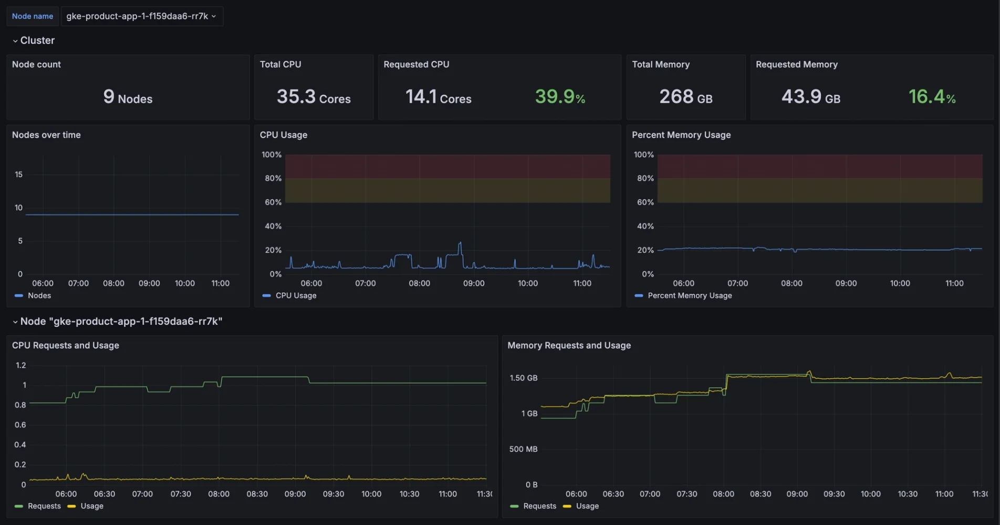
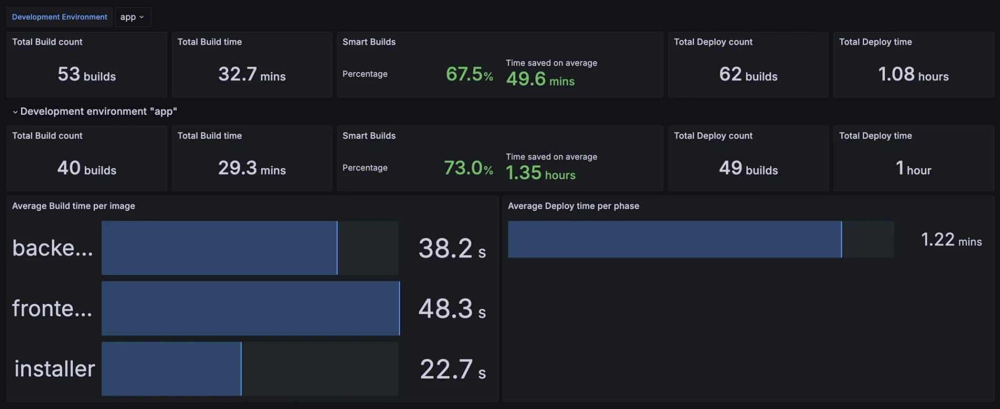

Platform Teams can’t succeed in improving the DevX unless they have clear metrics that help them understand the outcome of their initiatives. To help platform engineers achieve that, we’re very excited to launch Okteto’s latest feature: Insights.

{/* truncate */}

## The Need For Metrics

Metrics are critical fuel for any platform team. Usage data enables teams to measure how developers are using the platform, what parts are loved, and what needs attention and improvements. More importantly, this data helps determine the platform team’s overall success in improving the DevX and ensures that the platform continues to evolve in ways that truly benefit its users. With this goal in mind, we launched Okteto Insights to help provide visibility to platform teams adopting Okteto as their development platform.

## What Is Okteto Insights?

Okteto generates a lot of data from developers using the platform, covering product usage, behavior data like developer activity, and performance metrics such as infrastructure utilization and platform operations.

Admin users can access this data through Okteto Insights via Prometheus Endpoints, enabling Okteto administrators to programmatically retrieve and analyze it. Subsequently, this data can be leveraged to create insightful dashboards using Grafana or similar tools to visualize platform usage patterns.

## What Do These Metrics Tell?

Okteto Insights sheds light on various crucial aspects of the Okteto platform. The metrics provide a comprehensive view of:

- The load and demand on pods and nodes, helping the platform team decide whether to scale the development infrastructure up or down.
- Developer usage patterns, which are key indicators of the degree of platform adoption.
- Utilization of preview environments, showing how often features are tested before full deployment.
- Trends in build and deployment times, which can highlight changes in application over time and the need for optimizations to speed up development cycles.

These insights can collectively guide strategic decisions which help the platform team improve the overall development experience with Okteto.

## Try it out

If you want to understand the impact and utility your developers are getting out of Okteto, you should definitely try Okteto Insights out. You can read the [complete feature documentation here](https://www.okteto.com/docs/admin/okteto-insights/).

Start measuring and maximizing the success of your platform today!
