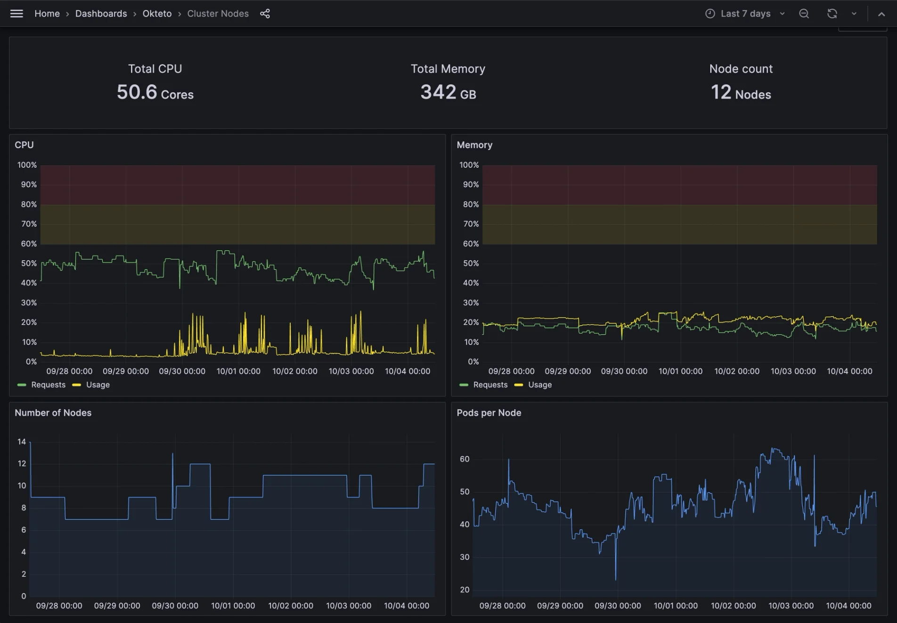
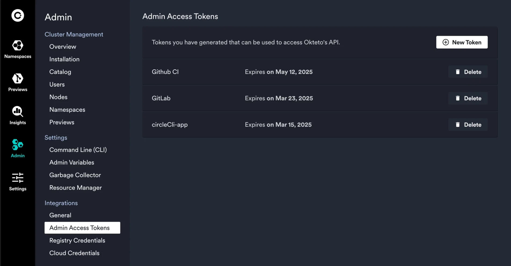

import { CallToAction } from '@site/src/components/blog';

## Okteto highlights 2024

At Okteto, our core focus this past year was on building features that directly solve critical challenges faced by platform engineering teams. We split our efforts into four main categories; enhance developer productivity, simplify cloud native development and Kubernetes workflows, improve security practices, and help organizations optimize their cloud resources. Below, we highlight some of the key innovations we’ve delivered and the actual impact they have for our customers.

{/* truncate */}

### Smarter Resource Management and Data

We introduced [Okteto Insights](https://www.okteto.com/docs/admin/okteto-insights/) and the [Resource Manager](https://www.okteto.com/docs/admin/resource-manager/) to give platform teams visibility into their resource usage. These tools enable infrastructure optimization and help reduce unnecessary cloud costs by fine-tuning the resources allocated to your Kubernetes workloads.

Okteto Insights includes dashboards to visualize product usage and behavior data such as developer usage, as well as infrastructure utilization and performance data like infrastructure and platform activities. Okteto's Resource Manager is designed to optimize CPU and memory resource requests for your Kubernetes workloads on Okteto. By analyzing the actual utilization of resources in real-time, the Resource Manager adjusts the resource requests for your pods automatically, ensuring they are appropriately configured without the need for manual intervention.

With better insights into usage and metrics, cloud-native teams can make informed decisions that lower infrastructure costs and optimize performance, ensuring that resources are allocated efficiently and effectively.

### Accelerating Quality with Okteto Test

[Okteto Test](https://www.okteto.com/docs/testing/) was designed to seamlessly integrate testing into your development workflow on the Okteto platform. Whether you're running unit tests or end-to-end (E2E) tests, Okteto Test ensures an efficient testing experience before and after making a pull request. This ensures that code is tested in real-world conditions, reducing the likelihood of bugs and improving the overall quality of applications before they go live.

Okteto Test helps teams ship high-quality code faster. This reduces time spent on debugging and minimizes the risk of production issues, which translates into a better developer experience and faster time to market.

### Expanding Access Through Google Marketplace

By launching Okteto on the [Google Marketplace](https://console.cloud.google.com/marketplace/product/okteto-public/okteto-bring-your-own-cloud?inv=1&invt=AbkoGg), we’ve made it even easier for organizations to discover and adopt Okteto. This provides additional flexibility for large organizations by simplifying procurement processes. Teams can now purchase Okteto through the Google Cloud Marketplace, take advantage of flexible billing terms, and apply existing spend commitments or credits.

We are working on adding Okteto to AWS Marketplace in early 2025. If this is something you are interested in, [please reach out](https://www.okteto.com/contact/)!

### Enhanced Security and Control

Security is a priority for our customers. With [Admin Access tokens](https://www.okteto.com/docs/admin/dashboard/#admin-access-tokens), we’ve enabled teams to manage access to their Okteto clusters more securely and efficiently. This feature allows granular control over who can interact with resources, making it easier for platform teams to enforce security best practices.

We introduced updates to our [Registry Credentials](https://www.okteto.com/docs/admin/registry-credentials/), [Cloud Credentials](https://www.okteto.com/docs/admin/cloud-credentials/), and we will be making environments rootless by default in upcoming months. We also introduced [air-gapped installation](https://www.okteto.com/docs/self-hosted/manage/air-gapped/) for organizations that require a fully isolated network environment. This feature ensures that Okteto can be installed and operated without requiring direct internet access, providing an extra layer of security for customers with strict compliance or regulatory needs.

By improving credentials management and enhancing security protocols, Okteto gives security-conscious teams peace of mind that their environments are secure, helping them focus on development without worrying about breaches or unauthorized access.

### Simplifying Cloud Native Development: Amazon EKS and OpenShift Integration

We built [Amazon (EKS) installation guides](https://www.okteto.com/docs/get-started/install/amazon-eks/), made product improvements around installation, error messaging, support bundling and added [OpenShift support](https://www.okteto.com/docs/get-started/install/openshift/) to simplify the setup of cloud native development environments. Customers can now get up and running faster on platforms they already use, reducing setup time and operational overhead. This means teams can spend less time configuring environments and more time building the applications that drive business value.

### Pushing forward with Platform Engineering teams in 2025

As we look to the future, Okteto remains dedicated to helping platform engineering teams overcome their biggest challenges. From simplifying complexity of managing CI to enhancing teams ability to debug in real-time across distributed, cloud-native environments, we’re here to help platform and development teams remove friction in their workflows.

**Ready to tackle some of your platform challenges?** [We’d love to chat](https://www.okteto.com/get-demo/)!

<CallToAction title={"We’d love to chat about your team’s objectives for 2025 and see if Okteto can help."} actions={[{"label":"Let's chat","url":"https://www.okteto.com/get-demo/"}]} />
