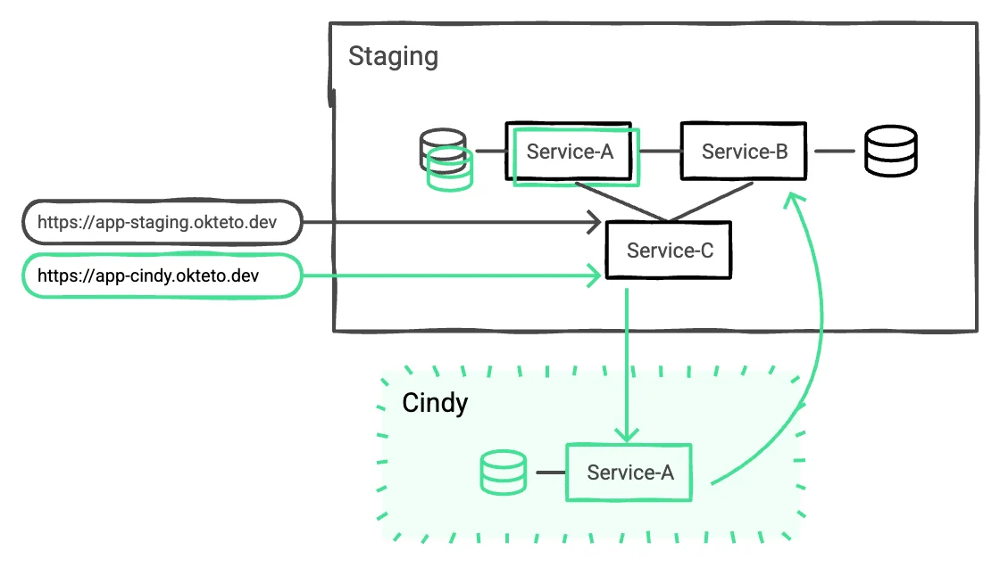

import { CallToAction } from '@site/src/components/blog';

Let’s be honest: development environments haven’t kept up with how modern teams are building software.

{/* truncate */}

You’re either stuck spinning up a full application stack locally every time you want to test something, or dealing with shared environments that break the moment someone else merges their half-working code. Neither approach scales well. Neither option is built for how fast you want your team to move.

Meanwhile, AI is speeding up the development loop. Teams are growing. Infra budgets are shrinking. Expectations are higher than ever. But somehow… your dev environment is still the bottleneck?

It’s time for a better way.

## Yesterday’s Approach: Where Most Teams Have Started

Traditional development environments usually follow one of these two models:

### Local Development

Spinning up services on your laptop used to work, until your app needed 20 microservices, a message queue, two databases, and a bunch of cloud-specific configs. Now you’re juggling Docker Compose files and spending hours replicating production just to fix a bug.

### Shared Environments

Everyone works in the same long-lived environment. These are easy to spin up, but delicate in use. One wrong push, and the whole team is debugging someone else’s mess. Testing is hit-or-miss. You never know what state you're in, and to top it off, they are likely [costing your team more in productivity and dollars](https://www.okteto.com/blog/shared-environments-cost-millions/) than you realize.

These environments can get teams started, but they don't scale well.

## Today’s Standard: Full Ephemeral Environments

Most modern teams moving to Kubernetes or Cloud Native workflows adopt a [**fully isolated dev environment per engineer**](https://www.okteto.com/kubernetes-development-environments/). These environments are powerful. They’re realistic. And they let each developer move independently.

But as your team grows, keep an eye on how your environment strategy scales:

- Are boot times getting longer as your app complexity grows?
- Are you seeing infra costs rise with every new engineer?
- Are clusters starting to feel overloaded during peak dev cycles?

These are common signals that it's time to evaluate and design how you're managing environments *at scale*.

Full environments are essential for modern teams. And Okteto makes it easy to create and manage these environments, making them a great default starting point for most teams.

## The Next Step For Scale: Ephemeral + Divert

As teams grow and mature, they start looking for smarter ways to optimize their setup without sacrificing speed, flexibility or quality.

That’s where Divert comes in.

[Divert is an Okteto feature](https://www.okteto.com/docs/tutorials/divert/) that lets you spin up just the services you're working on, while connecting them to shared, long-running services like databases, queues, or backend APIs.

With Divert:

- Teams operate with a standardized, shared environment model with all production-like configs and policies
- As a dev, you only run the microservices you’re actively working on
- Traffic to shared services is seamlessly routed between both environments
- End-to-end testing still works with no mocks or patchwork
- The experience is transparent to developers, just like working in a full environment

This approach unlocks a flexible model:

- You keep the realism and independence of full ephemeral environments
- You reduce costs and boot times by sharing what doesn’t change as frequently
- You enable faster collaboration without duplicating infrastructure

## When to Use Divert vs. Full Environments

Choosing between full environments and Divert isn’t just about features, it’s about understanding where your team sits on the environment maturity curve. The needs of your team today, require a different environment from two years ago and will be something else two years down the road. That’s why having a flexible strategy is critical for modern teams.

- Full environments are simpler to adopt and work great for small teams, smaller applications and specific use cases
- Divert is more efficient at scale, but requires deeper knowledge of how services and data interact.

## Final Thoughts

There’s no one-size-fits-all in dev environments.

You need full environments for some workflows, and shared resources for others. Okteto gives you both with the flexibility to evolve as your team and architecture scale.

Start with full environments. Layer in Divert for optimized resource sharing and infra usage. This is the recipe to scale with confidence.

<CallToAction title={"Okteto helps platform teams and developers move fast without sacrificing control. Ready to give it a spin?"} actions={[{"label":"Book a demo","url":"https://www.okteto.com/get-demo/"}]} />
