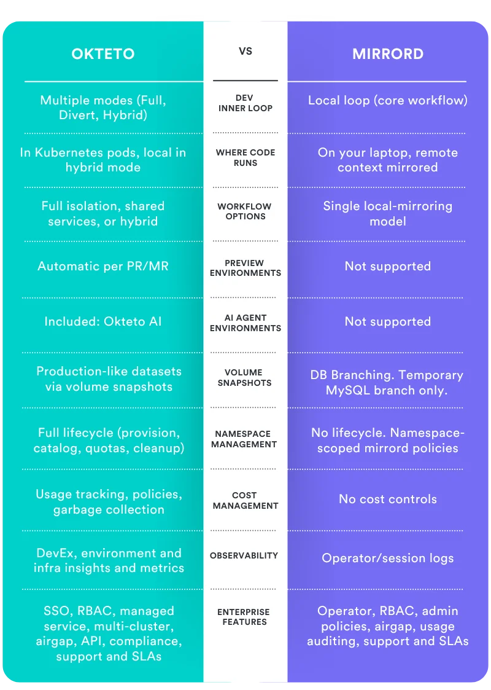

import { BlogButton } from '@site/src/components/blog';

When evaluating Kubernetes development solutions, platform teams face a critical choice: invest in a tool that solves one problem well, or a platform that meets your needs today and supports your development environment vision as you scale. If you're researching mirrord by MetalBear and Okteto, you're likely focused on solving the same core challenge: giving developers faster feedback loops without sacrificing environment realism.

{/* truncate */}

Both solutions address this need, but one is built for individual developer speed while the other is designed for organizational velocity.

## Understanding the Shared Goal

Modern application development has moved far beyond simple monoliths. Your applications are now code plus configuration, runtime, network policies, and countless dependencies across microservices. Developers can't gain real confidence that their changes work by running unit tests alone. They need access to realistic environments that reflect production complexity.

This is where solutions like Okteto and mirrord come in. Both recognize that the traditional "code locally, pray it works in CI" workflow creates bottlenecks, bugs, and frustration. Both offer ways to speed up the inner development loop while connecting to shared services.

## How mirrord Works

mirrord is designed to give individual developers a fast feedback loop by allowing them to run their code locally while connecting to services running in a remote Kubernetes cluster. When you use mirrord, your application process runs on your local machine, but mirrord creates an abstraction layer that intercepts network calls, environment variables, and file system access, routing them to or from the remote cluster as needed.

This approach lets developers iterate quickly on their code without needing to build containers, push images, or wait for deployments. You write code, save the file, and see results almost immediately, all while your service behaves as if it's connected to your staging or development environment.

The focus is squarely on developer velocity for that inner development loop: the cycle of writing code and iterating.

## How Okteto Works

Okteto takes a different architectural approach. Instead of running your code locally with an abstraction layer, Okteto runs your development process directly in Kubernetes, in actual pods within your cluster. When you develop with Okteto, you're working in the same runtime environment where your code will eventually run in production.

Okteto's flexibility comes from recognizing that different teams and different scenarios need different approaches. Your payments team testing a critical transaction flow doesn't need the same environment as your front-end team building a new dashboard. A developer fixing a bug in one service doesn't need the same setup as a platform engineer validating infrastructure changes across 50 microservices. Okteto adapts to match what each team actually needs, whether that's a single service connected to shared dependencies, a full environment replica, or something in between.

Beyond the development experience, Okteto provides the infrastructure for your entire development lifecycle: on-demand image builds, namespace management, preview environments for pull requests, testing capabilities, observability, and the governance features platform teams need to support hundreds of developers.

## Quick Comparison: What Are the Key Differences?

*The table shows what each solution offers. The rest of this guide explains why those differences matter for your decision.*

## Understanding the Strategic Differences

### Architecture: Where Your Code Actually Runs

Here's a technical distinction that matters: when you use mirrord, your process isn't actually running on Kubernetes. There's an abstraction layer that replicates network calls, secrets, and other cluster behaviors. This works for many scenarios, but it means you're not testing against the actual runtime environment, access controls, and network patterns your code will face in production.

With Okteto, your development process runs in actual Kubernetes pods within your cluster. Same access management, same network policies, same runtime constraints. This matters more as your applications grow in complexity and your organization's compliance and security requirements mature.

### Scope: Individual Speed vs. Organizational Velocity

Now that you understand how each solution works, the strategic question becomes: what do you actually need?

mirrord is a focused tool built to solve one part of the development lifecycle exceptionally well: enabling individual developers to get fast feedback by running code locally while connecting to a remote Kubernetes environment.

Okteto is a complete platform built with the understanding that fast feedback loops are essential, but they're just the starting point. Building great developer experience for your organization means thinking beyond individual speed to organizational velocity. A platform handles your full development lifecycle: building images, running tests, generating preview environments, managing access and costs, and providing the visibility platform teams need to support hundreds of developers efficiently.

## The Day One and Day Two Story

Both Okteto and mirrord excel at day one. You can start with a single service, connect it to a shared environment, and immediately give developers that fast feedback loop everyone wants.

The difference emerges after that initial win, when your team's needs expand:

**Months 1-3**: A few developers are using the new workflow. Fast feedback is delivering value. Success stories are spreading.

**Months 6-12**: More teams want in. You've gone from 10 to 40 to 100 developers. New questions surface: How do we manage access to shared environments? What's this costing us? Can we build images on-demand instead of depending on CI? How do developers run tests before opening a PR? What about preview environments for code review?

**Year 2+**: You have multiple teams with completely different needs. The front-end team just needs API access. The payments team needs three specific microservices. The platform team needs to test changes across 50+ services. Your AI team needs environments to run and test hundreds of agents in parallel.

This is where the platform approach proves its value.

## What an Environment Platform Actually Provides

When we talk about Okteto as a platform, here's what that means in practice:

### Multiple Development Models, One Solution

Not every team in your organization will work the same way. Some teams need full environment deployments. Others work better with a single service connected to shared dependencies. Some need hybrid approaches depending on what they're building that day.

Okteto supports all three models:

- **Divert mode**: Run a single service with your changes while routing traffic from a shared environment (similar to mirrord's approach)
- **Full deployments**: Spin up complete environment replicas when you need true end-to-end validation
- **Hybrid**: Mix local and remote services based on what makes sense for your workflow

You don't have to choose one model and force every team to adapt. Different teams can use different approaches, and individual developers can switch between them based on their current task.

### Supporting The Full Development Lifecycle

Fast feedback on code changes is table stakes. But your developers also need:

**Build infrastructure**: Build container images on-demand without depending on CI pipelines or running Docker Desktop locally. This becomes crucial as your team scales and build times impact everyone's velocity.

**Testing capabilities**: Run integration tests, end-to-end tests, and validation against realistic data before your code reaches CI. Catch issues earlier in the cycle.

**Preview environments**: Automatically generate shareable environments for every pull request. Your reviewers can see changes in action, not just read code diffs.

**Namespace management**: Control who can access what, how long environments live, and how resources are allocated across teams. This isn't glamorous, but it's essential at scale.

**Observability and insights**: Understand how your team actually works. Which microservices are build bottlenecks? How are teams using environments? Where are the friction points? This visibility helps you continuously improve your developer experience.

**Cost and resource management**: Know what you're spending and where. Set policies for automatic cleanup and scale resources based on actual usage patterns.

**Enterprise readiness**: SSO, audit logs, compliance controls, and the security features that enterprise organizations require.

## Choosing a Development Environment Solution For Your Team

As you evaluate development environment solutions, look beyond the feature comparison chart. Consider where your team will be in 12 months, 24 months. Do you need just faster feedback loops, or complete development infrastructure? Will this solution grow with you, or will you need to migrate again as you scale?

Here's how to think about this decision:

**Choose a focused tool like mirrord if:**

- You have a small team with simple environment needs
- Your development model is straightforward and unlikely to change
- You have other solutions in place for builds, testing, and preview environments
- Your primary concern is individual developer speed, not organizational velocity

**Choose a platform like Okteto if:**

- Your team is growing or you expect significant growth
- You need to support multiple development workflows across different teams
- You're building or scaling a platform engineering function
- You care about realistic Kubernetes environments, not abstraction layers
- You want a solution that handles the entire development lifecycle
- You need enterprise features like governance, observability, and cost management
- You're thinking about developer experience as a long-term investment

## Ready to See the Difference?

If you're building for growth, if you're investing in platform engineering, if you need flexibility to support diverse teams and workflows, Okteto is built for you.

Start with our free tier to see how easy it is to get up and running.

<BlogButton href={"https://bit.ly/4oFX1eC"} variant={"green"} arrow>Start free</BlogButton>

Want to discuss your specific environment strategy? Our team has helped organizations from 20 to 2,000 developers build platforms that actually scale. [Talk to our team →](https://bit.ly/4478H2A)
