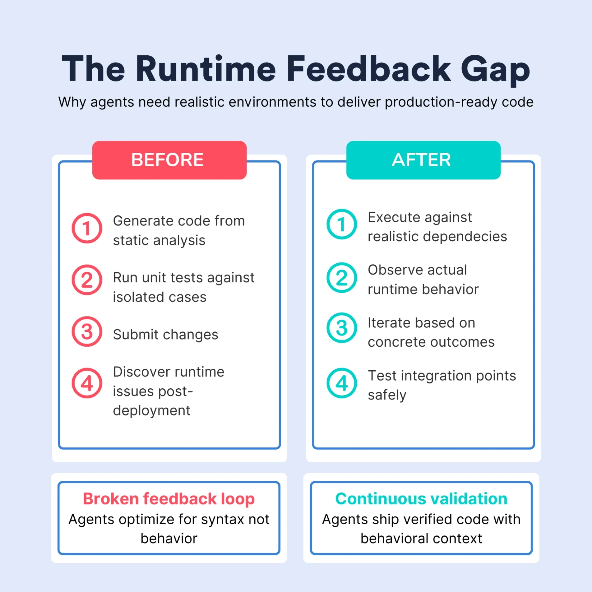

import { CallToAction } from '@site/src/components/blog';

## Why every agent needs runtime feedback

AI agents are quickly becoming first-class contributors to enterprise codebases, generating pull requests and refactoring systems at scale. Yet there's a growing disconnect between what agentic development demos promise and what engineering teams experience in practice.

{/* truncate */}

The gap isn't model intelligence or prompt sophistication. It's something more fundamental: agents lack access to the runtime feedback loops that human developers rely on constantly. Without the ability to run and observe their code in realistic conditions, agents remain stuck optimizing for syntax rather than behavior.

The solution lies in extending on-demand development environments to support agentic workflows. When agents can validate changes against real dependencies and iterate based on runtime behavior, the quality ceiling disappears.

## Why Code-Only Validation Fails Modern Development

Modern applications depend on complex webs of infrastructure, external services, and runtime configurations. A microservice might interact with Kubernetes clusters, Redis caches, PostgreSQL databases, and third-party APIs while respecting network policies that exist only in deployed environments.

Human developers understand this intuitively. We write code, then immediately run it. We spin up environments, test edge cases, and iterate until reality confirms our assumptions.

**Agents can't do this yet.**

Most current workflows stop at code generation and unit testing, leaving agents to guess whether their output works in real systems. They're essentially coding blind, optimizing for patterns rather than measurable outcomes.

## The Runtime Feedback Problem

This constraint creates a recognizable pattern: agents that look impressive in isolated demos but produce brittle code in production. Generated code follows correct patterns and passes basic tests, but subtle integration failures accumulate over time.

The broken feedback loop follows this sequence:

- **Generate** code based on static analysis
- **Unit test** against isolated cases
- **Submit** changes and hope they work
- **Discover** runtime issues post-deployment

Without runtime validation, agents can't distinguish between code that compiles and code that actually works. They can't observe whether database migrations handle production data volumes or whether API changes maintain backward compatibility with existing clients.

Quality plateaus because agents lack the iterative validation that drives improvement in human development workflows.

## Development Environments Close the Loop

The solution requires completing the feedback cycle that produces high-quality software: **generate → run → observe → refine**.

This means providing agents with ephemeral development environments where they can:

- Execute code against realistic dependencies
- Observe actual behavior and performance
- Iterate based on concrete outcomes
- Test integration points safely

**Self-service environment provisioning becomes crucial.** Agents working on different system components need dedicated environments where they can validate changes without coordination overhead or resource conflicts.

This infrastructure transforms agentic development from speculation-driven to validation-driven. It shifts their reality from "does this code look right" to "what happens when this code runs". In turn, agents generate verified code backed by concrete evidence of runtime behavior.

## Enterprise Requirements: Inside the Firewall

Enterprise adoption faces an additional constraint: agents need access to internal services, proprietary data, and real configuration systems (all while maintaining security boundaries).

Most enterprises won't allow agents to modify systems without understanding how changes interact with internal APIs, database schemas, and security policies that exist only within their infrastructure perimeters.

**Cloud development environments solve this by bringing computation inside the enterprise firewall** while maintaining the isolation and on-demand provisioning that agents require. Organizations can run agents within their own Kubernetes clusters, connected to internal services but isolated in ephemeral environments that prevent unintended side effects.

This approach scales with agentic workflow adoption without requiring manual platform team intervention.

<CallToAction title={"See how Okteto's on-demand development environments provide the runtime feedback infrastructure your agents need to deliver production-ready code."} actions={[{"label":"Get a demo","url":"https://www.okteto.com/get-demo"}]} />

## The Future: Every Agent Gets an Environment

Looking ahead, successful agentic development will require infrastructure parity between human and artificial contributors. Just as every developer expects access to development environments, every agent will need similar runtime resources.

This represents a fundamental shift in how we approach code quality:

- **Before:** Static analysis → code review → post-deployment monitoring
- **After:** Continuous runtime validation throughout development

Agents won't just run unit tests or push changes blindly to CI. Agents will spin up environments, run integration tests, measure performance impacts, and iterate based on observed behavior before submitting changes for review.

## Okteto's Competitive Advantage in Agentic Development

Okteto has spent years solving a hard infrastructure problem: how to provision development environments that are fast, accessible, and enterprise-ready.

We built our platform for the reality of modern development. Complex, distributed systems require runtime validation that unit tests simply can't provide. Others in the space treat environments as deployment destinations. We designed them as development infrastructure from the ground up.

This foundation becomes essential as agents take on sophisticated architectural changes that demand real-time feedback. While others are retrofitting deployment tools for development workflows, we're extending proven development infrastructure to support agentic workflows.

## Ready to Enable Agentic Development?

The infrastructure for autonomous development isn't a future problem (it's an opportunity available today). Organizations that extend their development environment strategies to include AI contributors will unlock more sophisticated agentic workflows while maintaining security and quality standards.

[**See how Okteto's on-demand development environments provide the runtime feedback infrastructure your agents need to deliver production-ready code**](https://www.okteto.com/get-demo)**.**

### The Bottom Line

Agentic development won't reach its potential through better models alone. The breakthrough comes when agents gain access to the same runtime feedback loops that human developers rely on for building reliable software.

Development environments (ephemeral, enterprise-ready, and optimized for continuous validation) are the missing infrastructure layer that will unlock this potential. The future belongs to agents that can validate their decisions against runtime reality, not just static analysis.
