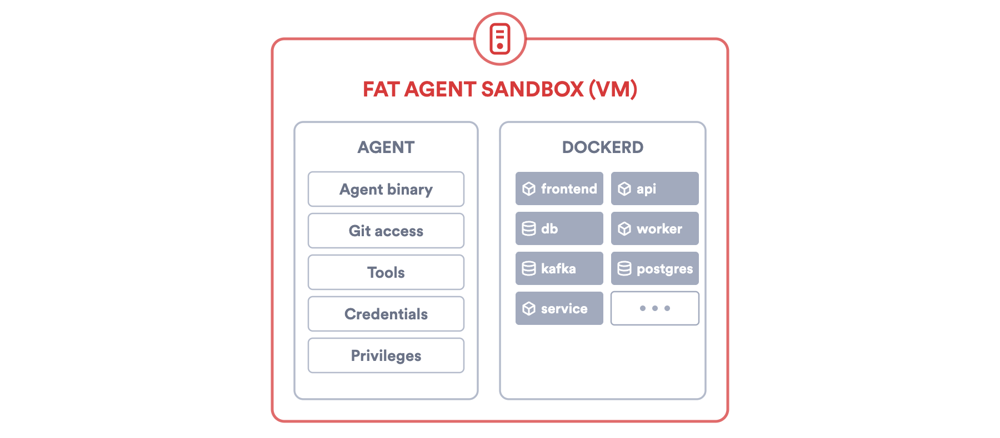
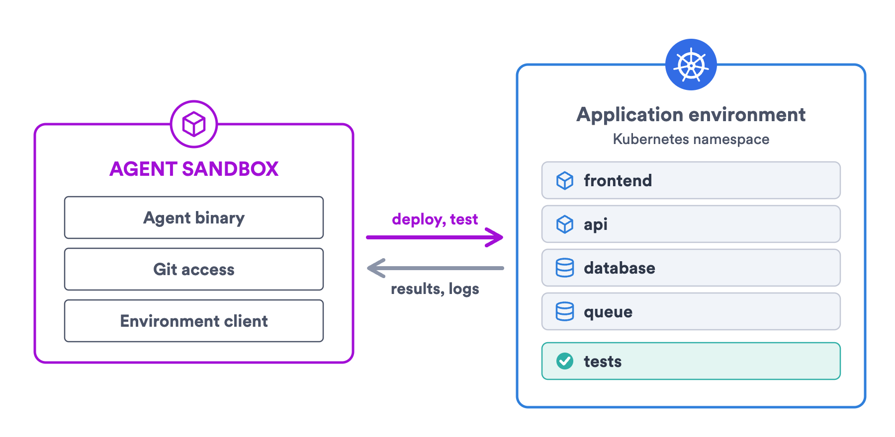
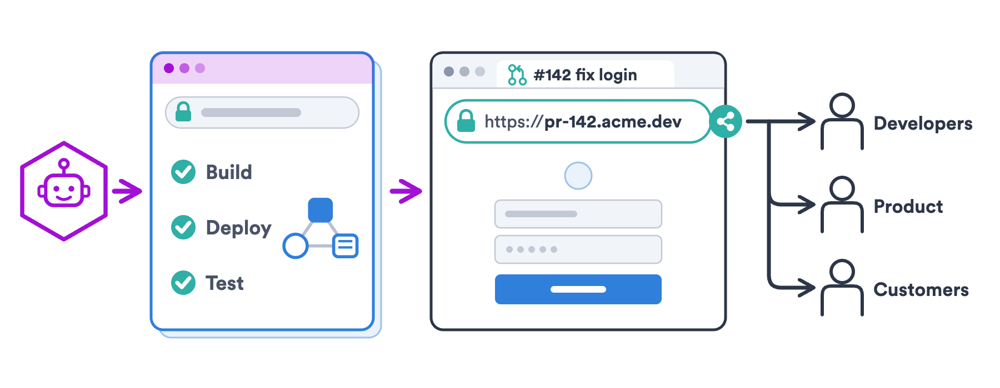

A coding agent that can't run the application it changes is guessing. So a platform team that moves agents from laptops to Kubernetes has two questions to answer, not one: where does the agent run, and where does the application it is changing run?

{/* truncate */}

[Why Run AI Coding Agents on Kubernetes?](https://www.okteto.com/blog/why-run-ai-coding-agents-on-kubernetes/) covered the first question: why a cluster is a better place for agents than a laptop. This post covers the second one, and argues that the two answers should be different places: an agent sandbox for the agent, and an application environment for the application.

## Agent sandbox and application environment

The two concepts tend to get mixed up:

- **The agent sandbox is the agent's runtime.** It holds the agent process, a checkout of the repository, and the tools the agent calls directly. This is where the agent reads code, queries the model, edits files, and opens the pull request. It is also where untrusted input lands: issue text, web pages, and the code the agent itself generates.
- **The application environment is the application, deployed.** Frontend, backend, databases, queues, and the cloud resources they depend on: a complete, isolated instance of the application running the code the agent just wrote. Each agent needs its own, and Kubernetes already has the construct for that: the namespace. Resource names only have to be unique within a namespace, so many copies of the same application can run in one cluster, each with the same Deployment, Service, and PVC names, without colliding. Each agent gets a namespace that is created for its work and deleted when the work is done.

It is common to assume that the application environment runs inside the agent sandbox. It doesn't have to. As in the illustration above, the application environment can live outside the sandbox: the agent deploys it, exercises it through its endpoints and its tests, reads the results, and destroys it. The next two sections cover both options, starting with the application inside the sandbox.

## The fat agent sandbox

The usual first design puts the agent sandbox and the application environment in the same place. Each agent gets a large sandbox, often a virtual machine, with a Docker daemon inside, and the agent runs `docker compose up` to have something to test against. It is the laptop model moved to the cluster, and it is attractive because nothing about the application setup has to change.

The problems show up as soon as there are more than a few agents:

- **Privileges.** Running a container runtime inside the sandbox takes a privileged container, and a privileged container is not an option for untrusted code. That forces you to install a sandboxed runtime such as [Kata Containers](https://katacontainers.io/) or [gVisor](https://gvisor.dev/) in the cluster, which is one more component to maintain.
- **Credentials.** To build and run the application, the sandbox needs registry credentials, cloud keys, and database passwords, next to an agent that reads untrusted content.
- **A black box.** The containers that Docker starts inside the sandbox are not Kubernetes objects, so the cluster sees one pod and nothing inside it. Admission policies don't check their images, the logging and monitoring stack doesn't collect their logs and metrics, and audit events don't record what was deployed. The platform team can't govern or track what runs in there.
- **Drift.** An application started with Docker Compose inside a virtual machine is not the application that runs on Kubernetes, with its ingress rules, service accounts, and network policies. The agent validates its change against something that is not what ships, which limits how well it can check its own work.
- **Size and startup.** The sandbox is sized for the whole application plus the agent, and it pulls the images of every service before the agent can test anything. Most of that capacity sits idle while the agent thinks.
- **One sandbox image per application or stack.** The sandbox has to be able to compile the application and run its unit tests, so each application or stack needs an image with its own toolchains and dependencies. The platform team maintains many images instead of one.

## The decoupled design

The alternative is to split the two. The sandbox keeps only what the agent needs to do its own job:

- The agent process.
- Git access to the repository.
- Kubernetes credentials scoped to the agent's namespace, to deploy and test the application there.

Everything else, the application itself included, moves to the application environment. Builds, deployments, and tests run remotely in the cluster: the agent asks for them and reads the result.

This changes the sandbox in five ways:

- **No privileges.** Without a container runtime inside, the sandbox runs as a standard unprivileged pod.
- **No infrastructure credentials.** The sandbox only needs Kubernetes credentials for one namespace, where it deploys and tests the application. Registry, cloud, and database credentials are resolved in the cluster, at deploy and test time. The agent never sees them.
- **Small, and it starts fast.** The sandbox is a light process. Its image can be pulled in advance, so a new agent doesn't wait for the application to come up before it starts working.
- **The same for every application.** The sandbox doesn't carry the dependencies of any application, so one image, pinned by digest, serves every repository.
- **Replaceable.** The contract between the two layers is "deploy this definition and run these tests". You can change the agent, the model, the sandbox runtime, the orchestrator, or your whole software factory, and they all reuse the same application environment definition. How the application is deployed doesn't change.

## An agent's work from start to finish

With the two layers in place, the work of one agent looks like this:

1. The orchestrator starts a sandbox pod with the repository and the task.
2. The agent edits the code.
3. The agent requests an application environment. A namespace is created, the images are built, and the application is deployed from the definition in the repository.
4. The agent runs the tests against the running services, and reads the results and the logs.
5. The agent repeats steps 2 to 4 until the tests pass.
6. The agent opens a pull request. The reviewer gets the diff and a URL to the running application.
7. When the pull request is merged or closed, the environment is deleted.

Step 6 is the checkpoint between the agent and a person. The agent does the work, and the reviewer verifies it in a running application instead of reading only a diff. That reviewer doesn't have to be a developer: anyone with the URL and access to it can try the change.

## Two isolation boundaries

Decoupling also separates two kinds of risk that the fat agent sandbox mixes:

- **The code the agent runs directly**, such as shell commands, scripts, and package installs, runs in the agent sandbox. In the decoupled design that sandbox has no container runtime, no privileges, and no infrastructure credentials, so it can be a standard unprivileged container with a short-lived, scoped token and a NetworkPolicy that limits egress to the repository, the model endpoint, and the Kubernetes API.
- **The application the agent modified** runs in its own namespace as ordinary Kubernetes workloads, under the controls the cluster already applies: RBAC scoped to the namespace, quotas, network policies, admission policies, and Pod Security Standards.

## Fat agent sandbox and decoupled design side by side

|  | Fat agent sandbox | Agent sandbox and application environment |
| --- | --- | --- |
| **Privileges** | Privileged container, inside a sandboxed runtime that the cluster has to add | Unprivileged pod; a sandboxed runtime is optional |
| **Credentials** | Registry, cloud, and database credentials inside the sandbox | A scoped token in the sandbox; the rest is injected at deploy and test time |
| **Visibility** | The application is a black box for the cluster | Ordinary Kubernetes workloads, under the cluster's policies, logging, and monitoring |
| **Fidelity** | The application runs differently from how it is deployed | The application runs on Kubernetes from its real definition |
| **Size and startup** | Sized for the whole application | A light process with an image pulled in advance |
| **Sandbox images** | One per application or stack | One for every application |
| **Review** | A diff | A diff and a running application |

## Two layers, kept independent

Agents, models, and the tools that orchestrate them change every few months. How your application is built, deployed, and tested shouldn't have to change with them.

Keep the agent sandbox small and replaceable, and keep the application environment as a layer of its own: defined in the repository, running in your cluster, and shared by developers, CI, and agents. That separation is what lets the sandbox stay small and unprivileged, and what makes any agent platform easy to adopt today and easy to replace tomorrow.
