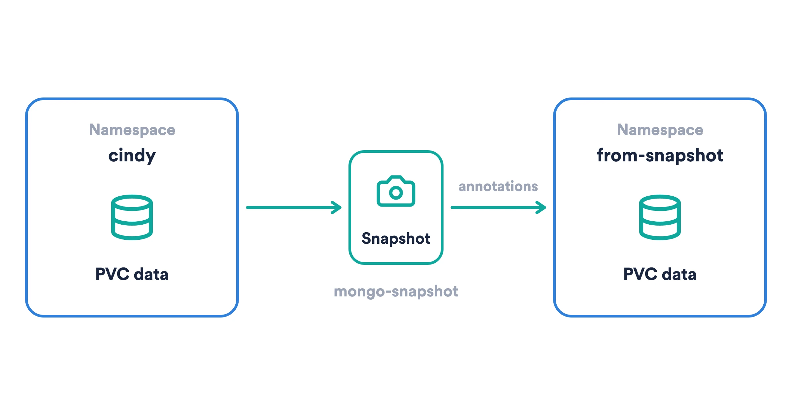

Okteto creates the database volume of an environment from a [Volume Snapshot](/docs/core/use-volume-snapshots/), so the environment starts with real data instead of an empty database or a seed script. This tutorial deploys a recipe API backed by MongoDB, adds some data, takes a snapshot of its database, and creates a second environment whose database starts from that snapshot.

## Prerequisites

- Access to an Okteto instance, with your [Okteto context](/docs/reference/okteto-cli/#context) configured.
- The [Okteto CLI](/docs/get-started/install-okteto-cli/) and [kubectl](https://kubernetes.io/docs/tasks/tools/) installed on your machine.
- A [VolumeSnapshotClass](https://kubernetes.io/docs/concepts/storage/volume-snapshot-classes/) in your cluster. Okteto BYOC includes one, `okteto-snapshot-class`. For Self-Hosted, see the [requirements of Volume Snapshots](/docs/core/use-volume-snapshots/#requirements).
- A local copy of the sample application:

```bash
git clone https://github.com/okteto/fastapi-snapshot-app
cd fastapi-snapshot-app
```

## The Sample Application

The application is a FastAPI service that stores recipes in MongoDB. The `manifests` folder has its Kubernetes manifests: `fastapi.yml` deploys the API, and `mongo.yml` deploys MongoDB with a PersistentVolumeClaim named `data` for its files.

Deploy it from the root of the repository:

```bash
okteto deploy
```

Okteto builds the image of the API, applies both manifests, and shows the endpoint of the API in the Okteto UI, for example `https://fastapi-snapshot-demo-cindy.okteto.example.com`. Add two recipes, replacing the URL with your endpoint:

```bash
curl -X POST 'https://fastapi-snapshot-demo-cindy.okteto.example.com/recipe' \
  -H 'Content-Type: application/json' \
  -d '{"name": "Donuts", "ingredients": ["Flour", "Milk", "Sugar", "Vegetable Oil"]}'

curl -X POST 'https://fastapi-snapshot-demo-cindy.okteto.example.com/recipe' \
  -H 'Content-Type: application/json' \
  -d '{"name": "Pancake", "ingredients": ["Flour", "Milk", "Sugar", "Baking Powder", "Vegetable Oil"]}'
```

## Creating the Snapshot

The two recipes are now in the `data` volume. A VolumeSnapshot captures that volume as it is at this moment:



Create a `snapshot.yml` file in the `manifests` folder:

```yaml title="manifests/snapshot.yml"
apiVersion: snapshot.storage.k8s.io/v1
kind: VolumeSnapshot
metadata:
  name: mongo-snapshot
spec:
  volumeSnapshotClassName: okteto-snapshot-class
  source:
    persistentVolumeClaimName: data
```

Download your [Kubernetes credentials](/docs/core/credentials/kubernetes-credentials/) and create the snapshot:

```bash
okteto kubeconfig
kubectl apply -f manifests/snapshot.yml
```

The snapshot is ready when `READYTOUSE` is `true`:

```bash
kubectl get volumesnapshot mongo-snapshot
```

```
NAME             READYTOUSE   SOURCEPVC   SOURCESNAPSHOTCONTENT   RESTORESIZE   SNAPSHOTCLASS           SNAPSHOTCONTENT                                    CREATIONTIME   AGE
mongo-snapshot   true         data                                1Gi           okteto-snapshot-class   snapcontent-1b8d8e7a-0b09-43c5-adeb-a08005ffbb4d   32s            34s
```

## Creating an Environment from the Snapshot

Create a new Namespace for the second environment:

```bash
okteto namespace create from-snapshot
```

Create a `pvc-from-snapshot.yml` file in the `manifests` folder, with the same PersistentVolumeClaim as `mongo.yml` and two annotations that tell Okteto to create it from `mongo-snapshot`. Replace `cindy` with the Namespace where you created the snapshot:

```yaml title="manifests/pvc-from-snapshot.yml"
kind: PersistentVolumeClaim
apiVersion: v1
metadata:
  name: data
  annotations:
    dev.okteto.com/from-snapshot-name: mongo-snapshot
    dev.okteto.com/from-snapshot-namespace: cindy
spec:
  storageClassName: csi-okteto
  accessModes:
    - ReadWriteOnce
  resources:
    requests:
      storage: 1Gi
```

Create the volume in the new Namespace, and then deploy the application in it:

```bash
kubectl apply -n from-snapshot -f manifests/pvc-from-snapshot.yml
okteto deploy -n from-snapshot
```

The `data` volume already exists when `okteto deploy` applies `mongo.yml`, so MongoDB starts with the files of the snapshot.

## Verifying the Data

List the recipes of the new environment, with the endpoint of the API in the `from-snapshot` Namespace:

```bash
curl 'https://fastapi-snapshot-demo-from-snapshot.okteto.example.com/recipe'
```

The response has the two recipes you added to the first environment, with the same IDs:

```json
{
  "data": [
    {
      "id": "60ce68651eeddf1c5ab796d1",
      "name": "Donuts",
      "ingredients": ["Flour", "Milk", "Sugar", "Vegetable Oil"]
    },
    {
      "id": "60ce689c1eeddf1c5ab796d2",
      "name": "Pancake",
      "ingredients": ["Flour", "Milk", "Sugar", "Baking Powder", "Vegetable Oil"]
    }
  ]
}
```

Every environment you create from the snapshot starts with the same data, and writes to its own copy. The same works for tests: a test that needs preloaded data can start its database from a snapshot with [Okteto Test](/docs/core/okteto-manifest/#test), instead of loading it before every run.
